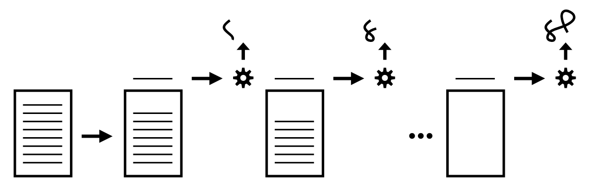
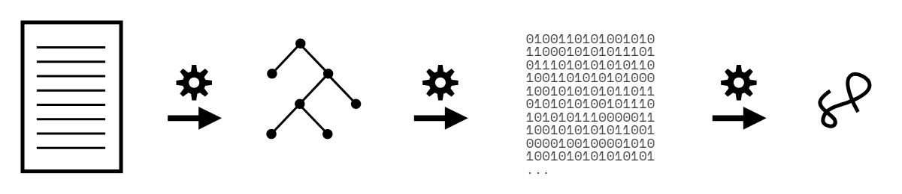
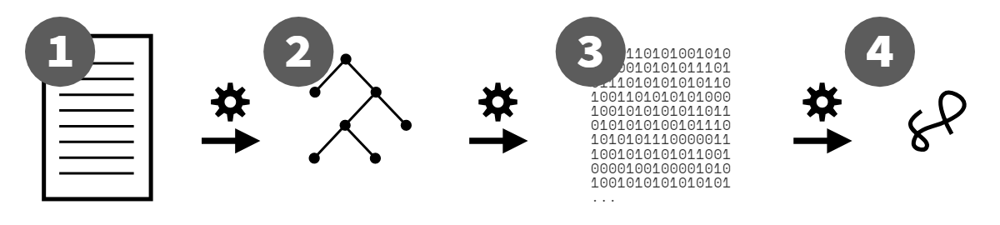

# You Don't Know JS Yet: Get Started - Tái bản lần thứ 2
# Chương 1: JavaScript Thực Sự *Là* Gì?

Bạn vẫn chưa thực sự hiểu JS đâu (You don't know JS, yet). Tôi cũng vậy, ít nhất là chưa hiểu một cách tường tận hoàn toàn. Không ai trong chúng ta nắm trọn nó cả. Nhưng tất cả chúng ta đều có thể bắt đầu để hiểu rõ JS hơn.

Trong chương đầu tiên của cuốn sách đầu thuộc bộ sách *You Don't Know JS Yet* (YDKJSY), chúng ta sẽ dành thời gian để xây dựng nền tảng vững chắc nhằm tiến bước xa hơn. Chúng ta cần bắt đầu bằng việc điểm qua nhiều chi tiết chuẩn bị cơ bản quan trọng, làm sáng tỏ một số giai thoại và ngộ nhận về bản chất thực sự của ngôn ngữ này (và cả những gì không phải là nó!).

Đây là những góc nhìn sâu sắc và có giá trị về danh tính cũng như quy trình tổ chức và duy trì JS; mọi lập trình viên JS đều nên thấu hiểu điều này. Nếu bạn muốn thực sự hiểu rõ JS, đây chính là cách để *bắt đầu* (get started) những bước chân đầu tiên trong hành trình ấy.

## Về Cuốn Sách Này

Tôi nhấn mạnh từ "hành trình" (journey) bởi vì *việc hiểu biết JS* không phải là một đích đến, mà là một phương hướng. Bất kể bạn đã dành bao nhiêu thời gian gắn bó với ngôn ngữ này, bạn sẽ luôn có thể tìm thấy những điều mới mẻ khác để học hỏi và thấu hiểu sâu hơn một chút. Vì vậy, đừng xem cuốn sách này như một thứ để đọc lướt qua vội vã nhằm đạt được một thành tích chóng vánh. Thay vào đó, sự kiên nhẫn và bền bỉ là những người bạn đồng hành tốt nhất khi bạn bước những bước đi đầu tiên này.

Tiếp sau chương nền tảng này, phần còn lại của cuốn sách sẽ vạch ra một bản đồ tổng quan cấp cao về những gì bạn sẽ khám phá khi đào sâu nghiên cứu JS cùng với các cuốn sách trong bộ YDKJSY.

Cụ thể, Chương 4 sẽ chỉ ra ba trụ cột chính định hình nên ngôn ngữ JS: phạm vi/closure (scope/closures), nguyên mẫu/đối tượng (prototypes/objects), và kiểu dữ liệu/ép kiểu (types/coercion). JS là một ngôn ngữ rộng lớn và tinh tế, với rất nhiều tính năng cùng khả năng phong phú. Nhưng toàn bộ JS đều được xây dựng dựa trên ba trụ cột nền tảng này.

Hãy lưu ý rằng mặc dù cuốn sách này có tựa đề "Get Started" (Bắt Đầu), nhưng nó **không dành cho người mới bắt đầu học lập trình**. Trách nhiệm chính của cuốn sách này là chuẩn bị hành trang để bạn nghiên cứu JS một cách chuyên sâu trong suốt phần còn lại của bộ sách; nó được viết dựa trên giả định rằng bạn đã làm quen với JS và có ít nhất vài tháng kinh nghiệm thực tế trước khi đọc tiếp YDKJSY. Vì vậy, để thu được nhiều lợi ích nhất từ *Get Started*, hãy chắc chắn rằng bạn dành nhiều thời gian viết mã JS để tích lũy kinh nghiệm cho bản thân.

Ngay cả khi bạn đã viết rất nhiều mã JS trước đây, cuốn sách này cũng không nên bị đọc lướt qua hay bỏ qua; hãy dành thời gian để tiếp thu trọn vẹn tài liệu ở đây. **Một khởi đầu tốt luôn phụ thuộc vào một bước đi đầu tiên vững chắc.**

## Tên Gọi Đó Có Ý Nghĩa Gì?

Cái tên JavaScript có lẽ là cái tên ngôn ngữ lập trình gây nhầm lẫn và ngộ nhận nhiều nhất.

Liệu ngôn ngữ này có liên quan gì đến Java không? Phải chăng nó chỉ là một dạng kịch bản (script) của Java? Hay nó chỉ dùng để viết các đoạn script nhỏ chứ không phải các chương trình thực thụ?

Sự thật là, cái tên JavaScript chỉ là một sản phẩm từ những mánh khóe chiêu trò tiếp thị (marketing). Khi Brendan Eich lần đầu tiên thai nghén ngôn ngữ này, ông đã đặt cho nó mã hiệu là Mocha. Trong nội bộ Netscape, tên thương hiệu LiveScript từng được sử dụng. Nhưng khi đến thời điểm công bố tên ngôn ngữ ra công chúng, "JavaScript" đã giành phần thắng trong cuộc bỏ phiếu.

Tại sao ư? Bởi vì ngôn ngữ này ban đầu được thiết kế để thu hút đối tượng lập trình viên phần lớn là các lập trình viên Java vào thời bấy giờ, và vì từ "script" khi đó rất thịnh hành để chỉ các chương trình gọn nhẹ. Những đoạn "script" nhẹ nhàng này sẽ là những thứ đầu tiên được nhúng trực tiếp vào các trang trên một khái niệm hoàn toàn mới mẻ lúc bấy giờ mang tên web!

Nói cách khác, JavaScript là một chiêu bài tiếp thị nhằm cố gắng định vị ngôn ngữ này như một giải pháp thay thế vừa miệng, dễ chịu hơn so với việc phải viết Java vốn nặng nề và nổi tiếng hơn vào thời điểm đó. Thậm chí nếu thích, người ta hoàn toàn có thể gọi nó là "WebJava" cũng chẳng sao.

Có một vài nét tương đồng bề ngoài giữa mã JavaScript và mã Java. Những điểm tương đồng đó không hẳn bắt nguồn từ quá trình phát triển chung, mà là do cả hai ngôn ngữ đều nhắm đến đối tượng lập trình viên mang sẵn thói quen và kỳ vọng về mặt cú pháp từ ngôn ngữ C (và ở một mức độ nào đó là C++).

Ví dụ, chúng ta dùng `{` để bắt đầu một khối mã và `}` để kết thúc khối mã đó, hệt như C/C++ và Java. Chúng ta cũng dùng dấu `;` để chấm câu kết thúc một câu lệnh (statement).

Ở một số khía cạnh, mối quan hệ pháp lý ràng buộc thậm chí còn sâu sắc hơn cả mặt cú pháp. Oracle (thông qua Sun), công ty hiện vẫn sở hữu và điều hành Java, cũng đồng thời sở hữu nhãn hiệu thương mại chính thức cho cái tên "JavaScript" (thông qua Netscape). Nhãn hiệu thương mại này hầu như không bao giờ được thực thi, và nhiều khả năng cũng khó có thể thực thi ở thời điểm hiện tại.

Vì những lý do này, một số người đề xuất chúng ta nên dùng từ JS thay cho JavaScript. Đó là một cách viết tắt rất phổ biến, nếu không muốn nói là một ứng viên sáng giá để làm thương hiệu chính thức cho bản thân ngôn ngữ. Quả thực, bộ sách này hầu như chỉ sử dụng từ JS để đề cập đến ngôn ngữ.

Nhằm tách biệt ngôn ngữ này xa hơn nữa khỏi nhãn hiệu thương mại do Oracle sở hữu, tên chính thức của ngôn ngữ được quy định bởi TC39 và được chuẩn hóa bởi tổ chức tiêu chuẩn ECMA là **ECMAScript**. Và trên thực tế, kể từ năm 2016, tên chính thức của ngôn ngữ cũng được gắn thêm hậu tố là năm sửa đổi; tại thời điểm cuốn sách này được viết, đó là ECMAScript 2019, hay viết tắt là ES2019.

Nói cách khác, JavaScript/JS chạy trong trình duyệt hoặc trong Node.js của bạn, chính là *một* bản hiện thực hóa (implementation) của tiêu chuẩn ES2019.

| GHI CHÚ: |
| :--- |
| Đừng sử dụng các thuật ngữ như "JS6" hay "ES8" để gọi tên ngôn ngữ. Một số người vẫn dùng, nhưng các thuật ngữ đó chỉ càng làm cho sự nhầm lẫn tiếp diễn dai dẳng hơn. Bạn chỉ nên trung thành với "ES20xx" hoặc đơn giản là "JS". |

Cho dù bạn gọi nó là JavaScript, JS, ECMAScript hay ES2019, thì chắc chắn nó hoàn toàn không phải là một biến thể của ngôn ngữ Java!

> "Java đối với JavaScript cũng giống như ham (thịt giăm bông) đối với hamster (chuột hamster) vậy." --Jeremy Keith, 2009

## Đặc Tả Ngôn Ngữ (Language Specification)

Tôi đã nhắc tới TC39, ủy ban chỉ đạo kỹ thuật quản lý JS. Nhiệm vụ chính của họ là quản lý bản đặc tả chính thức cho ngôn ngữ. Họ họp định kỳ để bỏ phiếu cho bất kỳ thay đổi nào đã được thống nhất, sau đó họ đệ trình lên ECMA, tổ chức tiêu chuẩn hóa.

Cú pháp và hành vi của JS được định nghĩa trong đặc tả ES (ECMAScript specification).

ES2019 tình cờ là bản sửa đổi/đặc tả có đánh số thứ tự lớn thứ 10 kể từ khi JS ra đời vào năm 1995, vì vậy trong URL chính thức của đặc tả do ECMA lưu trữ, bạn sẽ thấy con số "10.0":

https://www.ecma-international.org/ecma-262/10.0/

Ủy ban TC39 bao gồm khoảng từ 50 đến 100 thành viên đại diện cho nhiều mảng công ty đầu tư mạnh vào web, chẳng hạn như các nhà phát triển trình duyệt (Mozilla, Google, Apple) và các nhà sản xuất thiết bị (Samsung, v.v.). Tất cả thành viên trong ủy ban đều là tình nguyện viên, dù nhiều người trong số họ là nhân viên của các công ty này và có thể nhận được một phần thù lao cho nhiệm vụ của họ trong ủy ban.

TC39 thường họp khoảng hai tháng một lần, thông thường kéo dài khoảng ba ngày, để rà soát công việc do các thành viên thực hiện kể từ cuộc họp trước, thảo luận về các vấn đề còn tồn đọng và bỏ phiếu cho các đề xuất (proposals). Địa điểm họp luân phiên giữa các công ty thành viên sẵn sàng đứng ra tổ chức.

Tất cả các đề xuất của TC39 đều trải qua một quy trình gồm năm giai đoạn (stages)—dĩ nhiên, vì chúng ta là lập trình viên, nên quy trình này được đánh số từ 0!—từ Stage 0 đến Stage 4. Bạn có thể đọc thêm về quy trình Stage tại đây: https://tc39.es/process-document/

Stage 0 đại khái có nghĩa là ai đó trong TC39 nghĩ rằng đây là một ý tưởng đáng giá và dự định sẽ đứng ra làm người bảo trợ (champion) và phát triển nó. Điều đó có nghĩa là rất nhiều ý tưởng do những người không thuộc TC39 "đề xuất" thông qua các kênh phi chính thức như mạng xã hội hoặc bài viết blog thực chất chỉ là "tiền Stage 0" (pre-stage 0). Bạn phải nhờ được một thành viên TC39 đứng ra bảo trợ cho đề xuất thì nó mới được chính thức công nhận là "Stage 0".

Một khi một đề xuất đạt được trạng thái "Stage 4", nó sẽ đủ điều kiện để được đưa vào bản sửa đổi thường niên tiếp theo của ngôn ngữ. Quá trình để một đề xuất vượt qua các giai đoạn này có thể mất từ vài tháng đến vài năm.

Mọi đề xuất đều được quản lý công khai trên kho lưu trữ GitHub của TC39: https://github.com/tc39/proposals

Bất kỳ ai, dù có thuộc TC39 hay không, đều được hoan nghênh tham gia vào các cuộc thảo luận công khai này cũng như quy trình đóng góp cho các đề xuất. Tuy nhiên, chỉ có các thành viên TC39 mới có quyền tham dự các cuộc họp và bỏ phiếu cho các đề xuất và thay đổi. Vì vậy, trên thực tế, tiếng nói của một thành viên TC39 có sức nặng rất lớn đối với định hướng phát triển trong tương lai của JS.

Trái ngược với một số quan niệm sai lầm đã ăn sâu và cứ bị lan truyền một cách khó chịu, ngoài thực tế *không hề có* nhiều phiên bản JavaScript khác nhau. Chỉ có **duy nhất một JS**, một tiêu chuẩn chính thức được duy trì bởi TC39 và ECMA.

Quay lại đầu những năm 2000, khi Microsoft duy trì một phiên bản phân nhánh (fork) được dịch ngược (reverse-engineered) và không hoàn toàn tương thích của JS mang tên "JScript", lúc đó thực sự đã từng tồn tại "nhiều phiên bản" JS. Nhưng những ngày tháng đó đã qua lâu rồi. Việc đưa ra những nhận định như vậy về JS ngày nay là lỗi thời và thiếu chính xác.

Tất cả các nhà phát triển trình duyệt và nhà sản xuất thiết bị lớn đều đã cam kết giữ cho các bản hiện thực hóa JS của họ luôn tuân thủ theo đặc tả trung tâm duy nhất này. Dĩ nhiên, các bộ engine triển khai các tính năng ở những thời điểm khác nhau. Nhưng sẽ không bao giờ có chuyện engine V8 (JS engine của Chrome) triển khai một tính năng đã được đặc tả theo cách khác biệt hoặc không tương thích so với engine SpiderMonkey (JS engine của Mozilla).

Điều đó có nghĩa là bạn có thể học **một JS duy nhất**, và tin cậy vào chính JS đó ở bất kỳ nơi đâu.

### Web Quyết Định Mọi Thứ Về (JS)

Mặc dù danh sách các môi trường chạy JS không ngừng mở rộng (từ trình duyệt, đến máy chủ (Node.js), đến robot, bóng đèn, v.v.), nhưng môi trường duy nhất thống trị JS chính là web. Nói cách khác, cách thức JS được triển khai cho các trình duyệt web, xét trên mọi góc độ thực tế, là thực tế duy nhất có ý nghĩa quan trọng.

Phần lớn thời gian, JS được định nghĩa trong đặc tả và JS chạy trong các engine JS trên trình duyệt là hoàn toàn giống nhau. Nhưng vẫn có một số khác biệt cần phải được lưu tâm.

Đôi khi đặc tả JS sẽ yêu cầu một hành vi mới hoặc tinh chỉnh lại một hành vi cũ, thế nhưng điều đó lại không khớp chính xác với cách nó hoạt động trong các engine JS trên trình duyệt. Sự không đồng nhất như vậy mang tính lịch sử: các JS engine đã có hơn 20 năm tồn tại các hành vi quan sát được xoay quanh những trường hợp ngoại lệ (corner cases) của các tính năng mà nội dung web bấy lâu nay đã lỡ phụ thuộc vào. Do đó, đôi khi các JS engine sẽ từ chối tuân theo một thay đổi do đặc tả quy định vì nó sẽ làm hỏng các nội dung web hiện hữu.

Trong những trường hợp này, TC39 thường sẽ nhượng bộ và đơn giản là chọn cách điều chỉnh đặc tả sao cho phù hợp với thực tế của web. Ví dụ: TC39 từng có kế hoạch thêm phương thức `contains(..)` cho mảng (Arrays), nhưng người ta phát hiện ra cái tên này xung đột với các thư viện/framework JS cũ vẫn đang được sử dụng trên một số trang web, vì thế họ đã đổi tên thành `includes(..)` để không gây xung đột. Điều tương tự cũng đã xảy ra trong một sự cố vừa hài hước vừa bi kịch của cộng đồng JS mang tên "smooshgate", khi phương thức dự định đặt tên là `flatten(..)` cuối cùng đã phải đổi tên thành `flat(..)`.

Tuy nhiên đôi khi, TC39 sẽ quyết định rằng đặc tả cần phải giữ vững lập trường ở một số điểm nhất định, cho dù rất khó có khả năng các JS engine trên trình duyệt sẽ tuân theo.

Giải pháp ở đây là gì? Phụ lục B, "Các Tính Năng ECMAScript Bổ Sung Dành Cho Trình Duyệt Web" (Additional ECMAScript Features for Web Browsers).[^specApB] Đặc tả JS bao gồm phụ lục này để mô tả chi tiết bất kỳ sự không trùng khớp nào đã biết giữa đặc tả JS chính thức và thực tế của JS trên môi trường web. Nói cách khác, đây là những ngoại lệ *chỉ* được phép áp dụng cho JS trên web; các môi trường JS khác bắt buộc phải tuân thủ nghiêm ngặt từng câu chữ của đặc tả chuẩn.

Phần B.1 và B.2 đề cập đến những phần *bổ sung* cho JS (cú pháp và API) mà JS trên web có bao gồm, cũng vì lý do lịch sử, nhưng TC39 không có kế hoạch đặc tả chính thức chúng vào phần cốt lõi của JS. Các ví dụ bao gồm các số bát phân (octal literals) có tiền tố `0`, các tiện ích toàn cục `escape(..)` / `unescape(..)`, các hàm "bổ trợ" String như `anchor(..)` và `blink()`, cùng phương thức `compile(..)` của RegExp.

Phần B.3 bao gồm một số xung đột mà mã nguồn có thể chạy được trên cả engine JS web lẫn phi web, nhưng hành vi *có thể* quan sát thấy sự khác biệt, dẫn đến các kết quả khác nhau. Hầu hết các thay đổi được liệt kê liên quan đến những tình huống bị gắn nhãn là lỗi sớm (early errors) khi mã chạy trong chế độ nghiêm ngặt (strict mode).

Những "cái bẫy" trong Phụ lục B ít khi bắt gặp, nhưng tốt nhất bạn vẫn nên tránh các cấu trúc này để đảm bảo an toàn cho tương lai. Bất cứ khi nào có thể, hãy tuân thủ đặc tả JS và đừng phụ thuộc vào các hành vi chỉ áp dụng trong một số môi trường JS engine nhất định.

### Không Phải Mọi Thứ Trên Web Đều Là JS...

Đoạn mã sau có phải là một chương trình JS không?

```js
alert("Hello, JS!");
```

Tùy thuộc vào góc nhìn của bạn. Hàm `alert(..)` xuất hiện ở đây không hề được quy định trong đặc tả JS, nhưng nó *có mặt* trong tất cả các môi trường JS trên web. Tuy nhiên, bạn cũng sẽ không tìm thấy nó trong Phụ lục B, vậy chuyện gì đang xảy ra ở đây?

Các môi trường JS khác nhau (như JS engine trong trình duyệt, Node.js, v.v.) bổ sung thêm các API vào phạm vi toàn cục (global scope) của chương trình JS, cung cấp cho bạn những khả năng dành riêng cho môi trường đó, chẳng hạn như khả năng bật một hộp thoại cảnh báo (alert) trên trình duyệt của người dùng.

Trên thực tế, rất nhiều API trông có vẻ giống JS, như `fetch(..)`, `getCurrentLocation(..)`, và `getUserMedia(..)`, đều là các API của web nhưng có diện mạo giống JS. Trong Node.js, chúng ta có thể truy cập hàng trăm phương thức API từ các mô-đun tích hợp sẵn khác nhau, chẳng hạn như `fs.write(..)`.

Một ví dụ phổ biến khác là `console.log(..)` (và tất cả các phương thức `console.*` khác!). Chúng không được định nghĩa trong đặc tả JS, nhưng nhờ tính hữu dụng phổ quát, chúng được định nghĩa bởi hầu như mọi môi trường JS dựa trên một sự đồng thuận chung.

Vì vậy, `alert(..)` và `console.log(..)` không được định nghĩa bởi JS. Nhưng chúng *trông giống như* JS. Chúng là các hàm và phương thức của đối tượng tuân theo các quy tắc cú pháp của JS. Hành vi đằng sau chúng được kiểm soát bởi môi trường chạy engine JS, nhưng trên bề mặt, chúng chắc chắn phải tuân thủ JS để có thể "chơi" trong sân chơi của JS.

Hầu hết các khác biệt giữa các trình duyệt mà mọi người hay phàn nàn và thốt lên rằng "JS thật thiếu nhất quán!" thực chất là do sự khác biệt trong cách hoạt động của các hành vi môi trường đó, chứ không phải do bản thân cách hoạt động của JS.

Như vậy, một lệnh gọi `alert(..)` *là* JS, nhưng bản thân `alert` thực chất chỉ là một "vị khách", chứ không phải là một phần của đặc tả JS chính thức.

### Không Phải Lúc Nào Cũng Là JS

Thoạt nhìn, việc sử dụng console/REPL (Read-Evaluate-Print-Loop) trong Công cụ Dành Cho Nhà Phát Triển (Developer Tools) của trình duyệt (hoặc Node) cho cảm giác như một môi trường JS khá trực tiếp và chuẩn mực. Nhưng thực ra không hẳn là vậy.

Developer Tools là... công cụ dành cho nhà phát triển. Mục đích chính của chúng là làm cho cuộc sống của lập trình viên trở nên dễ dàng hơn. Chúng ưu tiên trải nghiệm nhà phát triển DX (Developer Experience). Mục tiêu của những công cụ này *không phải* là phản ánh một cách thuần túy và chuẩn xác từng chi tiết sắc thái hành vi theo đặc tả nghiêm ngặt của JS. Do đó, có rất nhiều điểm kỳ dị có thể trở thành "cái bẫy" nếu bạn coi console là một môi trường JS *thuần khiết*.

Nhân tiện thì sự tiện lợi này là một điều tốt! Tôi rất mừng vì Developer Tools giúp cuộc sống của lập trình viên trở nên nhẹ nhàng hơn! Tôi rất mừng vì chúng ta có những tính năng UX tuyệt vời như tự động gợi ý biến/thuộc tính (auto-complete), v.v. Tôi chỉ muốn chỉ ra rằng chúng ta không thể và không nên kỳ vọng những công cụ như vậy *luôn luôn* tuân thủ nghiêm ngặt theo cách mà các chương trình JS được xử lý, bởi vì đó không phải là mục đích sinh ra của chúng.

Vì các công cụ này có hành vi khác nhau giữa các trình duyệt, và vì chúng thay đổi (đôi khi khá thường xuyên), tôi sẽ không ghi cứng bất kỳ chi tiết cụ thể nào vào văn bản này để tránh việc nội dung sách nhanh chóng bị lỗi thời.

Tuy nhiên, tôi sẽ chỉ gợi ý một vài ví dụ về các điểm kỳ quặc từng xuất hiện ở nhiều thời điểm khác nhau trong các môi trường console JS, nhằm củng cố quan điểm của tôi về việc không nên mặc định coi chúng là hành vi JS thuần túy:

* Liệu việc khai báo `var` hoặc `function` ở "phạm vi toàn cục" (global scope) cấp cao nhất của console có thực sự tạo ra một biến toàn cục thực sự hay không (và một thuộc tính `window` tương ứng, và ngược lại!).

* Điều gì xảy ra khi có nhiều khai báo `let` và `const` ở "phạm vi toàn cục" cấp cao nhất.

* Liệu việc nhập `"use strict";` trên một dòng (rồi nhấn `<enter>`) có kích hoạt chế độ nghiêm ngặt cho toàn bộ phiên console đó hay không, giống như cách nó hoạt động ở dòng đầu tiên của một tệp .js; cũng như liệu bạn có thể dùng `"use strict";` sau "dòng đầu tiên" mà vẫn bật được chế độ nghiêm ngặt cho phiên làm việc đó hay không.

* Cách thức liên kết mặc định (default-binding) của `this` trong chế độ không nghiêm ngặt (non-strict mode) hoạt động ra sao đối với các lời gọi hàm, và liệu "đối tượng toàn cục" (global object) được sử dụng có chứa các biến toàn cục như mong đợi hay không.

* Cách thức hoisting (xem Cuốn 2, *Scope & Closures*) hoạt động qua nhiều dòng lệnh được nhập vào.

* ...và một số trường hợp khác nữa.

Developer console không hề cố gắng đóng giả làm một trình biên dịch JS để xử lý mã bạn nhập vào hoàn toàn giống hệt cách engine JS xử lý một tệp .js. Nó cố gắng giúp bạn dễ dàng nhập nhanh vài dòng mã và thấy ngay kết quả tức thì. Đây là hai trường hợp sử dụng hoàn toàn khác nhau, và vì thế, thật vô lý khi kỳ vọng một công cụ có thể xử lý cả hai nhiệm vụ một cách như nhau.

Đừng tin rằng những hành vi bạn nhìn thấy trong developer console phản ánh *chính xác tuyệt đối* ngữ nghĩa của JS theo từng câu chữ; để biết điều đó, hãy đọc tài liệu đặc tả. Thay vào đó, hãy nghĩ về console như một môi trường "thân thiện với JS" (JS-friendly). Bản thân điều đó đã rất hữu ích rồi.

## Nhiều Diện Mạo (Many Faces)

Thuật ngữ "mô hình" (paradigm) trong ngữ cảnh ngôn ngữ lập trình đề cập đến một tư duy và cách tiếp cận rộng lớn (gần như phổ quát) trong việc cấu trúc mã nguồn. Trong cùng một mô hình, có vô số biến thể về phong cách và hình thức tạo nên sự khác biệt giữa các chương trình, bao gồm vô số thư viện và framework khác nhau để lại dấu ấn riêng biệt của chúng trên bất kỳ đoạn mã nào.

Nhưng bất kể phong cách riêng lẻ của một chương trình là gì, các phân chia tổng thể xoay quanh các mô hình lập trình hầu như luôn lộ rõ ngay từ cái nhìn đầu tiên vào bất kỳ chương trình nào.

Các danh mục mã cấp mô hình điển hình bao gồm thủ tục (procedural), hướng đối tượng (OO/classes), và hàm (functional programming - FP):

* Phong cách thủ tục (procedural) tổ chức mã theo tiến trình tuyến tính từ trên xuống dưới thông qua một tập hợp các thao tác được xác định trước, thường được gom lại thành các đơn vị liên quan gọi là các thủ tục (procedures).

* Phong cách hướng đối tượng (OO) tổ chức mã bằng cách gom logic và dữ liệu lại với nhau thành các đơn vị gọi là lớp (classes).

* Phong cách hàm (FP) tổ chức mã thành các hàm (các phép tính thuần túy - pure computations thay vì các thủ tục), và việc vận dụng các hàm đó như những giá trị.

Các mô hình lập trình không có đúng hay sai. Chúng là những định hướng dẫn dắt và định hình cách các lập trình viên tiếp cận vấn đề và giải pháp, cũng như cách họ cấu trúc và duy trì mã của mình.

Một số ngôn ngữ nghiêng hẳn về một mô hình duy nhất—C là ngôn ngữ thủ tục, Java/C++ hầu như hoàn toàn hướng lớp, và Haskell là ngôn ngữ hàm từ đầu đến chân.

Nhưng nhiều ngôn ngữ cũng hỗ trợ các mẫu mã có thể xuất phát từ nhiều mô hình khác nhau, thậm chí kết hợp và pha trộn chúng. Những ngôn ngữ được gọi là "đa mô hình" (multi-paradigm languages) này mang lại sự linh hoạt tối đa. Trong một số trường hợp, một chương trình đơn lẻ thậm chí có thể chứa hai hoặc nhiều biểu hiện của các mô hình này cùng tồn tại song song cạnh nhau.

JavaScript chắc chắn là một ngôn ngữ đa mô hình. Bạn có thể viết mã theo phong cách thủ tục, hướng lớp, hoặc phong cách hàm, và bạn có thể đưa ra những quyết định đó trên từng dòng lệnh thay vì bị ép buộc vào một lựa chọn "được ăn cả ngã về không".

## Tương Thích Ngược & Tương Thích Xuôi (Backwards & Forwards)

Một trong những nguyên tắc nền tảng nhất dẫn dắt JavaScript là việc bảo tồn *tính tương thích ngược* (backwards compatibility). Nhiều người cảm thấy bối rối trước ý nghĩa thực sự của thuật ngữ này, và thường nhầm lẫn nó với một thuật ngữ liên quan nhưng khác biệt: *tính tương thích xuôi* (forwards compatibility).

Chúng ta hãy làm rõ vấn đề này.

Tương thích ngược (Backwards compatibility) có nghĩa là một khi một điều gì đó đã được chấp nhận là JS hợp lệ, sẽ không có một thay đổi nào trong tương lai đối với ngôn ngữ khiến cho đoạn mã đó trở thành JS không hợp lệ. Mã được viết vào năm 1995—dù cho khi đó nó có thô sơ hay hạn chế đến đâu!—vẫn phải hoạt động bình thường ở thời điểm ngày nay. Như các thành viên TC39 thường tuyên bố: "chúng tôi không làm hỏng web!" (we don't break the web!).

Ý tưởng cốt lõi là các lập trình viên JS có thể tự tin viết mã mà không phải lo sợ rằng mã của họ sẽ đột ngột ngừng hoạt động một cách khó lường chỉ vì một bản cập nhật trình duyệt mới được phát hành. Điều này biến việc lựa chọn JS cho một chương trình thành một khoản đầu tư khôn ngoan và an toàn hơn cho nhiều năm về sau.

"Sự bảo đảm" đó không hề là chuyện nhỏ. Việc duy trì tính tương thích ngược kéo dài suốt gần 25 năm lịch sử của ngôn ngữ tạo ra một gánh nặng khổng lồ cùng hàng loạt thách thức độc nhất vô nhị. Bạn sẽ khó lòng tìm thấy nhiều ví dụ khác trong ngành điện toán có được một sự cam kết bền bỉ đối với tính tương thích ngược đến mức như vậy.

Cái giá phải trả cho việc kiên trì tuân thủ nguyên tắc này không nên bị xem nhẹ. Nó đòi hỏi một tiêu chuẩn cực kỳ khắt khe cho bất kỳ quyết định nào liên quan đến việc thay đổi hoặc mở rộng ngôn ngữ; bất kỳ quyết định nào đưa ra cũng gần như trở thành vĩnh viễn, kể cả những sai lầm. Một khi nó đã nằm trong JS, nó không thể bị gỡ bỏ vì điều đó có thể làm hỏng các chương trình hiện có, ngay cả khi chúng ta thực sự, thực sự rất muốn loại bỏ nó!

Có một vài ngoại lệ nhỏ đối với quy tắc này. JS từng có một số thay đổi không tương thích ngược, nhưng TC39 cực kỳ thận trọng khi thực hiện điều đó. Họ nghiên cứu mã hiện có trên web (thông qua dữ liệu thu thập từ các trình duyệt) để ước tính mức độ ảnh hưởng của sự cố vỡ mã đó, và các nhà phát triển trình duyệt cuối cùng sẽ quyết định và bỏ phiếu xem họ có sẵn sàng chấp nhận gạch đá từ người dùng cho một sự cố gián đoạn quy mô rất nhỏ để đổi lấy những lợi ích của việc sửa chữa hoặc cải thiện một khía cạnh nào đó của ngôn ngữ cho số lượng lớn các trang web (và người dùng) khác hay không.

Những loại thay đổi này rất hiếm, và hầu như luôn nằm trong các trường hợp sử dụng góc khuất (corner cases) mà rất khó có khả năng gây ảnh hưởng rõ rệt trên nhiều trang web.

Hãy so sánh *tương thích ngược* với khái niệm đối ứng của nó: *tương thích xuôi* (forwards compatibility). Có tính tương thích xuôi nghĩa là việc đưa một tính năng mới bổ sung của ngôn ngữ vào chương trình sẽ không làm chương trình đó bị lỗi nếu nó được chạy trên một engine JS cũ hơn. **JS không tương thích xuôi**, bất kể nhiều người mong muốn điều đó, thậm chí còn ngộ nhận một cách sai lầm rằng nó có tính chất này.

Ngược lại, HTML và CSS lại có tính tương thích xuôi nhưng không tương thích ngược. Nếu bạn đào lại một đoạn mã HTML hoặc CSS được viết từ năm 1995, hoàn toàn có khả năng nó sẽ không hoạt động (hoặc hoạt động không còn giống như trước) vào ngày nay. Nhưng nếu bạn sử dụng một tính năng mới toanh từ năm 2019 trên một trình duyệt từ năm 2010, trang web không hề bị "sập" hoàn toàn—các đoạn CSS/HTML không được nhận biết sẽ đơn giản bị bỏ qua, trong khi phần còn lại của CSS/HTML vẫn sẽ được xử lý bình thường.

Việc tính tương thích xuôi được đưa vào thiết kế ngôn ngữ lập trình có vẻ rất đáng khao khát, nhưng nói chung là điều bất khả thi trong thực tế. Đánh dấu (HTML) hay tạo kiểu dáng (CSS) mang bản chất khai báo (declarative), do đó việc "bỏ qua" các khai báo không được nhận biết sẽ dễ dàng hơn nhiều và ít gây ảnh hưởng tới các khai báo khác đã nhận biết.

Nhưng sự hỗn loạn và tính bất định sẽ xảy ra ngay lập tức nếu một engine ngôn ngữ lập trình tự ý bỏ qua các câu lệnh (hoặc thậm chí là các biểu thức!) mà nó không hiểu, vì không thể nào đảm bảo rằng phần tiếp theo của chương trình không trông đợi phần bị bỏ qua đó đã được xử lý xong xuôi.

Mặc dù JS không thể và không có tính tương thích xuôi, nhưng điều quan trọng là phải nhận thức rõ tính tương thích ngược của JS, bao gồm cả những lợi ích lâu dài đối với web lẫn những ràng buộc và khó khăn mà nó đặt lên vai JS như một hệ quả tất yếu.

### Vượt Qua Khoảng Cách (Jumping the Gaps)

Vì JS không có tính tương thích xuôi, điều này đồng nghĩa với việc luôn tiềm ẩn một khoảng cách giữa đoạn mã JS hợp lệ mà bạn có thể viết với môi trường engine cũ nhất mà trang web hoặc ứng dụng của bạn cần phải hỗ trợ. Nếu bạn chạy một chương trình sử dụng tính năng của ES2019 trên một engine từ năm 2016, rất có thể bạn sẽ thấy chương trình bị lỗi và gặp sự cố crash.

Nếu tính năng đó là một cú pháp mới, chương trình nhìn chung sẽ hoàn toàn thất bại ngay trong khâu biên dịch và chạy, thường sẽ quăng ra một lỗi cú pháp (SyntaxError). Nếu tính năng đó là một API (chẳng hạn như `Object.is(..)` của ES6), chương trình có thể chạy đến một điểm nhất định nhưng sau đó sẽ ném ra một ngoại lệ thời gian chạy (runtime exception) và dừng lại ngay khi chạm tới tham chiếu đến API không xác định đó.

Điều này có đồng nghĩa với việc các lập trình viên JS phải luôn tụt hậu lại phía sau tốc độ phát triển, chỉ được phép dùng mã nằm ở ranh giới chậm chạp của các môi trường engine JS cũ nhất mà họ phải hỗ trợ hay không? Hoàn toàn không!

Nhưng điều đó có nghĩa là các lập trình viên JS cần phải đặc biệt chú ý để giải quyết khoảng cách này.

Đối với các cú pháp mới và không tương thích, giải pháp ở đây là chuyển mã (transpiling). Transpiling (biên dịch chuyển đổi mã) là một thuật ngữ do cộng đồng sáng chế ra để mô tả việc sử dụng một công cụ nhằm chuyển đổi mã nguồn của chương trình từ dạng này sang dạng khác (nhưng vẫn ở dạng mã nguồn văn bản). Thông thường, các vấn đề tương thích xuôi liên quan đến cú pháp được giải quyết bằng cách sử dụng một bộ chuyển mã (phổ biến nhất là Babel (https://babeljs.io)) để chuyển đổi cú pháp JS mới hơn đó thành một cú pháp cũ hơn tương đương.

Ví dụ, một lập trình viên có thể viết một đoạn mã như sau:

```js
if (something) {
    let x = 3;
    console.log(x);
}
else {
    let x = 4;
    console.log(x);
}
```

Đây là diện mạo của mã trong cây mã nguồn của ứng dụng đó. Nhưng khi tạo ra các tệp để triển khai lên trang web công khai, bộ chuyển đổi mã Babel có thể biến đổi mã đó trông giống như sau:

```js
var x$0, x$1;
if (something) {
    x$0 = 3;
    console.log(x$0);
}
else {
    x$1 = 4;
    console.log(x$1);
}
```

Đoạn mã gốc dựa vào từ khóa `let` để tạo ra các biến `x` có phạm vi khối (block-scoped) ở cả hai mệnh đề `if` và `else` mà không xung đột lẫn nhau. Một chương trình tương đương (với sự chỉnh sửa tối thiểu) mà Babel có thể tạo ra đơn giản là chọn cách đặt tên cho hai biến khác nhau bằng các định danh duy nhất, mang lại kết quả không xung đột hệt như vậy.

| GHI CHÚ: |
| :--- |
| Từ khóa `let` được bổ sung trong ES6 (vào năm 2015). Ví dụ chuyển đổi mã ở trên sẽ chỉ cần áp dụng nếu ứng dụng cần chạy trong một môi trường JS hỗ trợ phiên bản trước ES6. Ví dụ ở đây chỉ nhằm mục đích minh họa đơn giản. Khi ES6 còn mới mẻ, nhu cầu chuyển đổi mã như vậy là rất phổ biến, nhưng vào năm 2020, nhu cầu hỗ trợ các môi trường trước ES6 đã ít hơn rất nhiều. Do đó, "mục tiêu" (target) được sử dụng để chuyển mã là một khung cửa sổ trượt (sliding window) chỉ dịch chuyển tịnh tiến lên khi có quyết định ngừng hỗ trợ một trình duyệt/engine cũ nào đó cho một trang web/ứng dụng. |

Bạn có thể tự hỏi: tại sao lại phải nhọc công sử dụng một công cụ để chuyển đổi từ một phiên bản cú pháp mới sang một phiên bản cũ hơn? Chẳng phải chúng ta có thể tự viết hai biến khác tên và bỏ qua việc sử dụng từ khóa `let` hay sao? Lý do là các lập trình viên được khuyến nghị mạnh mẽ nên sử dụng phiên bản JS mới nhất để mã nguồn của họ luôn gọn gàng, rõ ràng và truyền tải ý đồ một cách hiệu quả nhất.

Lập trình viên nên tập trung vào việc viết các hình thức cú pháp mới, sạch sẽ và để công cụ lo liệu phần việc tạo ra một phiên bản tương thích xuôi của mã đó, phù hợp để triển khai và chạy trên các môi trường JS engine cũ nhất cần hỗ trợ.

### Lấp Đầy Khoảng Trống (Filling the Gaps)

Nếu vấn đề tương thích xuôi không liên quan đến cú pháp mới, mà là do thiếu một phương thức API mới được bổ sung gần đây, giải pháp phổ biến nhất là cung cấp một định nghĩa cho phương thức API còn thiếu đó để nó thay thế và hoạt động như thể môi trường cũ đã được định nghĩa sẵn nó một cách tự nhiên. Mẫu hình này được gọi là một polyfill (hoặc "shim").

Hãy xem xét đoạn mã này:

```js
// getSomeRecords() trả về cho chúng ta một promise chứa
// dữ liệu mà nó sẽ fetch về
var pr = getSomeRecords();

// hiển thị spinner trên UI trong lúc chờ lấy dữ liệu
startSpinner();

pr
.then(renderRecords)   // render nếu thành công
.catch(showError)      // hiển thị lỗi nếu thất bại
.finally(hideSpinner)  // luôn luôn ẩn spinner đi
```

Đoạn mã này sử dụng một tính năng của ES2019, đó là phương thức `finally(..)` trên prototype của Promise. Nếu đoạn mã này được sử dụng trong một môi trường trước ES2019, phương thức `finally(..)` sẽ không tồn tại, và một lỗi sẽ xảy ra.

Một polyfill cho `finally(..)` trong các môi trường trước ES2019 có thể trông như thế này:

```js
if (!Promise.prototype.finally) {
    Promise.prototype.finally = function f(fn){
        return this.then(
            function t(v){
                return Promise.resolve( fn() )
                    .then(function t(){
                        return v;
                    });
            },
            function c(e){
                return Promise.resolve( fn() )
                    .then(function t(){
                        throw e;
                    });
            }
        );
    };
}
```

| CẢNH BÁO: |
| :--- |
| Đây chỉ là một ví dụ minh họa đơn giản về một polyfill cơ bản (chưa hoàn toàn tuân thủ đặc tả) cho `finally(..)`. Đừng sử dụng polyfill này trong mã sản phẩm của bạn; hãy luôn sử dụng một polyfill chính thức, mạnh mẽ và toàn diện bất cứ khi nào có thể, chẳng hạn như bộ sưu tập polyfills/shims trong ES-Shim. |

Câu lệnh `if` bảo vệ định nghĩa polyfill bằng cách ngăn không cho nó chạy trong bất kỳ môi trường nào mà JS engine đã định nghĩa sẵn phương thức đó. Trong các môi trường cũ hơn, polyfill sẽ được định nghĩa, nhưng trong các môi trường mới hơn, câu lệnh `if` sẽ lặng lẽ bị bỏ qua.

Các bộ chuyển đổi mã như Babel thường tự động phát hiện xem mã của bạn cần những polyfill nào và cung cấp chúng tự động cho bạn. Nhưng đôi khi bạn có thể cần phải nhúng/định nghĩa chúng một cách tường minh, tương tự như đoạn mã chúng ta vừa xem qua.

Hãy luôn viết mã bằng cách sử dụng các tính năng thích hợp nhất để truyền tải các ý tưởng và mục đích của nó một cách hiệu quả. Nhìn chung, điều này có nghĩa là sử dụng phiên bản JS ổn định mới nhất. Tránh làm ảnh hưởng tiêu cực đến khả năng đọc hiểu của mã bằng cách cố gắng tự điều chỉnh thủ công cho các khoảng cách cú pháp/API. Đó là công việc sinh ra dành cho các công cụ!

Biên dịch chuyển mã (Transpilation) và polyfilling là hai kỹ thuật cực kỳ hiệu quả để giải quyết khoảng cách giữa đoạn mã sử dụng các tính năng ổn định mới nhất trong ngôn ngữ với các môi trường cũ mà một trang web hoặc ứng dụng vẫn cần hỗ trợ. Vì JS sẽ không ngừng cải tiến, nên khoảng cách này sẽ không bao giờ biến mất. Cả hai kỹ thuật này nên được đón nhận như một phần tiêu chuẩn trong quy trình phát hành (production chain) của mọi dự án JS từ nay về sau.

## Bản Chất Của Thông Dịch Là Gì? (What's in an Interpretation?)

Một câu hỏi tranh luận bấy lâu nay đối với mã được viết bằng JS: liệu nó là một kịch bản thông dịch (interpreted script) hay một chương trình được biên dịch (compiled program)? Quan điểm của số đông dường như cho rằng JS là một ngôn ngữ thông dịch (scripting). Nhưng sự thật lại phức tạp hơn thế.

Trong phần lớn lịch sử phát triển của các ngôn ngữ lập trình, các ngôn ngữ "thông dịch" và ngôn ngữ "kịch bản" (scripting) thường bị coi thường là kém cỏi hơn so với các đối trọng được biên dịch của chúng. Có rất nhiều lý do dẫn đến sự gay gắt này, bao gồm quan niệm cho rằng chúng thiếu tối ưu hóa hiệu năng, cũng như sự ác cảm đối với một số đặc điểm nhất định của ngôn ngữ, chẳng hạn như các ngôn ngữ kịch bản thường sử dụng kiểu động (dynamic typing) thay vì là ngôn ngữ kiểu tĩnh (statically typed) "trưởng thành hơn".

Các ngôn ngữ được coi là "biên dịch" thường tạo ra một biểu diễn khả chuyển (dạng nhị phân) của chương trình để phân phối và thực thi sau này. Vì chúng ta không thực sự quan sát thấy mô hình đó với JS (chúng ta phân phối mã nguồn, chứ không phải dạng nhị phân), nhiều người khẳng định rằng điều đó khiến JS bị loại khỏi thể loại biên dịch. Trong thực tế, mô hình phân phối cho dạng "thực thi" của một chương trình đã trở nên đa dạng hơn rất nhiều và cũng ít liên quan hơn trong vài thập kỷ qua; đối với câu hỏi đang bàn luận, việc một chương trình được truyền tay nhau dưới hình thức nào thực sự không còn quá quan trọng nữa.

Những tuyên bố và lời chỉ trích sai lầm này nên được gạt sang một bên. Lý do thực sự khiến việc có một cái nhìn rõ ràng về việc JS là thông dịch hay biên dịch lại quan trọng là vì nó liên quan trực tiếp đến bản chất của cách thức xử lý lỗi.

Trong lịch sử, các ngôn ngữ kịch bản hoặc thông dịch thường được thực thi theo tiến trình từ trên xuống dưới và từng dòng một; thường sẽ không có một lượt quét sơ bộ ban đầu qua chương trình để xử lý trước khi quá trình thực thi bắt đầu (xem Hình 1).

<figure>
    
    <figcaption><em>Hình 1: Thực Thi Thông Dịch / Dạng Kịch Bản</em></figcaption>
    <br><br>
</figure>

Trong các ngôn ngữ kịch bản hoặc thông dịch, một lỗi ở dòng 5 của chương trình sẽ không bị phát hiện cho đến khi các dòng từ 1 đến 4 đã được thực thi xong xuôi. Đáng chú ý là lỗi ở dòng 5 có thể là do một điều kiện thời gian chạy (runtime condition), chẳng hạn như một biến hoặc giá trị nào đó mang giá trị không phù hợp cho một phép toán, hoặc có thể là do một câu lệnh/mệnh lệnh bị sai cú pháp trên dòng đó. Tùy thuộc vào ngữ cảnh, việc trì hoãn xử lý lỗi cho đến đúng dòng xảy ra lỗi có thể là một hiệu ứng đáng mong muốn hoặc không mong muốn.

Hãy so sánh điều đó với các ngôn ngữ trải qua một bước xử lý (thường được gọi là phân tích cú pháp - parsing) trước khi bất kỳ quá trình thực thi nào diễn ra, như được minh họa trong Hình 2:

<figure>
    
    <figcaption><em>Hình 2: Phân Tích Cú Pháp + Biên Dịch + Thực Thi</em></figcaption>
    <br><br>
</figure>

Trong mô hình xử lý này, một lệnh không hợp lệ (chẳng hạn như lỗi cú pháp) ở dòng 5 sẽ bị bắt ngay trong giai đoạn phân tích cú pháp (parsing), trước khi bất kỳ quá trình thực thi nào bắt đầu, và hoàn toàn không có phần nào của chương trình được chạy cả. Để bắt các lỗi cú pháp (hoặc các lỗi "tĩnh" khác), nhìn chung người ta luôn ưu tiên việc biết trước về chúng trước bất kỳ một cuộc thực thi dở dang nào nắm chắc phần thất bại.

Vậy các ngôn ngữ "được phân tích cú pháp" (parsed languages) có điểm gì chung với các ngôn ngữ "được biên dịch" (compiled languages)? Đầu tiên, tất cả các ngôn ngữ biên dịch đều phải qua bước phân tích cú pháp (parsed). Vì vậy, một ngôn ngữ được phân tích cú pháp đã đi được một chặng đường khá dài trên con đường trở thành một ngôn ngữ được biên dịch rồi. Trong lý thuyết biên dịch cổ điển, bước cuối cùng còn lại sau khi phân tích cú pháp là sinh mã (code generation): tạo ra một dạng có thể thực thi được.

Một khi bất kỳ chương trình nguồn nào đã được phân tích cú pháp hoàn chỉnh, việc thực thi tiếp theo của nó rất thường xuyên—dưới hình thức này hay hình thức khác—sẽ bao gồm một bước chuyển đổi từ dạng đã phân tích cú pháp của chương trình—thường được gọi là Cây Cú Pháp Trừu Tượng (Abstract Syntax Tree - AST)—sang dạng thực thi đó.

Nói cách khác, các ngôn ngữ được phân tích cú pháp thường cũng thực hiện việc sinh mã trước khi thực thi, vì vậy nói rằng trên tinh thần cốt lõi chúng là các ngôn ngữ biên dịch cũng chẳng phải là điều gì quá xa vời.

Mã nguồn JS được phân tích cú pháp trước khi nó được thực thi. Bản đặc tả yêu cầu rõ như vậy, bởi vì nó đòi hỏi các "lỗi sớm" (early errors)—các lỗi được xác định tĩnh trong mã nguồn, chẳng hạn như việc đặt tên tham số bị trùng lặp—phải được báo cáo trước khi mã bắt đầu chạy. Những lỗi đó không thể nào được phát hiện nếu mã chưa trải qua bước phân tích cú pháp.

Vì vậy **JS là một ngôn ngữ được phân tích cú pháp (parsed language)**, nhưng liệu nó có *được biên dịch* (compiled) hay không?

Câu trả lời nghiêng về "có" nhiều hơn là "không". Đoạn mã JS sau khi phân tích cú pháp sẽ được chuyển đổi sang một dạng (nhị phân) đã được tối ưu hóa, và "mã" đó sau đó mới được thực thi (Hình 2); engine thường không chuyển ngược lại chế độ thực thi từng dòng (như Hình 1) sau khi đã hoàn thành tất cả công việc nặng nhọc của khâu phân tích cú pháp—hầu hết các ngôn ngữ/engine sẽ không làm thế, vì điều đó cực kỳ kém hiệu quả.

Nói cụ thể hơn, quá trình "biên dịch" này tạo ra một dạng mã byte nhị phân (byte code), sau đó được chuyển giao cho "máy ảo JS" (JS virtual machine) để thực thi. Một số người thích nói rằng máy ảo này đang "thông dịch" mã byte đó. Nhưng nếu nói như vậy thì Java, và hàng tá ngôn ngữ chạy trên JVM khác, cũng sẽ bị coi là thông dịch chứ không phải biên dịch. Dĩ nhiên, điều đó hoàn toàn mâu thuẫn với nhận định phổ biến cho rằng Java/v.v. là các ngôn ngữ biên dịch.

Thú vị thay, mặc dù Java và JavaScript là hai ngôn ngữ rất khác nhau, nhưng câu hỏi về việc thông dịch hay biên dịch giữa chúng lại có mối liên hệ khá mật thiết!

Một điểm phức tạp khác là các JS engine có thể sử dụng nhiều lượt tối ưu hóa/xử lý JIT (Just-In-Time) trên mã đã được tạo ra (sau khi phân tích cú pháp), điều mà tùy theo góc nhìn cũng có thể được dán nhãn hợp lý là "biên dịch" hoặc "thông dịch". Thực tế bên dưới nắp ca-pô của một JS engine là một bức tranh phức tạp đến kinh ngạc.

Vậy những chi tiết vụn vặt tỉ mỉ này đúc kết lại điều gì? Hãy lùi lại một bước và xem xét toàn bộ luồng đi của một chương trình nguồn JS:

1. Sau khi một chương trình rời khỏi trình soạn thảo của lập trình viên, nó được chuyển mã bởi Babel, sau đó được đóng gói bởi Webpack (và có thể là nửa tá quy trình build khác nữa), rồi nó được chuyển giao dưới hình thức rất khác biệt đó tới một JS engine.

2. JS engine phân tích cú pháp mã nguồn thành một AST.

3. Sau đó, engine chuyển đổi AST đó thành một dạng mã byte, một dạng biểu diễn trung gian nhị phân (IR - intermediate representation), rồi dạng này tiếp tục được tinh chỉnh/chuyển đổi sâu hơn nữa bởi trình biên dịch JIT tối ưu hóa.

4. Cuối cùng, máy ảo JS VM thực thi chương trình.

Để hình dung lại các bước đó một lần nữa:

<figure>
    
    <figcaption><em>Hình 3: Phân Tích Cú Pháp, Biên Dịch và Thực Thi JS</em></figcaption>
    <br><br>
</figure>

Liệu JS được xử lý giống một đoạn script thông dịch từng dòng hơn, như trong Hình 1, hay nó được xử lý giống một ngôn ngữ biên dịch được xử lý qua một đến nhiều lượt trước khi thực thi (như trong Hình 2 và Hình 3)?

Tôi nghĩ rõ ràng là về mặt tinh thần, nếu không muốn nói là cả trong thực tế, **JS là một ngôn ngữ biên dịch (compiled language)**.

Và một lần nữa, lý do điều đó quan trọng là: vì JS được biên dịch, chúng ta được thông báo về các lỗi tĩnh (chẳng hạn như sai cú pháp) trước khi mã của chúng ta được thực thi. Đó là một mô hình tương tác hoàn toàn khác biệt so với những gì chúng ta nhận được từ các chương trình "kịch bản" truyền thống, và có thể nói là hữu ích hơn rất nhiều!

### Web Assembly (WASM)

Một mối bận tâm hàng đầu đã thúc đẩy một phần đáng kể sự tiến hóa của JS chính là hiệu năng, bao gồm cả việc JS có thể được phân tích cú pháp/biên dịch nhanh đến mức nào và mã đã biên dịch đó có thể được thực thi nhanh ra sao.

Vào năm 2013, các kỹ sư từ Mozilla Firefox đã trình diễn một bản chuyển đổi của game engine Unreal 3 từ C sang JS. Khả năng mã này chạy được trong một JS engine trên trình duyệt với hiệu năng mượt mà 60fps trọn vẹn dựa trên một tập hợp các tối ưu hóa mà JS engine có thể thực hiện một cách chuyên biệt, bởi vì phiên bản JS của mã Unreal engine sử dụng một phong cách mã ưu tiên một tập con của ngôn ngữ JS, mang tên "ASM.js".

Tập con này là JS hợp lệ được viết theo những cách thức hơi khác thường so với cách viết mã thông thường, nhưng lại phát tín hiệu về một số thông tin kiểu dữ liệu quan trọng cho engine để giúp nó đưa ra các tối ưu hóa then chốt. ASM.js được giới thiệu như một phương pháp nhằm giải quyết những áp lực đối với hiệu năng thời gian chạy của JS.

Nhưng điều quan trọng cần lưu ý là ASM.js chưa bao giờ được dự định là đoạn mã do các lập trình viên tự tay viết ra, mà đúng hơn là một dạng biểu diễn của một chương trình đã được biên dịch chuyển đổi từ một ngôn ngữ khác (chẳng hạn như C), nơi mà những "chú thích" kiểu dữ liệu này được chèn vào hoàn toàn tự động bởi các công cụ.

Vài năm sau khi ASM.js chứng minh tính khả thi của các phiên bản chương trình do công cụ tạo ra có thể được xử lý hiệu quả hơn bởi engine JS, một nhóm kỹ sư khác (ban đầu cũng đến từ Mozilla) đã phát hành Web Assembly (WASM).

WASM tương tự như ASM.js ở chỗ mục đích ban đầu của nó là cung cấp một con đường để các chương trình không phải JS (C, v.v.) được chuyển đổi sang một dạng có thể chạy được trong engine JS. Không giống như ASM.js, WASM đã chọn cách vượt qua thêm một số sự chậm trễ cố hữu trong khâu phân tích cú pháp/biên dịch của JS trước khi một chương trình có thể thực thi, bằng cách biểu diễn chương trình dưới một dạng hoàn toàn không giống với JS.

WASM là một định dạng biểu diễn gần giống với Hợp ngữ Assembly hơn (do đó nó mới có tên gọi như vậy), định dạng này có thể được xử lý bởi một JS engine bằng cách bỏ qua giai đoạn phân tích cú pháp/biên dịch mà JS engine thường làm. Quá trình phân tích cú pháp/biên dịch của một chương trình nhắm mục tiêu WASM diễn ra trước thời hạn (Ahead-Of-Time - AOT); những gì được phân phối là một chương trình được đóng gói nhị phân sẵn sàng cho JS engine thực thi với quá trình xử lý cực kỳ tối thiểu.

Động lực ban đầu cho WASM rõ ràng là tiềm năng cải thiện hiệu năng. Trong khi điều đó tiếp tục là một trọng tâm, WASM còn được thúc đẩy thêm bởi mong muốn mang lại sự bình đẳng hơn cho các ngôn ngữ phi JS trên nền tảng web. Ví dụ: nếu một ngôn ngữ như Go hỗ trợ lập trình đa luồng (threads), nhưng JS (bản thân ngôn ngữ) lại không hỗ trợ, WASM mang lại tiềm năng để một chương trình Go như vậy được chuyển đổi sang dạng mà engine JS có thể hiểu được, mà không cần tính năng luồng (threads) xuất hiện ngay trong bản thân ngôn ngữ JS.

Nói cách khác, WASM giải tỏa áp lực phải bổ sung các tính năng vào JS mà vốn dĩ chỉ chủ yếu hoặc dành riêng cho các chương trình được chuyển mã từ các ngôn ngữ khác sử dụng. Điều đó có nghĩa là việc phát triển tính năng của JS có thể được đánh giá (bởi TC39) mà không bị bóp méo bởi các lợi ích/nhu cầu trong hệ sinh thái của các ngôn ngữ khác, trong khi vẫn cho phép các ngôn ngữ đó có một con đường khả thi để bước chân lên nền tảng web.

Một góc nhìn khác về WASM đang dần xuất hiện, thú vị thay, thậm chí còn không liên quan trực tiếp đến web (chữ W). WASM đang tiến hóa để trở thành một dạng máy ảo (VM) đa nền tảng, nơi các chương trình có thể được biên dịch một lần và chạy trong nhiều môi trường hệ thống khác nhau.

Vì vậy, WASM không chỉ dành riêng cho web, và WASM cũng không phải là JS. Mỉa mai thay, mặc dù WASM chạy trong JS engine, nhưng ngôn ngữ JS lại là một trong những ngôn ngữ kém phù hợp nhất để dùng làm nguồn tạo ra các chương trình WASM, bởi vì WASM phụ thuộc rất nhiều vào thông tin kiểu tĩnh. Ngay cả TypeScript (TS)—về bề ngoài là JS + kiểu tĩnh—cũng chưa thực sự phù hợp (ở hiện trạng bây giờ) để chuyển mã sang WASM, mặc dù các biến thể ngôn ngữ như AssemblyScript đang nỗ lực bắc nhịp cầu thu hẹp khoảng cách giữa JS/TS và WASM.

Cuốn sách này không nói về WASM, vì vậy tôi sẽ không dành thêm nhiều thời gian để bàn về nó, ngoại trừ việc đưa ra một điểm nhấn cuối cùng. *Một số* người đã gợi ý rằng WASM chỉ ra một tương lai nơi JS sẽ bị loại bỏ khỏi web, hoặc bị thu nhỏ vai trò trên web. Những người này thường ôm giữ ác cảm về JS, và muốn một ngôn ngữ nào đó khác—bất kỳ ngôn ngữ nào cũng được!—thay thế nó. Vì WASM cho phép các ngôn ngữ khác chạy trong JS engine, thoạt nhìn thì đây không hẳn là một câu chuyện cổ tích hoàn toàn hoang đường.

Nhưng hãy để tôi khẳng định một cách dứt khoát: WASM sẽ không thay thế JS. WASM gia tăng đáng kể những gì web (bao gồm cả JS) có thể hoàn thành. Đó là một điều tuyệt vời, hoàn toàn độc lập với việc liệu một số người có dùng nó như một lối thoát hiểm để không phải viết JS hay không.

## Nói Một Cách *Nghiêm Ngặt* (*Strict*ly Speaking)

Quay trở lại năm 2009 với sự phát hành của ES5, JS đã bổ sung *chế độ nghiêm ngặt* (strict mode) như một cơ chế tự nguyện (opt-in) nhằm khuyến khích tạo ra các chương trình JS chất lượng tốt hơn.

Những lợi ích của chế độ nghiêm ngặt vượt trội hơn rất nhiều so với chi phí, nhưng thói quen cũ thì khó bỏ và quán tính của các cơ sở mã nguồn hiện có (mã kế thừa - legacy) thực sự rất khó để thay đổi. Vì vậy, đáng buồn thay, sau hơn 10 năm, *tính tùy chọn* của strict mode đồng nghĩa với việc nó vẫn chưa hẳn là mặc định đối với các lập trình viên JS.

Tại sao lại cần chế độ nghiêm ngặt? Strict mode không nên bị coi là một sự hạn chế về những điều bạn không được làm, mà đúng hơn là một lời chỉ dẫn về cách tốt nhất để làm mọi việc, giúp cho JS engine có cơ hội tối ưu hóa và chạy mã một cách hiệu quả nhất. Hầu hết mã JS đều được phát triển bởi các nhóm lập trình viên, vì vậy tính *nghiêm ngặt* của strict mode (cùng với các công cụ như linters!) thường hỗ trợ việc cộng tác trên mã nguồn bằng cách tránh được một số sai lầm tai hại dễ bị lọt lưới trong chế độ không nghiêm ngặt (non-strict mode).

Hầu hết các cơ chế kiểm soát của strict mode đều ở dạng *lỗi sớm* (early errors), nghĩa là các lỗi tuy không hẳn là lỗi cú pháp thuần túy nhưng vẫn bị ném ra vào thời điểm biên dịch (compile time - trước khi mã được chạy). Ví dụ: strict mode không cho phép đặt tên hai tham số hàm trùng nhau, và sẽ dẫn đến một lỗi sớm. Một số cơ chế kiểm soát khác của strict mode chỉ có thể quan sát thấy trong thời gian chạy (runtime), chẳng hạn như cách `this` mặc định nhận giá trị `undefined` thay vì đối tượng toàn cục (global object).

Thay vì chống đối và tranh cãi với strict mode, như một đứa trẻ chỉ muốn làm ngược lại bất cứ điều gì cha mẹ cấm đoán, tư duy tốt nhất là xem strict mode như một công cụ kiểm tra mã (linter) nhắc nhở bạn về cách mà JS *nên* được viết để đạt chất lượng cao nhất và có cơ hội tối ưu hiệu năng tốt nhất. Nếu bạn thấy mình cảm thấy bị trói buộc và đang cố gắng tìm cách lách qua strict mode, đó nên là một hồi chuông cảnh báo đỏ rực cho thấy bạn cần lùi lại và suy nghĩ lại toàn bộ cách tiếp cận của mình.

Chế độ nghiêm ngặt được bật trên từng tệp bằng một chỉ thị đặc biệt (pragma) (không được phép có bất kỳ thứ gì xuất hiện trước nó ngoại trừ chú thích và khoảng trắng):

```js
// chỉ cho phép khoảng trắng và chú thích
// đứng trước chỉ thị use-strict
"use strict";
// phần còn lại của tệp sẽ chạy trong chế độ strict mode
```

| CẢNH BÁO: |
| :--- |
| Một điều cần hết sức lưu ý là ngay cả một dấu `;` đơn độc đứng một mình xuất hiện trước chỉ thị strict mode cũng sẽ khiến chỉ thị đó trở nên vô hiệu; không có lỗi nào được ném ra vì việc có một biểu thức chuỗi nguyên bản (string literal expression) ở vị trí một câu lệnh vẫn là JS hợp lệ, nhưng nó cũng sẽ âm thầm *không* bật chế độ strict mode! |

Chế độ nghiêm ngặt cũng có thể được bật theo phạm vi từng hàm, với các quy tắc hoàn toàn tương tự về các ký tự xung quanh nó:

```js
function someOperations() {
    // khoảng trắng và chú thích ở đây hoàn toàn hợp lệ
    "use strict";

    // toàn bộ mã này sẽ chạy trong chế độ strict mode
}
```

Thú vị là, nếu một tệp đã bật chế độ nghiêm ngặt, thì các chỉ thị strict mode ở cấp độ hàm sẽ bị cấm. Do đó bạn phải chọn một trong hai cách.

Lý do hợp lệ **duy nhất** để sử dụng cách tiếp cận strict mode trên từng hàm là khi bạn đang chuyển đổi một tệp chương trình hiện có chưa dùng strict mode và cần thực hiện các thay đổi từng chút một theo thời gian. Nếu không, tốt hơn hết là bạn chỉ cần bật strict mode cho toàn bộ tệp/chương trình.

Nhiều người từng tự hỏi liệu có bao giờ JS đặt strict mode làm mặc định hay không? Câu trả lời là, gần như chắc chắn là không. Như chúng ta đã thảo luận trước đó xoay quanh tính tương thích ngược, nếu một bản cập nhật JS engine bắt đầu mặc định coi mã nguồn là strict mode ngay cả khi nó không được đánh dấu như vậy, thì có khả năng đoạn mã đó sẽ bị hỏng do các cơ chế kiểm soát của strict mode gây ra.

Tuy nhiên, có một vài yếu tố giúp giảm bớt tác động trong tương lai của sự "mờ nhạt" không-mặc-định này của strict mode.

Thứ nhất, hầu như toàn bộ mã đã qua chuyển mã (transpiled code) cuối cùng đều chạy ở strict mode ngay cả khi mã nguồn ban đầu không được viết như vậy. Phần lớn mã JS trên môi trường production đều đã trải qua khâu chuyển mã, điều đó đồng nghĩa với việc hầu hết JS đã và đang tuân thủ strict mode. Bạn hoàn toàn có thể hủy bỏ giả định đó, nhưng bạn sẽ phải cố tình làm điều đó một cách rất phức tạp, nên khả năng xảy ra là cực kỳ thấp.

Hơn nữa, một sự chuyển dịch mạnh mẽ đang diễn ra hướng tới việc nhiều/phần lớn mã JS mới được viết bằng định dạng ES6 module. Các ES6 module mặc định coi mã là strict mode, do đó toàn bộ mã trong các tệp như vậy đều tự động chạy ở strict mode theo mặc định.

Tổng hợp lại, strict mode phần lớn đã trở thành chế độ mặc định trên thực tế (de facto default), cho dù về mặt kỹ thuật thì nó thực sự chưa phải là mặc định danh chính ngôn thuận.

## Định Nghĩa (Defined)

JS là một bản hiện thực hóa của tiêu chuẩn ECMAScript (phiên bản ES2019 tính đến thời điểm viết sách này), được dẫn dắt bởi ủy ban TC39 và được lưu trữ bởi tổ chức ECMA. Nó chạy trong các trình duyệt và các môi trường JS khác như Node.js.

JS là một ngôn ngữ đa mô hình (multi-paradigm), nghĩa là cú pháp và khả năng của nó cho phép lập trình viên pha trộn và kết hợp (cũng như uốn nắn và định hình lại!) các khái niệm từ nhiều mô hình lớn khác nhau, chẳng hạn như thủ tục (procedural), hướng đối tượng (OO/classes), và hàm (FP).

JS là một ngôn ngữ biên dịch (compiled language), nghĩa là các công cụ (bao gồm cả JS engine) xử lý và kiểm tra tính hợp lệ của chương trình (báo cáo bất kỳ lỗi nào!) trước khi nó được thực thi.

Với việc ngôn ngữ của chúng ta giờ đây đã được *định nghĩa*, hãy cùng bắt đầu tìm hiểu cặn kẽ mọi ngóc ngách của nó.

[^specApB]: Đặc tả ngôn ngữ ECMAScript 2019, Phụ lục B: Các tính năng ECMAScript bổ sung cho trình duyệt web (Additional ECMAScript Features for Web Browsers), https://www.ecma-international.org/ecma-262/10.0/#sec-additional-ecmascript-features-for-web-browsers (bản mới nhất tính đến thời điểm viết sách vào tháng 1 năm 2020)
