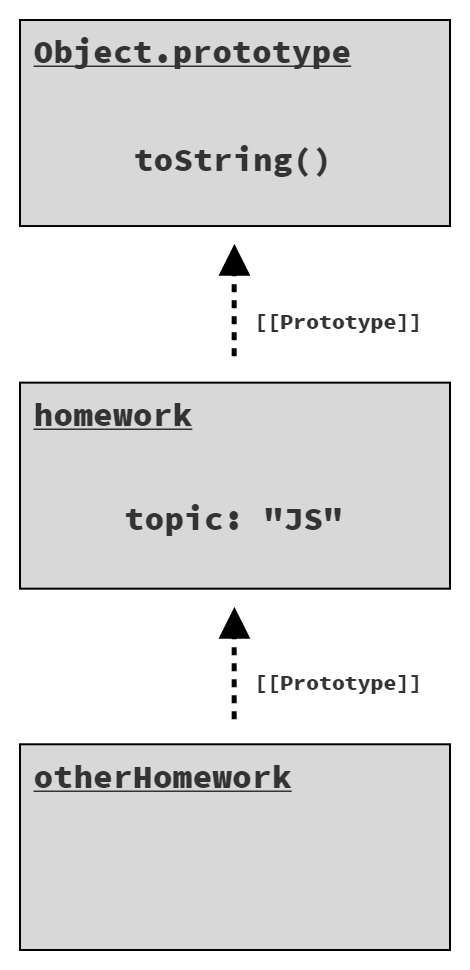
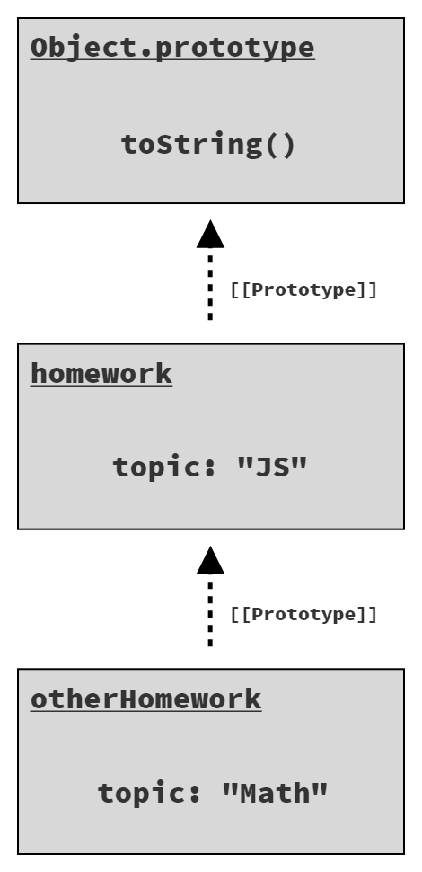
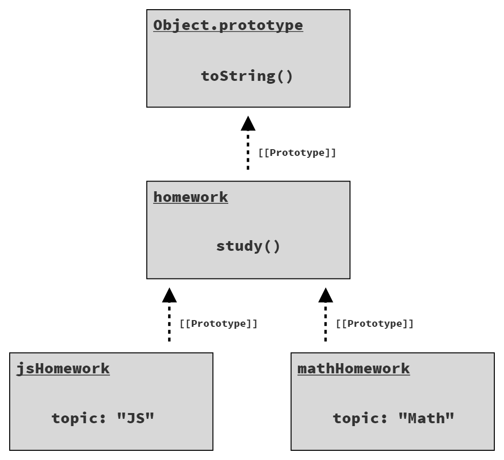

# Bạn Chưa Biết JS Đâu: Bắt Đầu (Get Started) - Tái bản lần 2
# Chương 3: Đào sâu vào nguồn cội của JS

Nếu bạn đã đọc Chương 1 và 2, đồng thời dành thời gian để nghiền ngẫm và thẩm thấu, hy vọng bạn bắt đầu *hiểu* JS thêm một chút. Nếu bạn đã bỏ qua hoặc chỉ đọc lướt qua chúng (đặc biệt là Chương 2), tôi khuyên bạn nên quay lại để dành thêm thời gian cho phần tài liệu đó.

Trong Chương 2, chúng ta đã khảo sát cú pháp, các mô thức (patterns), và hành vi ở mức khái quát tổng quan. Trong chương này, sự chú ý của chúng ta chuyển sang một số đặc tính nền tảng ở tầng sâu hơn của JS, vốn là chỗ dựa cho hầu như từng dòng code mà chúng ta viết.

Hãy lưu ý: chương này đào sâu hơn nhiều so với cách bạn thường nghĩ về một ngôn ngữ lập trình. Mục tiêu của tôi là giúp bạn cảm nhận và đánh giá được phần cốt lõi trong cách JS vận hành, điều gì làm cho nó hoạt động. Chương này sẽ bắt đầu trả lời một số câu hỏi "Tại sao?" có thể đang nảy sinh khi bạn khám phá JS. Tuy nhiên, nội dung này vẫn chưa phải là sự trình bày cặn kẽ toàn diện về ngôn ngữ; đó là mục đích của các cuốn sách còn lại trong bộ sách! Mục tiêu của chúng ta ở đây vẫn chỉ là *bắt đầu*, và cảm thấy thoải mái hơn với *cảm giác* về JS, cách mà nó thăng trầm và tuôn chảy.

Đừng vội vã lướt nhanh qua phần tài liệu này kẻo bạn sẽ bị lạc vào rừng chi tiết. Như tôi đã nhắc lại cả chục lần rồi, **hãy dành thời gian cho bản thân**. Ngay cả khi đọc xong chương này, có thể bạn vẫn còn những câu hỏi chưa được giải đáp. Điều đó hoàn toàn bình thường, bởi vì vẫn còn cả một bộ sách phía trước để bạn tiếp tục khám phá!

## Lặp (Iteration)

Vì các chương trình về bản chất được xây dựng để xử lý dữ liệu (và đưa ra quyết định dựa trên dữ liệu đó), các mô thức (patterns) được sử dụng để duyệt qua dữ liệu có tác động rất lớn đến khả năng đọc hiểu của chương trình.

Mô thức iterator (iterator pattern) đã tồn tại trong nhiều thập kỷ, và đề xuất một cách tiếp cận "được chuẩn hóa" để tiêu thụ dữ liệu từ một nguồn tại một thời điểm theo từng *phần* (chunk). Ý tưởng ở đây là việc lặp qua nguồn dữ liệu—xử lý dần tập hợp dữ liệu bằng cách xử lý phần đầu tiên, sau đó là phần tiếp theo, và cứ thế tiếp diễn—thì phổ biến và hữu ích hơn nhiều so với việc xử lý toàn bộ tập dữ liệu cùng một lúc.

Hãy tưởng tượng một cấu trúc dữ liệu đại diện cho một câu truy vấn `SELECT` của cơ sở dữ liệu quan hệ, thường tổ chức các kết quả dưới dạng các hàng (rows). Nếu truy vấn này chỉ có một hoặc vài hàng, bạn có thể xử lý toàn bộ tập kết quả cùng một lúc, gán từng hàng cho một biến cục bộ, và thực hiện bất kỳ thao tác nào phù hợp trên dữ liệu đó.

Nhưng nếu truy vấn có 100 hoặc 1.000 (hoặc nhiều hơn nữa!) hàng, bạn sẽ cần xử lý lặp để giải quyết lượng dữ liệu này (thường là một vòng lặp).

Mô thức iterator định nghĩa một cấu trúc dữ liệu được gọi là "iterator" (bộ lặp), nắm giữ một tham chiếu đến nguồn dữ liệu bên dưới (chẳng hạn như các hàng kết quả truy vấn), và cung cấp một phương thức như `next()`. Việc gọi `next()` sẽ trả về mẩu dữ liệu tiếp theo (nghĩa là một "bản ghi" hoặc "hàng" từ một truy vấn cơ sở dữ liệu).

Bạn không phải lúc nào cũng biết trước mình sẽ cần lặp qua bao nhiêu mẩu dữ liệu, vì vậy mô thức này thường chỉ ra sự hoàn tất bằng một giá trị đặc biệt hoặc một ngoại lệ khi bạn đã lặp qua toàn bộ tập dữ liệu và *đi quá điểm kết thúc*.

Tầm quan trọng của mô thức iterator nằm ở việc tuân theo một cách thức *chuẩn mực* để xử lý dữ liệu theo phương pháp lặp, giúp tạo ra code gọn gàng và dễ hiểu hơn, thay vì mỗi cấu trúc dữ liệu/nguồn dữ liệu lại tự định nghĩa một cách xử lý riêng của nó.

Sau nhiều năm nỗ lực của cộng đồng JS xoay quanh các kỹ thuật lặp được đồng thuận chung, ES6 đã chuẩn hóa một giao thức (protocol) cụ thể cho mô thức iterator ngay trong ngôn ngữ. Giao thức này định nghĩa một phương thức `next()` có giá trị trả về là một đối tượng được gọi là *iterator result* (kết quả của iterator); đối tượng này có các thuộc tính `value` và `done`, trong đó `done` là một giá trị boolean nhận `false` cho đến khi quá trình lặp qua nguồn dữ liệu bên dưới hoàn tất.

### Tiêu thụ Iterator (Consuming Iterators)

Với giao thức lặp của ES6 đã được thiết lập, ta hoàn toàn có thể tiêu thụ một nguồn dữ liệu theo từng giá trị một, kiểm tra sau mỗi lần gọi `next()` xem `done` có bằng `true` hay không để dừng việc lặp. Nhưng cách tiếp cận này khá thủ công, vì vậy ES6 cũng bao gồm một số cơ chế (cú pháp và API) để tiêu thụ các iterator này một cách chuẩn hóa.

Một cơ chế như vậy là vòng lặp `for..of`:

```js
// cho trước một iterator của một nguồn dữ liệu nào đó:
var it = /* .. */;

// lặp qua các kết quả của nó từng giá trị một
for (let val of it) {
    console.log(`Iterator value: ${ val }`);
}
// Iterator value: ..
// Iterator value: ..
// ..
```

| GHI CHÚ: |
| :--- |
| Chúng ta sẽ bỏ qua đoạn code vòng lặp thủ công tương đương ở đây, nhưng nó chắc chắn kém dễ đọc hơn nhiều so với vòng lặp `for..of`! |

Một cơ chế khác cũng thường được sử dụng để tiêu thụ các iterator là toán tử `...`. Toán tử này thực ra có hai dạng đối xứng: *spread* (trải) và *rest* (hoặc *gather* - gom tụ, như tôi thích gọi hơn). Dạng *spread* là một cơ chế tiêu thụ iterator.

Để *spread* (trải) một iterator, bạn phải có *thứ gì đó* để trải nó vào. Có hai khả năng trong JS: một mảng hoặc một danh sách đối số cho một lời gọi hàm.

Trải vào một mảng (array spread):

```js
// trải một iterator vào một mảng,
// với mỗi giá trị lặp chiếm một
// vị trí phần tử trong mảng.
var vals = [ ...it ];
```

Trải vào một lời gọi hàm (function call spread):

```js
// trải một iterator vào một hàm,
// gọi với mỗi giá trị lặp chiếm
// một vị trí đối số.
doSomethingUseful( ...it );
```

Trong cả hai trường hợp, dạng iterator-spread của `...` đều tuân theo giao thức tiêu thụ iterator (tương tự như vòng lặp `for..of`) để lấy ra tất cả các giá trị sẵn có từ một iterator và đặt (hay nói cách khác, trải) chúng vào ngữ cảnh tiếp nhận (mảng, danh sách đối số).

### Đối tượng có thể lặp (Iterables)

Giao thức tiêu thụ iterator về mặt kỹ thuật được định nghĩa để tiêu thụ *iterable*; một iterable là một giá trị có thể được lặp qua.

Giao thức này tự động tạo ra một thực thể iterator từ một iterable, và tiêu thụ *chính thực thể iterator đó* cho đến khi hoàn tất. Điều này có nghĩa là một iterable duy nhất có thể được tiêu thụ nhiều lần; mỗi lần, một thực thể iterator mới sẽ được tạo ra và sử dụng.

Vậy chúng ta tìm thấy các iterable ở đâu?

ES6 đã định nghĩa các kiểu cấu trúc dữ liệu/tập hợp cơ bản trong JS là các iterable. Điều này bao gồm chuỗi (strings), mảng (arrays), maps, sets, và những kiểu khác.

Hãy xem xét:

```js
// một mảng là một iterable
var arr = [ 10, 20, 30 ];

for (let val of arr) {
    console.log(`Array value: ${ val }`);
}
// Array value: 10
// Array value: 20
// Array value: 30
```

Vì mảng là các iterable, chúng ta có thể sao chép nông (shallow-copy) một mảng bằng cách tiêu thụ iterator thông qua toán tử spread `...`:

```js
var arrCopy = [ ...arr ];
```

Chúng ta cũng có thể lặp qua các ký tự trong một chuỗi từng ký tự một:

```js
var greeting = "Hello world!";
var chars = [ ...greeting ];

chars;
// [ "H", "e", "l", "l", "o", " ",
//   "w", "o", "r", "l", "d", "!" ]
```

Cấu trúc dữ liệu `Map` sử dụng các đối tượng làm khóa (keys), liên kết một giá trị (thuộc bất kỳ kiểu nào) với đối tượng đó. Map có hành vi lặp mặc định khác với những gì thấy ở đây, ở chỗ việc lặp không chỉ diễn ra trên các giá trị của map mà thay vào đó là trên các *entry* của nó. Một *entry* là một tuple (mảng 2 phần tử) bao gồm cả khóa và giá trị.

Hãy xem xét:

```js
// cho trước hai phần tử DOM, `btn1` và `btn2`

var buttonNames = new Map();
buttonNames.set(btn1,"Button 1");
buttonNames.set(btn2,"Button 2");

for (let [btn,btnName] of buttonNames) {
    btn.addEventListener("click",function onClick(){
        console.log(`Clicked ${ btnName }`);
    });
}
```

Trong vòng lặp `for..of` duyệt qua cơ chế lặp mặc định của map, chúng ta sử dụng cú pháp `[btn,btnName]` (gọi là "phân rã mảng" - array destructuring) để bóc tách từng tuple được tiêu thụ thành các cặp key/value tương ứng (`btn1` / `"Button 1"` và `btn2` / `"Button 2"`).

Mỗi iterable tích hợp sẵn trong JS đều cung cấp một cơ chế lặp mặc định, một cơ chế nhiều khả năng khớp với trực giác của bạn. Nhưng bạn cũng có thể chọn một phép lặp cụ thể hơn nếu cần. Ví dụ, nếu chúng ta chỉ muốn tiêu thụ các giá trị của map `buttonNames` ở trên, chúng ta có thể gọi `values()` để nhận một iterator chỉ chứa các giá trị:

```js
for (let btnName of buttonNames.values()) {
    console.log(btnName);
}
// Button 1
// Button 2
```

Hoặc nếu chúng ta muốn có cả chỉ số (index) *và* giá trị trong một lần lặp mảng, chúng ta có thể tạo một iterator chứa các entry bằng phương thức `entries()`:

```js
var arr = [ 10, 20, 30 ];

for (let [idx,val] of arr.entries()) {
    console.log(`[${ idx }]: ${ val }`);
}
// [0]: 10
// [1]: 20
// [2]: 30
```

Hầu như tất cả các iterable tích hợp sẵn trong JS đều có sẵn ba dạng iterator: chỉ-khóa (`keys()`), chỉ-giá-trị (`values()`), và các entry (`entries()`).

Ngoài việc chỉ sử dụng các iterable tích hợp sẵn, bạn cũng có thể đảm bảo các cấu trúc dữ liệu của riêng mình tuân thủ giao thức lặp; làm như vậy đồng nghĩa với việc bạn kích hoạt khả năng tiêu thụ dữ liệu của mình bằng các vòng lặp `for..of` và toán tử `...`. Việc "chuẩn hóa" theo giao thức này giúp code nói chung trở nên dễ nhận biết và dễ đọc hơn.

| GHI CHÚ: |
| :--- |
| Bạn có thể đã nhận thấy một sự chuyển dịch tinh tế diễn ra trong cuộc thảo luận này. Ban đầu chúng ta nói về việc tiêu thụ các **iterator**, nhưng sau đó chuyển sang nói về việc lặp qua các **iterable**. Giao thức tiêu thụ-lặp mong đợi một *iterable*, nhưng lý do chúng ta có thể cung cấp trực tiếp một *iterator* là vì bản thân một iterator cũng chính là một iterable của chính nó! Khi tạo một thực thể iterator từ một iterator đã tồn tại, chính iterator đó sẽ được trả về. |

## Closure

Có lẽ mà không hề nhận ra, hầu như mọi nhà phát triển JS đều đã từng sử dụng closure. Trên thực tế, closure là một trong những tính năng lập trình phổ biến nhất trên phần lớn các ngôn ngữ. Nó thậm chí có thể quan trọng ngang với việc hiểu về biến hoặc vòng lặp; đó là mức độ nền tảng của nó.

Tuy vậy, nó mang lại cảm giác có phần ẩn giấu, gần như ma thuật. Và nó thường được bàn luận bằng những thuật ngữ hoặc là rất trừu tượng, hoặc là rất mơ hồ, điều này chẳng giúp ích được mấy cho việc chúng ta nắm bắt chính xác nó là gì.

Chúng ta cần có khả năng nhận biết closure được sử dụng ở đâu trong các chương trình, vì sự hiện diện hay thiếu vắng của closure đôi khi là nguyên nhân gây ra lỗi (bug) (hoặc thậm chí là nguyên nhân của các vấn đề hiệu năng).

Vì vậy, hãy định nghĩa closure theo một cách thực tế và cụ thể:

> Closure là khi một hàm ghi nhớ và tiếp tục truy cập các biến từ bên ngoài phạm vi (scope) của nó, ngay cả khi hàm đó được thực thi trong một phạm vi khác.

Chúng ta thấy ở đây có hai đặc tính mang tính định nghĩa. Thứ nhất, closure là một phần bản chất của một hàm. Đối tượng không có closure, hàm mới có. Thứ hai, để quan sát thấy một closure, bạn phải thực thi một hàm trong một phạm vi khác với nơi hàm đó được định nghĩa ban đầu.

Hãy xem xét:

```js
function greeting(msg) {
    return function who(name) {
        console.log(`${ msg }, ${ name }!`);
    };
}

var hello = greeting("Hello");
var howdy = greeting("Howdy");

hello("Kyle");
// Hello, Kyle!

hello("Sarah");
// Hello, Sarah!

howdy("Grant");
// Howdy, Grant!
```

Đầu tiên, hàm bên ngoài `greeting(..)` được thực thi, tạo ra một thực thể của hàm bên trong `who(..)`; hàm đó bao đóng (closes over) biến `msg`, vốn là tham số từ phạm vi bên ngoài của `greeting(..)`. Khi hàm bên trong đó được trả về, tham chiếu của nó được gán cho biến `hello` ở phạm vi bên ngoài. Sau đó, chúng ta gọi `greeting(..)` lần thứ hai, tạo ra một thực thể hàm bên trong mới, với một closure mới bao đóng một `msg` mới, và trả về tham chiếu đó để gán cho `howdy`.

Khi hàm `greeting(..)` chạy xong, thông thường chúng ta sẽ kỳ vọng tất cả các biến của nó sẽ được thu gom rác (garbage collection - giải phóng khỏi bộ nhớ). Chúng ta sẽ mong đợi mỗi `msg` biến mất, nhưng chúng không hề biến mất. Lý do chính là closure. Vì các thực thể hàm bên trong vẫn còn sống (lần lượt được gán cho `hello` và `howdy`), nên các closure của chúng vẫn đang gìn giữ các biến `msg`.

Những closure này không phải là một ảnh chụp nhanh (snapshot) giá trị của biến `msg`; chúng là một liên kết trực tiếp và lưu giữ chính bản thân biến đó. Điều đó có nghĩa là closure thực sự có thể quan sát (hoặc tạo ra!) các cập nhật đối với các biến này theo thời gian.

```js
function counter(step = 1) {
    var count = 0;
    return function increaseCount(){
        count = count + step;
        return count;
    };
}

var incBy1 = counter(1);
var incBy3 = counter(3);

incBy1();       // 1
incBy1();       // 2

incBy3();       // 3
incBy3();       // 6
incBy3();       // 9
```

Mỗi thực thể của hàm bên trong `increaseCount()` đều đóng bao (closed over) cả hai biến `count` và `step` từ phạm vi hàm `counter(..)` bên ngoài của nó. `step` giữ nguyên theo thời gian, nhưng `count` được cập nhật sau mỗi lần gọi hàm bên trong đó. Vì closure bao bọc trên các biến chứ không chỉ là ảnh chụp nhanh của các giá trị, nên những cập nhật này được bảo toàn.

Closure phổ biến nhất khi làm việc với code bất đồng bộ, chẳng hạn như với các callback. Hãy xem xét:

```js
function getSomeData(url) {
    ajax(url,function onResponse(resp){
        console.log(
            `Response (from ${ url }): ${ resp }`
        );
    });
}

getSomeData("https://some.url/wherever");
// Response (from https://some.url/wherever): ...
```

Hàm bên trong `onResponse(..)` đóng bao trên `url`, và do đó gìn giữ và ghi nhớ nó cho đến khi lời gọi Ajax trả về và thực thi `onResponse(..)`. Mặc dù `getSomeData(..)` kết thúc ngay lập tức, biến tham số `url` vẫn được giữ cho tồn tại trong closure chừng nào còn cần thiết.

Không nhất thiết phạm vi bên ngoài phải là một hàm—thường là vậy, nhưng không phải luôn luôn—chỉ cần có ít nhất một biến trong phạm vi bên ngoài được truy cập từ một hàm bên trong:

```js
for (let [idx,btn] of buttons.entries()) {
    btn.addEventListener("click",function onClick(){
       console.log(`Clicked on button (${ idx })!`);
    });
}
```

Bởi vì vòng lặp này sử dụng các khai báo `let`, mỗi lần lặp sẽ nhận được các biến `idx` và `btn` mới có phạm vi khối (block-scoped, hay nói cách khác là cục bộ); vòng lặp cũng tạo ra một hàm bên trong `onClick(..)` mới mỗi lần chạy. Hàm bên trong đó đóng bao trên `idx`, bảo toàn nó chừng nào trình xử lý sự kiện click (click handler) còn được thiết lập trên `btn`. Vì vậy, khi mỗi nút được nhấp, trình xử lý của nó có thể in ra giá trị chỉ số tương ứng, bởi vì trình xử lý ghi nhớ biến `idx` riêng biệt của nó.

Hãy nhớ rằng: closure này không bao đóng trên giá trị (như `1` hay `3`), mà là trên chính biến `idx`.

Closure là một trong những mô thức lập trình phổ biến và quan trọng nhất trong bất kỳ ngôn ngữ nào. Nhưng điều đó đặc biệt đúng với JS; thật khó để tưởng tượng có thể làm được điều gì hữu ích mà không tận dụng closure theo cách này hay cách khác.

Nếu bạn vẫn cảm thấy chưa rõ ràng hoặc còn mơ hồ về closure, phần lớn Cuốn 2, *Scope & Closures* sẽ tập trung chuyên sâu vào chủ đề này.

## Từ khóa `this`

Một trong những cơ chế mạnh mẽ nhất của JS cũng là một trong những cơ chế bị hiểu lầm nhiều nhất: từ khóa `this`. Một quan niệm sai lầm phổ biến là `this` của một hàm tham chiếu đến chính bản thân hàm đó. Do cách `this` hoạt động trong các ngôn ngữ khác, một quan niệm sai lầm khác là `this` trỏ đến thực thể (instance) mà một phương thức thuộc về. Cả hai quan niệm này đều không chính xác.

Như đã thảo luận trước đó, khi một hàm được định nghĩa, nó được *gắn kết* với phạm vi bao quanh nó thông qua closure. Phạm vi (scope) là tập hợp các quy tắc kiểm soát cách thức phân giải các tham chiếu đến các biến.

Nhưng các hàm còn có một đặc tính khác bên cạnh phạm vi của chúng, đặc tính này ảnh hưởng đến những gì chúng có thể truy cập. Đặc tính này được mô tả tốt nhất như là một *ngữ cảnh thực thi* (execution context), và nó được hiển lộ cho hàm thông qua từ khóa `this` của hàm đó.

Phạm vi mang tính tĩnh (static) và chứa một tập hợp biến cố định sẵn có tại thời điểm và vị trí bạn định nghĩa một hàm, nhưng *ngữ cảnh* thực thi của một hàm lại mang tính động (dynamic), hoàn toàn phụ thuộc vào **cách nó được gọi** (bất kể nó được định nghĩa ở đâu hay thậm chí được gọi từ đâu).

`this` không phải là một đặc tính cố định của một hàm dựa trên định nghĩa của hàm, mà đúng hơn là một đặc tính động được xác định mỗi lần hàm được gọi.

Một cách để hình dung về *ngữ cảnh thực thi* là xem nó như một đối tượng hữu hình mà các thuộc tính của nó sẵn sàng cho một hàm truy cập trong khi hàm đó thực thi. Hãy so sánh điều đó với phạm vi, vốn cũng có thể được coi như một *đối tượng*; ngoại trừ việc *đối tượng phạm vi* (scope object) này bị ẩn bên trong engine của JS, nó luôn luôn không đổi đối với hàm đó, và các *thuộc tính* của nó có dạng các biến định danh sẵn có bên trong hàm.

```js
function classroom(teacher) {
    return function study() {
        console.log(
            `${ teacher } says to study ${ this.topic }`
        );
    };
}
var assignment = classroom("Kyle");
```

Hàm bên ngoài `classroom(..)` không hề tham chiếu đến từ khóa `this`, vì vậy nó giống như bất kỳ hàm nào khác mà chúng ta đã thấy cho đến nay. Nhưng hàm bên trong `study()` có tham chiếu đến `this`, điều này làm cho nó trở thành một hàm nhận biết `this` (this-aware function). Nói cách khác, nó là một hàm phụ thuộc vào *ngữ cảnh thực thi* của nó.

| GHI CHÚ: |
| :--- |
| `study()` cũng bao đóng trên biến `teacher` từ phạm vi bên ngoài của nó. |

Hàm bên trong `study()` được trả về bởi `classroom("Kyle")` được gán cho một biến tên là `assignment`. Vậy `assignment()` (hay `study()`) có thể được gọi như thế nào?

```js
assignment();
// Kyle says to study undefined  -- Oops :(
```

Trong đoạn mã này, chúng ta gọi `assignment()` như một hàm thuần túy, bình thường, mà không cung cấp cho nó bất kỳ *ngữ cảnh thực thi* nào.

Vì chương trình này không ở chế độ nghiêm ngặt (strict mode) (xem Chương 1, "Nói một cách nghiêm ngặt"), các hàm có nhận biết ngữ cảnh được gọi **mà không có bất kỳ ngữ cảnh nào được chỉ định** sẽ mặc định ngữ cảnh về đối tượng toàn cục (`window` trong trình duyệt). Vì không có biến toàn cục nào tên là `topic` (và do đó không có thuộc tính nào như vậy trên đối tượng toàn cục), `this.topic` được phân giải thành `undefined`.

Bây giờ hãy xem xét:

```js
var homework = {
    topic: "JS",
    assignment: assignment
};

homework.assignment();
// Kyle says to study JS
```

Một bản sao của tham chiếu hàm `assignment` được đặt làm thuộc tính trên đối tượng `homework`, và sau đó nó được gọi dưới dạng `homework.assignment()`. Điều đó có nghĩa là `this` cho lời gọi hàm đó sẽ là đối tượng `homework`. Do đó, `this.topic` phân giải thành `"JS"`.

Cuối cùng:

```js
var otherHomework = {
    topic: "Math"
};

assignment.call(otherHomework);
// Kyle says to study Math
```

Cách thứ ba để gọi một hàm là sử dụng phương thức `call(..)`, phương thức này nhận một đối tượng (`otherHomework` ở đây) để sử dụng cho việc thiết lập tham chiếu `this` cho lời gọi hàm. Tham chiếu thuộc tính `this.topic` phân giải thành `"Math"`.

Cùng một hàm có nhận biết ngữ cảnh nhưng được gọi theo ba cách khác nhau, sẽ đưa ra những câu trả lời khác nhau mỗi lần về đối tượng mà `this` sẽ tham chiếu đến.

Lợi ích của các hàm nhận biết `this`—và ngữ cảnh động của chúng—là khả năng tái sử dụng linh hoạt hơn một hàm duy nhất với dữ liệu từ các đối tượng khác nhau. Một hàm bao đóng trên một phạm vi thì không bao giờ có thể tham chiếu đến một phạm vi hoặc một tập hợp biến khác. Nhưng một hàm có khả năng nhận biết ngữ cảnh `this` động có thể rất hữu ích cho một số tác vụ nhất định.

## Prototype

Trong khi `this` là một đặc tính của việc thực thi hàm, thì prototype (nguyên mẫu) là một đặc tính của một đối tượng, và cụ thể là việc phân giải khi truy cập thuộc tính.

Hãy nghĩ về một prototype như một liên kết giữa hai đối tượng; liên kết này ẩn sau hậu trường, mặc dù có những cách để hiển lộ và quan sát nó. Mối liên kết prototype này xảy ra khi một đối tượng được tạo ra; nó được liên kết với một đối tượng khác đã tồn tại từ trước.

Một chuỗi các đối tượng được liên kết với nhau thông qua prototype được gọi là "chuỗi prototype" (prototype chain).

Mục đích của liên kết prototype này (nghĩa là từ một đối tượng B đến một đối tượng A khác) là để các thao tác truy cập đối với B nhằm tìm kiếm các thuộc tính/phương thức mà B không có, sẽ được *ủy quyền* (delegated) cho A xử lý. Việc ủy quyền truy cập thuộc tính/phương thức cho phép hai (hoặc nhiều!) đối tượng hợp tác với nhau để thực hiện một tác vụ.

Hãy xem xét việc định nghĩa một đối tượng dưới dạng đối tượng tường minh (literal) thông thường:

```js
var homework = {
    topic: "JS"
};
```

Đối tượng `homework` chỉ có một thuộc tính duy nhất trên nó: `topic`. Tuy nhiên, liên kết prototype mặc định của nó kết nối đến đối tượng `Object.prototype`, vốn có sẵn các phương thức tích hợp phổ biến trên đó như `toString()` và `valueOf()`, cùng nhiều phương thức khác.

Chúng ta có thể quan sát sự *ủy quyền* liên kết prototype này từ `homework` tới `Object.prototype`:

```js
homework.toString();    // [object Object]
```

`homework.toString()` hoạt động ngay cả khi `homework` không có phương thức `toString()` nào được định nghĩa; việc ủy quyền đã gọi `Object.prototype.toString()` thay thế.

### Liên kết đối tượng (Object Linkage)

Để định nghĩa một liên kết prototype cho đối tượng, bạn có thể tạo đối tượng bằng tiện ích `Object.create(..)`:

```js
var homework = {
    topic: "JS"
};

var otherHomework = Object.create(homework);

otherHomework.topic;   // "JS"
```

Đối số đầu tiên truyền vào `Object.create(..)` chỉ định một đối tượng để liên kết đối tượng mới tạo tới, và sau đó trả về đối tượng mới được tạo (và đã được liên kết!).

Hình 4 cho thấy ba đối tượng (`otherHomework`, `homework`, và `Object.prototype`) được liên kết trong một chuỗi prototype như thế nào:

<figure>
    
    <figcaption><em>Hình 4: Các đối tượng trong một chuỗi prototype</em></figcaption>
    <br><br>
</figure>

Sự ủy quyền thông qua chuỗi prototype chỉ áp dụng cho các truy cập nhằm tra cứu giá trị trong một thuộc tính. Nếu bạn gán giá trị cho một thuộc tính của một đối tượng, thao tác đó sẽ áp dụng trực tiếp cho đối tượng đó bất kể đối tượng đó được liên kết prototype tới đâu.

| MẸO: |
| :--- |
| `Object.create(null)` tạo ra một đối tượng không có liên kết prototype tới bất cứ đâu, vì vậy nó thuần túy chỉ là một đối tượng độc lập; trong một số trường hợp, điều đó có thể thích hợp hơn. |

Hãy xem xét:

```js
homework.topic;
// "JS"

otherHomework.topic;
// "JS"

otherHomework.topic = "Math";
otherHomework.topic;
// "Math"

homework.topic;
// "JS" -- không phải "Math"
```

Phép gán cho `topic` tạo ra một thuộc tính cùng tên trực tiếp trên `otherHomework`; không hề có ảnh hưởng nào đến thuộc tính `topic` trên `homework`. Câu lệnh tiếp theo sau đó truy cập `otherHomework.topic`, và chúng ta thấy kết quả không bị ủy quyền từ thuộc tính mới đó: `"Math"`.

Hình 5 cho thấy các đối tượng/thuộc tính sau phép gán đã tạo ra thuộc tính `otherHomework.topic`:

<figure>
    
    <figcaption><em>Hình 5: Thuộc tính bị che bóng (shadowed) 'topic'</em></figcaption>
    <br><br>
</figure>

`topic` trên `otherHomework` đang "che bóng" (shadowing) thuộc tính cùng tên trên đối tượng `homework` trong chuỗi.

| GHI CHÚ: |
| :--- |
| Một cách khác thẳng thắn mà nói thì rắc rối hơn nhưng có lẽ vẫn phổ biến hơn để tạo một đối tượng có liên kết prototype là sử dụng mô thức "lớp nguyên mẫu" (prototypal class), từ thời trước khi `class` (xem Chương 2, "Classes") được thêm vào trong ES6. Chúng ta sẽ đề cập chi tiết hơn về chủ đề này trong Phụ lục A, "'Lớp' nguyên mẫu (Prototypal 'Classes')". |

### Xem lại `this` (this Revisited)

Chúng ta đã đề cập đến từ khóa `this` trước đó, nhưng tầm quan trọng thực sự của nó tỏa sáng rực rỡ khi xem xét cách nó tạo động lực cho các lời gọi hàm được ủy quyền qua prototype. Quả thực, một trong những lý do chính khiến `this` hỗ trợ ngữ cảnh động dựa trên cách hàm được gọi là để các lời gọi phương thức trên các đối tượng mà ủy quyền qua chuỗi prototype vẫn duy trì được `this` như mong đợi.

Hãy xem xét:

```js
var homework = {
    study() {
        console.log(`Please study ${ this.topic }`);
    }
};

var jsHomework = Object.create(homework);
jsHomework.topic = "JS";
jsHomework.study();
// Please study JS

var mathHomework = Object.create(homework);
mathHomework.topic = "Math";
mathHomework.study();
// Please study Math
```

Hai đối tượng `jsHomework` và `mathHomework` mỗi đối tượng đều có liên kết prototype tới đối tượng duy nhất `homework`, nơi chứa hàm `study()`. `jsHomework` và `mathHomework` mỗi đối tượng đều được gán thuộc tính `topic` của riêng mình (xem Hình 6).

<figure>
    
    <figcaption><em>Hình 6: Hai đối tượng liên kết tới một đối tượng cha chung</em></figcaption>
    <br><br>
</figure>

`jsHomework.study()` ủy quyền cho `homework.study()`, nhưng `this` (`this.topic`) cho lần thực thi đó phân giải thành `jsHomework` do cách hàm được gọi, vì vậy `this.topic` là `"JS"`. Tương tự đối với `mathHomework.study()` ủy quyền cho `homework.study()` nhưng vẫn phân giải `this` thành `mathHomework`, và do đó `this.topic` là `"Math"`.

Đoạn code trước đó sẽ kém hữu ích đi rất nhiều nếu `this` bị phân giải thành `homework`. Tuy nhiên, trong nhiều ngôn ngữ khác, có vẻ như `this` sẽ là `homework` vì phương thức `study()` thực sự được định nghĩa trên `homework`.

Không giống như nhiều ngôn ngữ khác, việc `this` trong JS mang tính động là một thành phần trọng yếu cho phép sự ủy quyền prototype, và quả thực cả `class`, hoạt động như mong đợi!

## Đặt câu hỏi "Tại sao?"

Bài học dự kiến rút ra từ chương này là có nhiều điều về JS diễn ra bên dưới bề mặt hơn những gì có thể thấy rõ khi chỉ nhìn lướt qua bên ngoài.

Khi bạn *bắt đầu* học và biết rõ về JS hơn, một trong những kỹ năng quan trọng nhất mà bạn có thể rèn luyện và củng cố là tính tò mò, và nghệ thuật đặt câu hỏi "Tại sao?" khi bạn bắt gặp một điều gì đó trong ngôn ngữ.

Mặc dù chương này đã đào sâu vào một số chủ đề, nhưng nhiều chi tiết vẫn hoàn toàn chỉ được lướt qua. Còn rất nhiều điều để học ở đây, và con đường dẫn tới đó bắt đầu từ việc bạn đặt những câu hỏi *đúng đắn* cho code của mình. Đặt câu hỏi đúng là một kỹ năng thiết yếu để trở thành một lập trình viên giỏi hơn.

Trong chương cuối cùng của cuốn sách này, chúng ta sẽ xem xét ngắn gọn cách JS được phân chia, như được trình bày xuyên suốt các cuốn còn lại của bộ sách *Bạn Chưa Biết JS Đâu* (You Don't Know JS Yet). Ngoài ra, đừng bỏ qua Phụ lục B của cuốn sách này, nơi có một số bài tập code thực hành để ôn lại một số chủ đề chính đã học trong cuốn sách.
