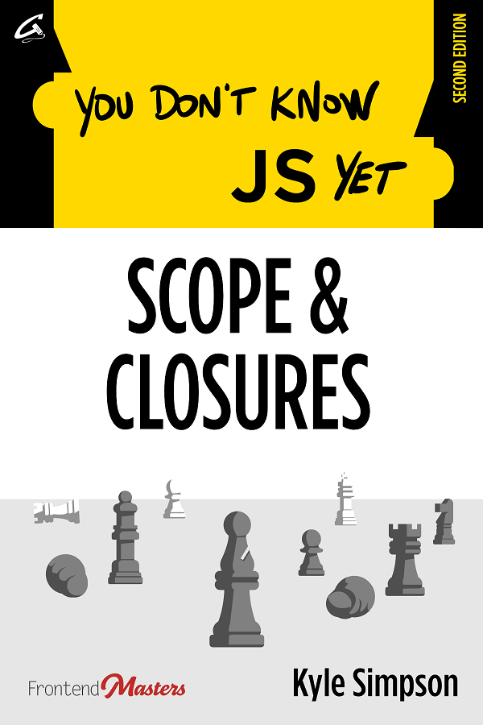

# Bạn Chưa Biết JS Đâu: Phạm Vi & Closures (Scope & Closures) - Tái bản lần 2

-----

**[Mua sách điện tử/PDF từ Leanpub](https://leanpub.com/ydkjsy-scope-closures)**

-----

[Mục lục](toc.md)

* [Lời tựa](foreword.md) (bởi [Sarah Drasner](https://sarah.dev/))
* [Lời nói đầu](../preface.md)
* [Chương 1: Scope là gì?](ch1.md)
* [Chương 2: Minh họa Lexical Scope](ch2.md)
* [Chương 3: Chuỗi phạm vi (The Scope Chain)](ch3.md)
* [Chương 4: Xoay quanh phạm vi toàn cục (Global Scope)](ch4.md)
* [Chương 5: Vòng đời (không mấy) bí mật của biến](ch5.md)
* [Chương 6: Hạn chế phơi bày phạm vi (Limiting Scope Exposure)](ch6.md)
* [Chương 7: Sử dụng Closures](ch7.md)
* [Chương 8: Mẫu thiết kế Module (The Module Pattern)](ch8.md)
* [Phụ lục A: Khám phá sâu hơn](apA.md)
* [Phụ lục B: Luyện tập](apB.md)

