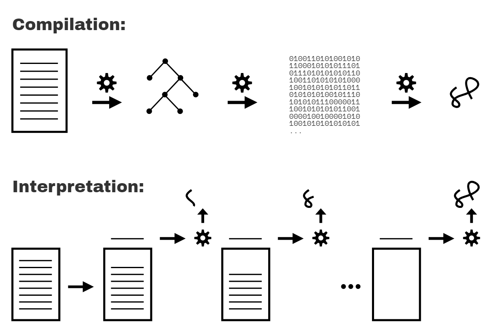

# You Don't Know JS Yet: Scope & Closures - Tái bản lần 2
# Chương 1: Phạm vi (Scope) là gì?

Đến khi bạn đã viết được vài chương trình đầu tiên của mình, nhiều khả năng bạn đã cảm thấy tương đối thoải mái với việc tạo các biến và lưu trữ các giá trị trong chúng. Làm việc với các biến là một trong những việc nền tảng nhất mà chúng ta làm trong lập trình!

Nhưng có thể bạn chưa từng xem xét thật kỹ lưỡng các cơ chế bên dưới được engine sử dụng để tổ chức và quản lý các biến này. Tôi không có ý nói về cách bộ nhớ được phân bổ trên máy tính, mà là: làm thế nào JS biết được những biến nào có thể được truy cập bởi một câu lệnh nhất định, và nó xử lý hai biến có cùng tên như thế nào?

Câu trả lời cho những câu hỏi như thế này có dạng các quy tắc được xác định rõ ràng gọi là phạm vi (scope). Cuốn sách này sẽ đào sâu qua mọi khía cạnh của scope—cách nó hoạt động, nó hữu ích cho việc gì, những cạm bẫy cần tránh—và sau đó hướng tới các mẫu (pattern) scope phổ biến giúp định hướng cấu trúc của các chương trình.

Bước đầu tiên của chúng ta là khám phá xem JS engine xử lý chương trình của chúng ta như thế nào **trước khi** nó chạy.

## Về cuốn sách này

Chào mừng bạn đến với cuốn sách thứ 2 trong bộ sách *You Don't Know JS Yet*! Nếu bạn đã hoàn thành cuốn *Get Started* (cuốn sách đầu tiên), bạn đã đến đúng nơi! Nếu chưa, trước khi tiếp tục, tôi khuyến khích bạn *hãy bắt đầu từ đó* để có được nền tảng tốt nhất.

Trọng tâm của chúng ta sẽ là trụ cột đầu tiên trong ba trụ cột của ngôn ngữ JS: hệ thống scope và các closure của hàm (function closure), cũng như sức mạnh của mẫu thiết kế module (module design pattern).

JS thường được phân loại là một ngôn ngữ kịch bản thông dịch (interpreted scripting language), vì vậy hầu hết mọi người cho rằng các chương trình JS được xử lý theo một lượt duy nhất từ trên xuống dưới. Nhưng trên thực tế, JS được phân tích cú pháp/biên dịch (parsed/compiled) trong một giai đoạn riêng biệt **trước khi quá trình thực thi bắt đầu**. Quyết định của tác giả mã lệnh về nơi đặt các biến, các hàm và các khối lệnh (blocks) trong mối tương quan với nhau được phân tích theo các quy tắc của scope, trong giai đoạn phân tích cú pháp/biên dịch ban đầu. Cấu trúc scope thu được nhìn chung không bị ảnh hưởng bởi các điều kiện tại thời điểm chạy (runtime).

Bản thân các hàm trong JS là các giá trị hạng nhất (first-class values); chúng có thể được gán và truyền qua lại giống như số hoặc chuỗi. Nhưng vì các hàm này chứa và truy cập các biến, chúng duy trì scope ban đầu của mình bất kể các hàm cuối cùng được thực thi ở đâu trong chương trình. Điều này được gọi là closure.

Module là một mẫu tổ chức mã lệnh có đặc trưng bởi các phương thức công khai (public methods) có quyền truy cập đặc quyền (thông qua closure) vào các biến và hàm ẩn nằm trong scope nội bộ của module.

## Biên dịch (Compiled) so với Thông dịch (Interpreted)

Có thể trước đây bạn đã từng nghe về *biên dịch mã lệnh* (code compilation), nhưng có lẽ nó giống như một chiếc hộp đen bí ẩn nơi mã nguồn đi vào ở một đầu và các chương trình thực thi xuất hiện ở đầu kia.

Tuy nhiên, nó không hề bí ẩn hay ma thuật. Biên dịch mã lệnh là một tập hợp các bước xử lý văn bản mã nguồn của bạn và biến nó thành một danh sách các chỉ thị mà máy tính có thể hiểu được. Thông thường, toàn bộ mã nguồn được chuyển đổi cùng một lúc, và các chỉ thị kết quả đó được lưu dưới dạng đầu ra (thường là trong một tệp) để có thể được thực thi sau này.

Bạn cũng có thể đã nghe nói rằng mã lệnh có thể được *thông dịch* (interpreted), vậy điều đó khác gì so với việc được *biên dịch*?

Thông dịch thực hiện một nhiệm vụ tương tự như biên dịch, ở chỗ nó chuyển đổi chương trình của bạn thành các chỉ thị máy có thể hiểu được. Nhưng mô hình xử lý thì khác. Không giống như một chương trình được biên dịch toàn bộ cùng một lúc, với thông dịch, mã nguồn được chuyển đổi từng dòng một; mỗi dòng hoặc câu lệnh được thực thi trước khi chuyển ngay sang xử lý dòng tiếp theo của mã nguồn.

<figure>
    
    <figcaption><em>Hình 1: Mã được biên dịch vs. Mã được thông dịch</em></figcaption>
    <br><br>
</figure>

Hình 1 minh họa việc biên dịch so với thông dịch các chương trình.

Hai mô hình xử lý này có loại trừ lẫn nhau không? Nhìn chung là có. Tuy nhiên, vấn đề có nhiều sắc thái hơn, bởi vì thông dịch thực sự có thể mang các hình thức khác thay vì chỉ thao tác từng dòng trên văn bản mã nguồn. Các JS engine hiện đại thực tế sử dụng rất nhiều biến thể của cả biên dịch lẫn thông dịch trong việc xử lý các chương trình JS.

Hãy nhớ lại rằng chúng ta đã khảo sát chủ đề này trong Chương 1 của cuốn sách *Get Started*. Kết luận của chúng ta ở đó là JS được mô tả chính xác nhất là một **ngôn ngữ biên dịch (compiled language)**. Để phục vụ độc giả ở đây, các phần tiếp theo sẽ xem xét lại và mở rộng thêm cho khẳng định đó.

## Biên dịch mã lệnh

Nhưng trước hết, tại sao việc JS có được biên dịch hay không lại quan trọng?

Scope được xác định chủ yếu trong quá trình biên dịch, do đó việc hiểu mối quan hệ giữa biên dịch và thực thi là chìa khóa để làm chủ scope.

Trong lý thuyết trình biên dịch cổ điển, một chương trình được xử lý bởi một trình biên dịch qua ba giai đoạn cơ bản:

1. **Phân tích từ vựng (Tokenizing/Lexing):** chia nhỏ một chuỗi các ký tự thành các phần có ý nghĩa (đối với ngôn ngữ), được gọi là các token. Ví dụ, xét chương trình: `var a = 2;`. Chương trình này có thể sẽ được chia thành các token sau: `var`, `a`, `=`, `2`, và `;`. Khoảng trắng có thể được giữ lại hoặc không dưới dạng một token, tùy thuộc vào việc nó có ý nghĩa hay không.

    (Sự khác biệt giữa tokenizing và lexing là rất tinh tế và mang tính học thuật, nhưng nó tập trung vào việc các token này được nhận diện theo cách *phi trạng thái (stateless)* hay *có trạng thái (stateful)*. Nói một cách đơn giản, nếu bộ phân tích token (tokenizer) cần viện dẫn các quy tắc phân tích cú pháp có trạng thái để tìm ra liệu `a` nên được coi là một token riêng biệt hay chỉ là một phần của token khác, thì *đó* sẽ là **lexing**.)

2. **Phân tích cú pháp (Parsing):** lấy một luồng (mảng) các token và biến nó thành một cây gồm các phần tử lồng nhau, đại diện chung cho cấu trúc ngữ pháp của chương trình. Cây này được gọi là Cây cú pháp trừu tượng (Abstract Syntax Tree - AST).

    Ví dụ: cây cho `var a = 2;` có thể bắt đầu bằng một node cấp cao nhất có tên là `VariableDeclaration`, với một node con có tên là `Identifier` (có giá trị là `a`), và một node con khác có tên là `AssignmentExpression`, bản thân node này lại có một node con có tên là `NumericLiteral` (có giá trị là `2`).

3. **Tạo mã (Code Generation):** lấy một AST và biến nó thành mã có thể thực thi được. Phần này thay đổi rất nhiều tùy thuộc vào ngôn ngữ, nền tảng mà nó nhắm mục tiêu, và các yếu tố khác.

    JS engine lấy AST vừa được mô tả cho `var a = 2;` và biến nó thành một tập hợp các chỉ thị máy để thực sự *tạo ra* một biến tên là `a` (bao gồm cả việc cấp phát bộ nhớ, v.v.), và sau đó lưu trữ một giá trị vào `a`.

| GHI CHÚ: |
| :--- |
| Các chi tiết hiện thực của một JS engine (sử dụng tài nguyên bộ nhớ hệ thống, v.v.) sâu hơn nhiều so với những gì chúng ta sẽ đào sâu ở đây. Chúng ta sẽ tập trung vào hành vi có thể quan sát được của các chương trình và để JS engine quản lý các lớp trừu tượng cấp hệ thống sâu hơn đó. |

JS engine phức tạp hơn rất nhiều so với *chỉ* ba giai đoạn này. Trong quá trình phân tích cú pháp và tạo mã, có các bước để tối ưu hóa hiệu năng thực thi (ví dụ: thu gọn các phần tử dư thừa). Trên thực tế, mã lệnh thậm chí có thể được tái biên dịch và tái tối ưu hóa trong tiến trình thực thi.

Vì vậy, ở đây tôi chỉ phác họa bằng những nét khái quát. Nhưng bạn sẽ sớm thấy lý do tại sao *những* chi tiết mà chúng ta *đề cập*, ngay cả ở mức độ tổng quan, lại có liên quan mật thiết.

Các JS engine không có sự xa xỉ về thời gian dồi dào để thực hiện công việc và các tối ưu hóa của chúng, bởi vì việc biên dịch JS không diễn ra trong một bước build trước thời hạn (ahead of time), như với các ngôn ngữ khác. Nó thường phải diễn ra chỉ trong vài micro giây (hoặc ít hơn!) ngay trước khi mã được thực thi. Để đảm bảo hiệu năng nhanh nhất dưới những hạn chế này, các JS engine sử dụng đủ loại thủ thuật (như JIT, thực hiện biên dịch lười/lazy compile và thậm chí tái biên dịch nóng/hot re-compile); những điều này vượt xa ngoài "phạm vi" thảo luận của chúng ta ở đây.

### Yêu cầu bắt buộc: Hai giai đoạn

Nói một cách đơn giản nhất có thể, nhận xét quan trọng nhất mà chúng ta có thể đưa ra về quá trình xử lý các chương trình JS là nó diễn ra trong (ít nhất) hai giai đoạn: phân tích cú pháp/biên dịch trước, sau đó mới thực thi.

Sự tách biệt giữa giai đoạn phân tích cú pháp/biên dịch với giai đoạn thực thi tiếp theo là một sự thật có thể quan sát được, không phải lý thuyết hay quan điểm. Mặc dù đặc tả kỹ thuật của JS không yêu cầu rõ ràng việc "biên dịch", nhưng nó yêu cầu hành vi mà về cơ bản chỉ khả thi với cách tiếp cận biên dịch-rồi-mới-thực-thi (compile-then-execute).

Có ba đặc tính của chương trình mà bạn có thể quan sát để tự chứng minh điều này: lỗi cú pháp (syntax errors), lỗi sớm (early errors), và hoisting.

#### Lỗi cú pháp ngay từ đầu

Hãy xem xét chương trình sau:

```js
var greeting = "Hello";

console.log(greeting);

greeting = ."Hi";
// SyntaxError: unexpected token .
```

Chương trình này không tạo ra đầu ra nào (`"Hello"` không được in ra), mà thay vào đó đưa ra một `SyntaxError` về token `.` bất ngờ ngay trước chuỗi `"Hi"`. Vì lỗi cú pháp xảy ra sau câu lệnh `console.log(..)` hoàn chỉnh và đúng ngữ pháp, nên nếu JS thực thi từ trên xuống dưới từng dòng một, người ta sẽ kỳ vọng thông điệp `"Hello"` được in ra trước khi lỗi cú pháp được ném ra. Điều đó không xảy ra.

Trên thực tế, cách duy nhất JS engine có thể biết về lỗi cú pháp ở dòng thứ ba, trước khi thực thi dòng thứ nhất và thứ hai, là JS engine trước tiên phải phân tích cú pháp toàn bộ chương trình trước khi bất kỳ phần nào của nó được thực thi.

#### Lỗi sớm (Early Errors)

Tiếp theo, hãy xem xét:

```js
console.log("Howdy");

saySomething("Hello","Hi");
// Uncaught SyntaxError: Duplicate parameter name not
// allowed in this context

function saySomething(greeting,greeting) {
    "use strict";
    console.log(greeting);
}
```

Thông điệp `"Howdy"` không được in ra, mặc dù là một câu lệnh có cấu trúc hoàn toàn đúng.

Thay vào đó, giống như đoạn mã ở phần trước, `SyntaxError` ở đây được ném ra trước khi chương trình được thực thi. Trong trường hợp này, đó là vì chế độ nghiêm ngặt strict-mode (ở đây chỉ được kích hoạt cho riêng hàm `saySomething(..)`) cấm các hàm có các tên tham số trùng lặp, cùng với nhiều điều khác; điều này vốn luôn được cho phép trong chế độ non-strict-mode.

Lỗi được ném ra không phải là lỗi cú pháp theo nghĩa là một chuỗi token sai định dạng (như `."Hi"` ở trên), nhưng trong strict-mode, đặc tả kỹ thuật vẫn yêu cầu nó phải được ném ra như một "lỗi sớm" (early error) trước khi bất kỳ quá trình thực thi nào bắt đầu.

Nhưng làm thế nào JS engine biết được tham số `greeting` đã bị trùng lặp? Làm thế nào nó biết được hàm `saySomething(..)` thậm chí đang ở chế độ strict-mode trong khi đang xử lý danh sách tham số (chỉ thị `"use strict"` chỉ xuất hiện sau đó, trong phần thân hàm)?

Một lần nữa, lời giải thích hợp lý duy nhất là mã nguồn trước tiên phải được phân tích cú pháp *đầy đủ* trước khi diễn ra bất kỳ quá trình thực thi nào.

#### Hoisting

Cuối cùng, hãy xem xét:

```js
function saySomething() {
    var greeting = "Hello";
    {
        greeting = "Howdy";  // error comes from here
        let greeting = "Hi";
        console.log(greeting);
    }
}

saySomething();
// ReferenceError: Cannot access 'greeting' before
// initialization
```

Lỗi `ReferenceError` được chỉ ra xảy ra từ dòng có câu lệnh `greeting = "Howdy"`. Những gì đang xảy ra là biến `greeting` cho câu lệnh đó thuộc về khai báo ở dòng tiếp theo, `let greeting = "Hi"`, chứ không phải thuộc về câu lệnh `var greeting = "Hello"` trước đó.

Cách duy nhất mà JS engine có thể biết, tại dòng ném ra lỗi, rằng *câu lệnh tiếp theo* sẽ khai báo một biến có phạm vi khối (block-scoped) cùng tên (`greeting`) là nếu JS engine đã xử lý đoạn mã này trong một lượt duyệt trước đó, và đã thiết lập tất cả các scope cũng như các liên kết biến của chúng. Việc xử lý các scope và các khai báo này chỉ có thể được thực hiện một cách chính xác bằng cách phân tích cú pháp chương trình trước khi thực thi.

Lỗi `ReferenceError` ở đây về mặt kỹ thuật xuất phát từ việc `greeting = "Howdy"` truy cập vào biến `greeting` **quá sớm**, một sự xung đột được gọi là Vùng chết tạm thời hay Temporal Dead Zone (TDZ). Chương 5 sẽ đề cập chi tiết hơn về điều này.

| CẢNH BÁO: |
| :--- |
| Người ta thường khẳng định rằng các khai báo `let` và `const` không được hoist (kéo lên đầu), như một lời giải thích cho hành vi TDZ vừa được minh họa. Nhưng điều này không chính xác. Chúng ta sẽ quay lại và giải thích cả hoisting lẫn TDZ của `let`/`const` trong Chương 5. |

Hy vọng bây giờ bạn đã bị thuyết phục rằng các chương trình JS được phân tích cú pháp trước khi bất kỳ quá trình thực thi nào bắt đầu. Nhưng liệu điều đó có chứng minh chúng được biên dịch không?

Đây là một câu hỏi thú vị để suy ngẫm. Liệu JS có thể phân tích cú pháp một chương trình, nhưng sau đó thực thi chương trình đó bằng cách *thông dịch* các thao tác được biểu diễn trong AST **mà không** cần biên dịch chương trình trước không? Vâng, điều đó là *có thể*. Nhưng điều đó cực kỳ khó xảy ra, phần lớn là vì nó sẽ cực kỳ kém hiệu quả về mặt hiệu năng.

Thật khó để tưởng tượng một JS engine đạt chất lượng cho môi trường production lại tốn công tốn sức phân tích cú pháp một chương trình thành AST, nhưng sau đó lại không chuyển đổi (nói cách khác là "biên dịch") AST đó thành biểu diễn (nhị phân) hiệu quả nhất để engine sau đó thực thi.

Nhiều người đã nỗ lực bắt bẻ câu chữ với thuật ngữ này, vì có rất nhiều sắc thái và những lời xen vào kiểu "thực ra thì..." trôi nổi khắp nơi. Nhưng về tinh thần và thực tế, những gì engine đang làm khi xử lý các chương trình JS **giống việc biên dịch hơn rất nhiều** so với không phải.

Việc phân loại JS là một ngôn ngữ biên dịch không bận tâm đến mô hình phân phối cho các biểu diễn thực thi nhị phân (hoặc byte-code) của nó, mà là để giữ một sự phân biệt rõ ràng trong tâm trí chúng ta về giai đoạn mà mã JS được xử lý và phân tích; giai đoạn này có thể quan sát được và không thể bàn cãi là diễn ra *trước khi* mã bắt đầu được thực thi.

Chúng ta cần các mô hình tư duy (mental models) đúng đắn về cách JS engine đối xử với mã lệnh của chúng ta nếu chúng ta muốn hiểu JS và scope một cách hiệu quả.

## Ngôn ngữ Trình biên dịch (Compiler Speak)

Với nhận thức về quy trình xử lý hai giai đoạn của một chương trình JS (biên dịch, sau đó thực thi), hãy chuyển sự chú ý của chúng ta sang cách JS engine xác định các biến và xác định các scope của một chương trình khi nó được biên dịch.

Trước tiên, hãy xem xét một chương trình JS đơn giản để sử dụng cho việc phân tích trong vài chương tiếp theo:

```js
var students = [
    { id: 14, name: "Kyle" },
    { id: 73, name: "Suzy" },
    { id: 112, name: "Frank" },
    { id: 6, name: "Sarah" }
];

function getStudentName(studentID) {
    for (let student of students) {
        if (student.id == studentID) {
            return student.name;
        }
    }
}

var nextStudent = getStudentName(73);

console.log(nextStudent);
// Suzy
```

Ngoài các khai báo, tất cả các lần xuất hiện của các biến/định danh trong một chương trình đều phục vụ một trong hai "vai trò": hoặc chúng là *đích* (target) của một phép gán, hoặc chúng là *nguồn* (source) của một giá trị.

(Khi tôi lần đầu tiên học lý thuyết trình biên dịch trong lúc lấy bằng khoa học máy tính, chúng tôi được dạy các thuật ngữ "LHS" (tức là *target*) và "RHS" (tức là *source*) tương ứng cho các vai trò này. Như bạn có thể đoán từ chữ "L" và chữ "R", các từ viết tắt này có nghĩa là "Left-Hand Side" (Vế trái) và "Right-Hand Side" (Vế phải), như trong vế trái và vế phải của một toán tử gán `=`. Tuy nhiên, các đích và nguồn của phép gán không phải lúc nào cũng xuất hiện theo nghĩa đen ở bên trái hoặc bên phải của một dấu `=`, vì vậy có lẽ sẽ rõ ràng hơn nếu nghĩ theo thuật ngữ *đích (target)* / *nguồn (source)* thay vì *trái* / *phải*.)

Làm thế nào để bạn biết một biến có phải là một *target* hay không? Hãy kiểm tra xem có giá trị nào đang được gán cho nó hay không; nếu có, nó là một *target*. Nếu không, thì biến đó là một *source*.

Để JS engine xử lý đúng đắn các biến của chương trình, trước tiên nó phải gắn nhãn cho mỗi lần xuất hiện của một biến là *target* hoặc *source*. Bây giờ chúng ta sẽ tìm hiểu sâu hơn về cách xác định từng vai trò.

### Các đích (Targets)

Điều gì làm cho một biến trở thành một *target*? Hãy xem xét:

```js
students = [ // ..
```

Câu lệnh này rõ ràng là một thao tác gán; hãy nhớ rằng phần `var students` được xử lý hoàn toàn như một khai báo tại thời điểm biên dịch, và do đó không liên quan trong quá trình thực thi; chúng tôi đã lược bỏ nó cho rõ ràng và tập trung. Tương tự với câu lệnh `nextStudent = getStudentName(73)`.

Nhưng có ba thao tác gán *target* khác trong mã lệnh có lẽ ít rõ ràng hơn. Một trong số đó:

```js
for (let student of students) {
```

Câu lệnh đó gán một giá trị cho `student` cho mỗi lần lặp của vòng lặp. Một tham chiếu *target* khác:

```js
getStudentName(73)
```

Nhưng làm thế nào mà điều đó lại là một phép gán cho một *target*? Hãy nhìn kỹ: đối số `73` được gán cho tham số `studentID`.

Và còn một tham chiếu *target* cuối cùng (rất tinh tế) trong chương trình của chúng ta. Bạn có thể phát hiện ra nó không?

..

..

..

Bạn có nhận diện được cái này không?

```js
function getStudentName(studentID) {
```

Một khai báo `function` là một trường hợp đặc biệt của một tham chiếu *target*. Bạn có thể nghĩ về nó tương tự như `var getStudentName = function(studentID)`, nhưng điều đó không hoàn toàn chính xác. Một định danh `getStudentName` được khai báo (tại thời điểm biên dịch), nhưng phần `= function(studentID)` cũng được xử lý tại thời điểm biên dịch; sự liên kết giữa `getStudentName` và hàm được tự động thiết lập ở đầu scope thay vì chờ đợi một câu lệnh gán `=` được thực thi.

| GHI CHÚ: |
| :--- |
| Sự liên kết tự động này giữa hàm và biến được gọi là "function hoisting", và được đề cập chi tiết trong Chương 5. |

### Các nguồn (Sources)

Như vậy chúng ta đã xác định được tất cả năm tham chiếu *target* trong chương trình. Các tham chiếu biến khác khi đó ắt phải là các tham chiếu *source* (bởi vì đó là lựa chọn duy nhất còn lại!).

Trong `for (let student of students)`, chúng ta đã nói rằng `student` là một *target*, nhưng `students` là một tham chiếu *source*. Trong câu lệnh `if (student.id == studentID)`, cả `student` và `studentID` đều là các tham chiếu *source*. `student` cũng là một tham chiếu *source* trong `return student.name`.

Trong `getStudentName(73)`, `getStudentName` là một tham chiếu *source* (mà chúng ta hy vọng sẽ phân giải thành một giá trị tham chiếu hàm). Trong `console.log(nextStudent)`, `console` là một tham chiếu *source*, và `nextStudent` cũng vậy.

| GHI CHÚ: |
| :--- |
| Trong trường hợp bạn thắc mắc, `id`, `name`, và `log` đều là các thuộc tính (properties), không phải là các tham chiếu biến. |

Ý nghĩa thực tiễn của việc hiểu *targets* so với *sources* là gì? Trong Chương 2, chúng ta sẽ xem xét lại chủ đề này và trình bày cách thức vai trò của một biến tác động đến việc tra cứu (lookup) của nó (cụ thể là nếu việc tra cứu thất bại).

## Gian lận: Sửa đổi Scope tại Runtime (Cheating: Runtime Scope Modifications)

Đến đây hẳn đã rõ ràng rằng scope được xác định khi chương trình được biên dịch, và nhìn chung không nên bị ảnh hưởng bởi các điều kiện tại thời điểm chạy (runtime). Tuy nhiên, trong non-strict-mode, về mặt kỹ thuật vẫn có hai cách để "gian lận" quy tắc này, nhằm sửa đổi các scope của chương trình trong thời gian chạy.

Cả hai kỹ thuật này đều *không nên* được sử dụng—chúng đều nguy hiểm và gây khó hiểu, và dù sao đi nữa bạn cũng nên sử dụng strict-mode (nơi chúng bị cấm). Nhưng điều quan trọng là bạn phải nhận thức được chúng trong trường hợp bạn bắt gặp chúng trong một số chương trình.

Hàm `eval(..)` nhận một chuỗi mã lệnh để biên dịch và thực thi ngay lập tức trong thời gian chạy của chương trình. Nếu chuỗi mã đó có khai báo `var` hoặc `function` bên trong, những khai báo đó sẽ sửa đổi scope hiện tại mà `eval(..)` đang thực thi:

```js
function badIdea() {
    eval("var oops = 'Ugh!';");
    console.log(oops);
}
badIdea();   // Ugh!
```

Nếu không có sự hiện diện của `eval(..)`, biến `oops` trong `console.log(oops)` sẽ không tồn tại và sẽ ném ra lỗi `ReferenceError`. Nhưng `eval(..)` đã sửa đổi scope của hàm `badIdea()` tại runtime. Điều này tồi tệ vì nhiều lý do, bao gồm cả việc sụt giảm hiệu năng do phải sửa đổi scope đã được biên dịch và tối ưu hóa trước đó, mỗi khi `badIdea()` chạy.

Cách gian lận thứ hai là từ khóa `with`, về cơ bản nó biến một đối tượng thành một scope cục bộ một cách động—các thuộc tính của nó được coi như các định danh trong khối lệnh của scope mới đó:

```js
var badIdea = { oops: "Ugh!" };

with (badIdea) {
    console.log(oops);   // Ugh!
}
```

Scope toàn cục (global scope) không bị sửa đổi ở đây, nhưng `badIdea` đã được biến thành một scope tại runtime thay vì tại thời điểm biên dịch, và thuộc tính `oops` của nó trở thành một biến trong scope đó. Một lần nữa, đây là một ý tưởng tồi tệ, vì lý do hiệu năng và khả năng đọc hiểu mã lệnh.

Bằng mọi giá, hãy tránh xa `eval(..)` (ít nhất là `eval(..)` tạo ra các khai báo) và `with`. Một lần nữa, không có cách gian lận nào trong số này khả dụng trong strict-mode, vì vậy nếu bạn chỉ cần sử dụng strict-mode (bạn nên làm vậy!) thì sự cám dỗ sẽ biến mất!

## Phạm vi từ vựng (Lexical Scope)

Chúng ta đã chứng minh rằng scope của JS được xác định tại thời điểm biên dịch; thuật ngữ cho loại scope này là "lexical scope" (phạm vi từ vựng). "Lexical" gắn liền với giai đoạn "lexing" của quá trình biên dịch, như đã thảo luận ở phần trước trong chương này.

Để cô đọng chương này thành một kết luận hữu ích, ý tưởng cốt lõi của "lexical scope" là nó được kiểm soát hoàn toàn bởi vị trí đặt các hàm, các khối lệnh và các khai báo biến trong mối tương quan với nhau.

Nếu bạn đặt một khai báo biến bên trong một hàm, trình biên dịch sẽ xử lý khai báo này khi nó phân tích cú pháp hàm và liên kết khai báo đó với scope của hàm. Nếu một biến được khai báo theo phạm vi khối (`let` / `const`), thì nó sẽ được liên kết với khối `{ .. }` bao quanh gần nhất, thay vì hàm bao quanh nó (như với `var`).

Hơn nữa, một tham chiếu (vai trò *target* hoặc *source*) cho một biến phải được phân giải từ một trong các scope *khả dụng về mặt từ vựng (lexically available)* đối với nó; nếu không biến đó được coi là "chưa được khai báo" (undeclared - điều thường dẫn đến lỗi!). Nếu biến không được khai báo trong scope hiện tại, scope bao ngoài tiếp theo sẽ được tham vấn. Quá trình bước ra ngoài một cấp độ lồng nhau của scope này tiếp tục cho đến khi tìm thấy khai báo biến khớp với nó, hoặc chạm tới scope toàn cục (global scope) và không còn nơi nào khác để đi nữa.

Điều quan trọng cần lưu ý là quá trình biên dịch không thực sự *làm bất cứ điều gì* về mặt cấp phát bộ nhớ cho các scope và biến. Chưa có phần nào của chương trình được thực thi cả.

Thay vào đó, quá trình biên dịch tạo ra một bản đồ của tất cả các lexical scope để vạch ra những gì chương trình sẽ cần trong khi nó thực thi. Bạn có thể coi kế hoạch này giống như đoạn mã được chèn vào để sử dụng tại runtime, xác định tất cả các scope (hay còn gọi là các "môi trường từ vựng" - "lexical environments") và đăng ký tất cả các định danh (biến) cho mỗi scope.

Nói cách khác, mặc dù các scope được xác định trong quá trình biên dịch, chúng không thực sự được tạo ra cho đến lúc runtime, mỗi khi một scope cần chạy. Trong chương tiếp theo, chúng ta sẽ phác thảo các nền tảng khái niệm cho lexical scope.
