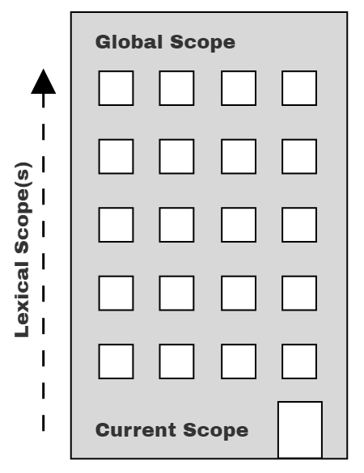

# You Don't Know JS Yet: Scope & Closures - Tái bản lần 2
# Chương 2: Minh họa Lexical Scope

Trong Chương 1, chúng ta đã tìm hiểu cách scope được xác định trong quá trình biên dịch mã nguồn, một mô hình được gọi là "lexical scope." Thuật ngữ "lexical" đề cập đến giai đoạn đầu tiên của quá trình biên dịch (lexing/parsing - phân tích từ vựng/cú pháp).

Để có thể *suy luận* một cách đúng đắn về các chương trình của mình, điều quan trọng là phải có một nền tảng khái niệm vững chắc về cách scope hoạt động. Nếu chúng ta chỉ dựa vào phỏng đoán và trực giác, đôi khi ta có thể tình cờ đưa ra câu trả lời đúng, nhưng phần lớn thời gian khác ta sẽ đi rất xa trật tự chuẩn xác. Đó không phải là một công thức dẫn đến thành công.

Giống như thuở xưa trong giờ toán tiểu học, việc chỉ đưa ra đáp án đúng là chưa đủ nếu chúng ta không chỉ ra được các bước chính xác để đi đến kết quả đó! Chúng ta cần xây dựng các mô hình tư duy (mental models) chuẩn xác và hữu ích để làm nền tảng tiến bước về phía trước.

Chương này sẽ minh họa *scope* thông qua một số phép ẩn dụ. Mục tiêu ở đây là giúp bạn *tư duy* về cách chương trình của bạn được JS engine xử lý theo những phương thức gần gũi nhất với cách thức mà JS engine thực sự vận hành.

## Những viên bi, những chiếc xô, và bong bóng... Ôi trời!

Một phép ẩn dụ mà tôi thấy rất hiệu quả trong việc thấu hiểu scope là phân loại những viên bi màu vào các chiếc xô có màu tương ứng.

Hãy tưởng tượng bạn bắt gặp một đống bi, và nhận thấy rằng tất cả các viên bi đều có màu đỏ, xanh dương hoặc xanh lá cây. Hãy cùng phân loại toàn bộ số bi đó: thả những viên màu đỏ vào xô đỏ, xanh lá cây vào xô xanh lá, và xanh dương vào xô xanh dương. Sau khi phân loại xong, khi sau này bạn cần một viên bi xanh lá cây, bạn đã biết rõ chiếc xô xanh lá cây là nơi cần tìm để lấy nó.

Trong phép ẩn dụ này, các viên bi đại diện cho các biến trong chương trình của chúng ta. Các chiếc xô là các scope (các hàm và khối lệnh - block), mà chúng ta chỉ đơn thuần gán cho các màu sắc riêng biệt về mặt khái niệm nhằm phục vụ cho mục đích thảo luận. Do đó, màu sắc của mỗi viên bi được xác định bởi scope *màu nào* mà ban đầu viên bi được tìm thấy khi khởi tạo.

Hãy cùng chú thích ví dụ chương trình xuyên suốt từ Chương 1 với các nhãn màu scope:

```js
// outer/global scope: ĐỎ (RED)

var students = [
    { id: 14, name: "Kyle" },
    { id: 73, name: "Suzy" },
    { id: 112, name: "Frank" },
    { id: 6, name: "Sarah" }
];

function getStudentName(studentID) {
    // function scope: XANH DƯƠNG (BLUE)

    for (let student of students) {
        // loop scope: XANH LÁ (GREEN)

        if (student.id == studentID) {
            return student.name;
        }
    }
}

var nextStudent = getStudentName(73);
console.log(nextStudent);   // Suzy
```

Chúng ta đã chỉ định ba màu sắc cho scope thông qua các chú thích mã nguồn: ĐỎ (RED - scope toàn cục ngoài cùng), XANH DƯƠNG (BLUE - scope của hàm `getStudentName(..)`), và XANH LÁ (GREEN - scope của/bên trong vòng lặp `for`). Nhưng vẫn có thể sẽ khó để nhận biết ranh giới của các xô scope này khi chỉ nhìn vào danh sách dòng mã.

Hình 2 giúp trực quan hóa ranh giới của các scope bằng cách vẽ các bong bóng có màu (hay còn gọi là các xô) bao quanh từng scope:

<figure>
    
    <figcaption><em>Hình 2: Các bong bóng Scope có màu</em></figcaption>
</figure>

1. **Bong bóng 1** (ĐỎ) bao hàm scope toàn cục (global scope), nơi chứa ba định danh/biến: `students` (dòng 1), `getStudentName` (dòng 8), và `nextStudent` (dòng 16).

2. **Bong bóng 2** (XANH DƯƠNG) bao hàm scope của hàm `getStudentName(..)` (dòng 8), nơi chỉ chứa một định danh/biến: tham số `studentID` (dòng 8).

3. **Bong bóng 3** (XANH LÁ) bao hàm scope của vòng lặp `for` (dòng 9), nơi chỉ chứa một định danh/biến: `student` (dòng 9).

| LƯU Ý: |
| :--- |
| Về mặt kỹ thuật, tham số `studentID` không hoàn toàn nằm chính xác trong scope XANH DƯƠNG(2). Chúng ta sẽ làm rõ sự rối rắm này trong mục "Implied Scopes" ở Phụ lục A. Hiện tại, việc gán cho `studentID` là một viên bi XANH DƯƠNG(2) đã đủ gần gũi và chính xác. |

Các bong bóng scope được xác định trong quá trình biên dịch dựa trên vị trí mà các hàm/khối scope được viết, sự lồng nhau bên trong nhau, v.v. Mỗi bong bóng scope hoàn toàn nằm trọn vẹn bên trong bong bóng scope cha của nó—một scope không bao giờ nằm một phần ở hai scope bên ngoài khác nhau.

Mỗi viên bi (biến/định danh) được tô màu dựa trên việc nó được khai báo trong bong bóng (xô) nào, chứ không phải màu của scope mà từ đó nó có thể được truy cập (ví dụ: `students` ở dòng 9 và `studentID` ở dòng 10).

| LƯU Ý: |
| :--- |
| Hãy nhớ rằng ở Chương 1 chúng ta đã khẳng định `id`, `name`, và `log` đều là các thuộc tính (properties), không phải là biến; nói cách khác, chúng không phải là những viên bi trong xô, vì vậy chúng không được tô màu theo bất kỳ quy tắc nào chúng ta đang thảo luận trong cuốn sách này. Để hiểu cách các truy cập thuộc tính như vậy được xử lý, hãy đón đọc cuốn sách thứ ba trong bộ sách, *Objects & Classes*. |

Khi JS engine xử lý một chương trình (trong quá trình biên dịch) và tìm thấy một khai báo cho một biến, về cơ bản nó sẽ hỏi: "Hiện tại tôi đang ở trong scope (bong bóng hoặc xô) *màu nào*?" Biến đó được chỉ định cùng *màu sắc* đó, nghĩa là nó thuộc về chiếc xô/bong bóng đó.

Chiếc xô XANH LÁ(3) được lồng hoàn toàn bên trong chiếc xô XANH DƯƠNG(2), và tương tự, chiếc xô XANH DƯƠNG(2) được lồng hoàn toàn bên trong chiếc xô ĐỎ(1). Các scope có thể lồng vào nhau như minh họa, tới bất kỳ độ sâu lồng nhau nào mà chương trình của bạn cần.

Các tham chiếu (không phải khai báo) đến các biến/định danh được cho phép nếu có một khai báo tương ứng trong scope hiện tại, hoặc bất kỳ scope nào bên trên/bên ngoài scope hiện tại, nhưng không thể tham chiếu tới các khai báo từ các scope thấp hơn/lồng bên trong.

Một biểu thức trong xô ĐỎ(1) chỉ có quyền truy cập vào các viên bi ĐỎ(1), **không** có quyền truy cập vào XANH DƯƠNG(2) hay XANH LÁ(3). Một biểu thức trong xô XANH DƯƠNG(2) có thể tham chiếu tới các viên bi XANH DƯƠNG(2) hoặc ĐỎ(1), **không** thể tham chiếu tới XANH LÁ(3). Và một biểu thức trong xô XANH LÁ(3) có quyền truy cập vào các viên bi ĐỎ(1), XANH DƯƠNG(2), và XANH LÁ(3).

Chúng ta có thể hình dung quá trình xác định màu sắc của các viên bi không phải là khai báo này trong thời gian chạy (runtime) như một phép tra cứu (lookup). Vì tham chiếu biến `students` trong câu lệnh vòng lặp `for` ở dòng 9 không phải là một khai báo, nên nó chưa có màu. Vì vậy, chúng ta hỏi xô scope XANH DƯƠNG(2) hiện tại xem nó có viên bi nào khớp với tên đó không. Vì không có, quá trình tra cứu tiếp tục với scope bao bọc/bên ngoài tiếp theo: ĐỎ(1). Chiếc xô ĐỎ(1) có một viên bi tên là `students`, vì vậy tham chiếu biến `students` của câu lệnh vòng lặp được xác định là một viên bi ĐỎ(1).

Câu lệnh `if (student.id == studentID)` ở dòng 10 tương tự được xác định là tham chiếu đến một viên bi XANH LÁ(3) tên là `student` và một viên bi XANH DƯƠNG(2) tên là `studentID`.

| LƯU Ý: |
| :--- |
| Nhìn chung, JS engine không xác định màu sắc của các viên bi này trong thời gian chạy; quá trình "tra cứu" ở đây là một phép tu từ nhằm giúp bạn thấu hiểu các khái niệm. Trong quá trình biên dịch, hầu hết hoặc tất cả các tham chiếu biến sẽ khớp với các xô scope đã biết từ trước, vì vậy màu sắc của chúng đã được xác định sẵn và được lưu kèm với mỗi tham chiếu viên bi để tránh các phép tra cứu không cần thiết khi chương trình chạy. Sẽ có thêm chi tiết về sắc thái này trong Chương 3. |

Những điểm cốt lõi rút ra từ các viên bi & chiếc xô (và bong bóng!):

* Các biến được khai báo trong các scope cụ thể, có thể được coi như những viên bi có màu từ các chiếc xô có màu tương ứng.

* Bất kỳ tham chiếu biến nào xuất hiện trong scope nơi nó được khai báo, hoặc xuất hiện trong bất kỳ scope nào lồng sâu hơn bên trong, đều sẽ được gắn nhãn là viên bi cùng màu đó—trừ khi có một scope can thiệp ở giữa "che khuất" (shadows) khai báo biến đó; xem phần "Shadowing" trong Chương 3.

* Việc xác định các xô có màu và các viên bi mà chúng chứa diễn ra trong quá trình biên dịch. Thông tin này được sử dụng cho các phép "tra cứu" biến (màu của viên bi) trong quá trình thực thi mã.

## Cuộc trò chuyện giữa những người bạn

Một phép ẩn dụ hữu ích khác cho quá trình phân tích các biến và các scope mà chúng bắt nguồn là tưởng tượng về các cuộc trò chuyện khác nhau diễn ra bên trong engine khi mã nguồn được xử lý và sau đó được thực thi. Chúng ta có thể "lắng nghe" các cuộc trò chuyện này để có được một nền tảng khái niệm tốt hơn về cách scope vận hành.

Bây giờ hãy cùng gặp gỡ các thành viên trong JS engine sẽ trò chuyện với nhau khi họ xử lý chương trình của chúng ta:

* *Engine*: chịu trách nhiệm biên dịch và thực thi chương trình JavaScript của chúng ta từ đầu đến cuối.

* *Compiler*: một người bạn của *Engine*; đảm nhận toàn bộ công việc khó khăn và phức tạp của việc phân tích từ vựng/cú pháp và sinh mã (xem phần trước).

* *Scope Manager*: một người bạn khác của *Engine*; thu thập và duy trì một danh sách tra cứu gồm tất cả các biến/định danh đã được khai báo, đồng thời thực thi một bộ quy tắc về cách những định danh này có thể được truy cập bởi mã đang thực thi.

Để bạn *thực sự hiểu thấu đáo* cách JavaScript hoạt động, bạn cần bắt đầu *suy nghĩ* giống như cách *Engine* (và những người bạn) suy nghĩ, đặt ra những câu hỏi mà họ đặt ra, và trả lời những câu hỏi đó theo cách tương tự.

Để khám phá những cuộc trò chuyện này, hãy cùng xem lại ví dụ chương trình quen thuộc của chúng ta:

```js
var students = [
    { id: 14, name: "Kyle" },
    { id: 73, name: "Suzy" },
    { id: 112, name: "Frank" },
    { id: 6, name: "Sarah" }
];

function getStudentName(studentID) {
    for (let student of students) {
        if (student.id == studentID) {
            return student.name;
        }
    }
}

var nextStudent = getStudentName(73);

console.log(nextStudent);
// Suzy
```

Hãy xem cách JS sẽ xử lý chương trình đó, cụ thể bắt đầu từ câu lệnh đầu tiên. Mảng và nội dung của nó chỉ là các giá trị literal JS cơ bản (và do đó không bị ảnh hưởng bởi bất kỳ mối bận tâm nào về scope), vì vậy trọng tâm của chúng ta ở đây sẽ là phần khai báo và gán khởi tạo `var students = [ .. ]`.

Chúng ta thường nghĩ đó là một câu lệnh duy nhất, nhưng đó không phải là cách mà người bạn *Engine* của chúng ta nhìn nhận nó. Trên thực tế, JS xem đây là hai thao tác riêng biệt, một thao tác mà *Compiler* sẽ xử lý trong quá trình biên dịch, và thao tác kia mà *Engine* sẽ xử lý trong quá trình thực thi.

Điều đầu tiên mà *Compiler* sẽ làm với chương trình này là thực hiện lexing để chia nhỏ nó thành các token, sau đó nó sẽ phân tích cú pháp (parse) thành một cây (AST).

Khi *Compiler* bước sang giai đoạn sinh mã (code generation), có nhiều chi tiết cần xem xét hơn những gì thoạt nhìn thấy. Một giả định hợp lý là *Compiler* sẽ tạo ra mã cho câu lệnh đầu tiên chẳng hạn như: "Cấp phát bộ nhớ cho một biến, gán nhãn cho nó là `students`, sau đó gắn một tham chiếu đến mảng vào biến đó." Nhưng câu chuyện không chỉ dừng lại ở đó.

Dưới đây là các bước mà *Compiler* sẽ tuân theo để xử lý câu lệnh đó:

1. Khi gặp `var students`, *Compiler* sẽ hỏi *Scope Manager* để xem liệu một biến có tên `students` đã tồn tại cho chiếc xô scope cụ thể đó hay chưa. Nếu đã có, *Compiler* sẽ bỏ qua khai báo này và tiếp tục. Nếu chưa, *Compiler* sẽ tạo ra mã (khi thực thi) yêu cầu *Scope Manager* tạo một biến mới có tên `students` trong xô scope đó.

2. Sau đó, *Compiler* tạo ra mã để *Engine* thực thi sau này, nhằm xử lý phép gán `students = []`. Đoạn mã mà *Engine* chạy trước tiên sẽ hỏi *Scope Manager* xem có biến nào tên là `students` có thể truy cập được trong xô scope hiện tại hay không. Nếu không, *Engine* sẽ tiếp tục tìm ở nơi khác (xem phần "Nested Scope" bên dưới). Khi *Engine* tìm thấy biến đó, nó sẽ gán tham chiếu của mảng `[ .. ]` cho biến.

Dưới hình thức đối thoại, giai đoạn biên dịch đầu tiên cho chương trình có thể diễn ra giữa *Compiler* và *Scope Manager* như sau:

> ***Compiler***: Này, *Scope Manager* (của scope toàn cục), tôi tìm thấy một khai báo chính thức cho một định danh có tên là `students`, bạn đã nghe nói về nó bao giờ chưa?
>
> ***(Global) Scope Manager***: Chưa, chưa nghe bao giờ, vậy nên tôi vừa tạo nó cho bạn rồi đấy.
>
> ***Compiler***: Này, *Scope Manager*, tôi tìm thấy một khai báo chính thức cho một định danh có tên là `getStudentName`, bạn đã nghe nói về nó bao giờ chưa?
>
> ***(Global) Scope Manager***: Chưa, nhưng tôi vừa tạo nó cho bạn rồi.
>
> ***Compiler***: Này, *Scope Manager*, `getStudentName` trỏ tới một hàm, nên chúng ta cần một chiếc xô scope mới.
>
> ***(Function) Scope Manager***: Rõ rồi, xô scope của bạn đây.
>
> ***Compiler***: Này, *Scope Manager* (của hàm), tôi tìm thấy một khai báo tham số chính thức cho `studentID`, bạn đã nghe nói về nó bao giờ chưa?
>
> ***(Function) Scope Manager***: Chưa, nhưng giờ thì nó đã được tạo trong scope này rồi nhé.
>
> ***Compiler***: Này, *Scope Manager* (của hàm), tôi tìm thấy một vòng lặp `for` sẽ cần chiếc xô scope riêng của nó.
>
> ...

Cuộc trò chuyện này là một màn hỏi-đáp, trong đó **Compiler** hỏi *Scope Manager* hiện tại xem một khai báo định danh vừa gặp đã từng xuất hiện trước đó chưa. Nếu câu trả lời là "chưa", *Scope Manager* sẽ tạo biến đó trong scope tương ứng. Nếu câu trả lời là "rồi", thì nó được bỏ qua một cách hiệu quả vì không còn việc gì khác để *Scope Manager* đó phải làm.

*Compiler* cũng phát tín hiệu khi bắt gặp các hàm hoặc các block scope, để một xô scope mới cùng *Scope Manager* mới có thể được khởi tạo.

Sau đó, khi đến lúc thực thi chương trình, cuộc trò chuyện sẽ chuyển sang giữa *Engine* và *Scope Manager*, và có thể diễn ra như sau:

> ***Engine***: Này, *Scope Manager* (của scope toàn cục), trước khi bắt đầu, bạn có thể tra cứu định danh `getStudentName` để tôi có thể gán hàm này cho nó không?
>
> ***(Global) Scope Manager***: Được chứ, biến của bạn đây.
>
> ***Engine***: Này, *Scope Manager*, tôi tìm thấy một tham chiếu *target* cho `students`, bạn từng nghe nói về nó chưa?
>
> ***(Global) Scope Manager***: Rồi, nó đã được khai báo chính thức cho scope này, nên nó đây nhé.
>
> ***Engine***: Cảm ơn, tôi đang khởi tạo `students` thành `undefined`, để nó sẵn sàng sử dụng.
>
> Này, *Scope Manager* (của scope toàn cục), tôi tìm thấy một tham chiếu *target* cho `nextStudent`, bạn từng nghe nói về nó chưa?
>
> ***(Global) Scope Manager***: Rồi, nó đã được khai báo chính thức cho scope này, nên nó đây.
>
> ***Engine***: Cảm ơn, tôi đang khởi tạo `nextStudent` thành `undefined`, để nó sẵn sàng sử dụng.
>
> Này, *Scope Manager* (của scope toàn cục), tôi tìm thấy một tham chiếu *source* cho `getStudentName`, bạn từng nghe nói về nó chưa?
>
> ***(Global) Scope Manager***: Rồi, nó đã được khai báo chính thức cho scope này. Nó đây nhé.
>
> ***Engine***: Tuyệt vời, giá trị trong `getStudentName` là một hàm, vậy nên tôi sẽ thực thi nó.
>
> ***Engine***: Này, *Scope Manager*, giờ chúng ta cần khởi tạo scope của hàm.
>
> ...

Cuộc trò chuyện này lại là một màn hỏi-đáp khác, trong đó trước tiên *Engine* yêu cầu *Scope Manager* hiện tại tra cứu định danh `getStudentName` đã được hoist (kéo lên), nhằm liên kết hàm với nó. Sau đó *Engine* tiếp tục hỏi *Scope Manager* về tham chiếu *target* cho `students`, và cứ thế tiếp diễn.

Để ôn lại và tóm tắt cách một câu lệnh như `var students = [ .. ]` được xử lý qua hai bước riêng biệt:

1. *Compiler* thiết lập khai báo của biến scope (vì trước đó nó chưa được khai báo trong scope hiện tại).

2. Trong khi *Engine* đang thực thi, để xử lý phần gán của câu lệnh, *Engine* yêu cầu *Scope Manager* tra cứu biến, khởi tạo nó thành `undefined` để sẵn sàng sử dụng, rồi sau đó gán giá trị mảng cho nó.

## Scope lồng nhau (Nested Scope)

Khi đến lúc thực thi hàm `getStudentName()`, *Engine* yêu cầu một instance *Scope Manager* cho scope của hàm đó, và sau đó nó sẽ tiến hành tra cứu tham số (`studentID`) để gán giá trị đối số `73` vào, và cứ thế tiếp tục.

Scope của hàm `getStudentName(..)` được lồng bên trong scope toàn cục (global scope). Block scope của vòng lặp `for` tương tự cũng được lồng bên trong scope của hàm đó. Các scope có thể được lồng nhau về mặt từ vựng (lexically nested) tới bất kỳ độ sâu tùy ý nào mà chương trình định nghĩa.

Mỗi scope nhận được instance *Scope Manager* riêng của nó mỗi khi scope đó được thực thi (một hoặc nhiều lần). Mỗi scope tự động có tất cả các định danh của nó được đăng ký khi scope bắt đầu được thực thi (điều này được gọi là "variable hoisting"; xem Chương 5).

Ở phần đầu của một scope, nếu có bất kỳ định danh nào đến từ một khai báo `function`, biến đó sẽ tự động được khởi tạo với tham chiếu hàm tương ứng của nó. Và nếu có bất kỳ định danh nào đến từ một khai báo `var` (trái ngược với `let`/`const`), biến đó sẽ tự động được khởi tạo thành `undefined` để có thể sử dụng; mặt khác, biến đó vẫn chưa được khởi tạo (tức là nằm trong "TDZ" của nó, xem Chương 5) và không thể sử dụng cho đến khi việc khai báo và khởi tạo đầy đủ của nó được thực thi.

Trong câu lệnh `for (let student of students) {`, `students` là một tham chiếu *source* cần phải được tra cứu. Nhưng phép tra cứu đó sẽ được xử lý như thế nào, khi mà scope của hàm sẽ không tìm thấy định danh như vậy?

Để giải thích, hãy cùng hình dung đoạn hội thoại đó diễn ra như sau:

> ***Engine***: Này, *Scope Manager* (của hàm), tôi có một tham chiếu *source* cho `students`, bạn từng nghe nói về nó chưa?
>
> ***(Function) Scope Manager***: Chưa, chưa nghe bao giờ. Thử hỏi scope bên ngoài tiếp theo xem.
>
> ***Engine***: Này, *Scope Manager* (của scope toàn cục), tôi có một tham chiếu *source* cho `students`, bạn từng nghe nói về nó chưa?
>
> ***(Global) Scope Manager***: Rồi, nó đã được khai báo chính thức, nó đây nhé.
>
> ...

Một trong những khía cạnh then chốt của lexical scope là bất cứ khi nào một tham chiếu định danh không thể tìm thấy trong scope hiện tại, scope bên ngoài tiếp theo trong cấu trúc lồng nhau sẽ được tham vấn; quá trình đó được lặp lại cho đến khi tìm thấy câu trả lời hoặc không còn scope nào để tham vấn nữa.

### Thất bại khi tra cứu (Lookup Failures)

Khi *Engine* đã vét cạn tất cả các scope *khả dụng về mặt từ vựng* (lexically available - di chuyển dần ra ngoài) mà vẫn không thể phân giải phép tra cứu của một định danh, thì một tình trạng lỗi sẽ xuất hiện. Tuy nhiên, tùy thuộc vào chế độ của chương trình (strict-mode hay không) và vai trò của biến (tức là *target* so với *source*; xem Chương 1), tình trạng lỗi này sẽ được xử lý khác nhau.

#### Sự lộn xộn của Undefined

Nếu biến là một *source*, một phép tra cứu định danh không được phân giải sẽ bị coi là một biến chưa được khai báo (undeclared - không xác định, bị thiếu), điều này luôn dẫn đến việc một `ReferenceError` bị ném ra. Ngoài ra, nếu biến là một *target*, và mã tại thời điểm đó đang chạy ở strict-mode, biến đó cũng bị coi là chưa khai báo và tương tự sẽ ném ra một `ReferenceError`.

Thông báo lỗi cho tình trạng biến chưa được khai báo, trong hầu hết các môi trường JS, sẽ có dạng như: "Reference Error: XYZ is not defined." Cụm từ "not defined" dường như gần như đồng nghĩa với từ "undefined", xét theo ngôn ngữ tiếng Anh. Nhưng hai điều này rất khác nhau trong JS, và thông báo lỗi này tiếc thay lại tạo ra một sự nhầm lẫn dai dẳng.

"Not defined" thực chất có nghĩa là "not declared" (chưa được khai báo)—hay đúng hơn là "undeclared", tức là một biến không có khai báo chính thức tương ứng trong bất kỳ scope nào *khả dụng về mặt từ vựng*. Ngược lại, "undefined" thực sự có nghĩa là biến đã được tìm thấy (được khai báo), nhưng biến đó hiện tại chưa chứa bất kỳ giá trị nào khác, vì vậy nó mặc định mang giá trị `undefined`.

Để làm cho sự nhầm lẫn càng trở nên trầm trọng hơn, toán tử `typeof` của JS trả về chuỗi `"undefined"` cho các tham chiếu biến ở cả hai trạng thái:

```js
var studentName;
typeof studentName;     // "undefined"

typeof doesntExist;     // "undefined"
```

Hai tham chiếu biến này ở trong hai tình trạng hoàn toàn khác nhau, nhưng JS chắc chắn đã làm đục ngầu vùng nước ranh giới giữa chúng. Sự lộn xộn về mặt thuật ngữ này thật khó hiểu và vô cùng đáng tiếc. Tiếc thay, các lập trình viên JS đành phải chú ý cẩn thận để không nhầm lẫn *loại* "undefined" nào mà họ đang phải đối mặt!

#### Toàn cục... Cái gì cơ!?

Nếu biến là một *target* và strict-mode không được áp dụng, một hành vi kế thừa (legacy behavior) khó hiểu và đáng kinh ngạc sẽ được kích hoạt. Kết quả phiền toái là *Scope Manager* của scope toàn cục sẽ đơn giản tạo ra một **biến toàn cục tình cờ** (accidental global variable) để đáp ứng phép gán target đó!

Hãy xem xét:

```js
function getStudentName() {
    // phép gán cho một biến chưa khai báo :(
    nextStudent = "Suzy";
}

getStudentName();

console.log(nextStudent);
// "Suzy" -- ôi thôi, một biến-toàn-cục-tình-cờ!
```

Dưới đây là cách *cuộc trò chuyện* đó sẽ diễn ra:

> ***Engine***: Này, *Scope Manager* (của hàm), tôi có một tham chiếu *target* cho `nextStudent`, bạn từng nghe nói về nó chưa?
>
> ***(Function) Scope Manager***: Chưa, chưa nghe bao giờ. Thử scope bên ngoài tiếp theo xem.
>
> ***Engine***: Này, *Scope Manager* (của scope toàn cục), tôi có một tham chiếu *target* cho `nextStudent`, bạn từng nghe nói về nó chưa?
>
> ***(Global) Scope Manager***: Chưa, nhưng vì chúng ta đang ở non-strict-mode, tôi đã giúp bạn một tay và vừa tạo một biến toàn cục cho bạn rồi, nó đây nhé!

Thật tồi tệ.

Loại sự cố này (gần như chắc chắn sẽ dẫn đến lỗi bug về sau) là một ví dụ tuyệt vời về những sự bảo vệ có lợi mà strict-mode mang lại, và lý do tại sao việc *không* sử dụng strict-mode lại là một ý tưởng tồi tệ đến thế. Trong strict-mode, ***Global Scope Manager*** thay vào đó sẽ phản hồi như sau:

> ***(Global) Scope Manager***: Chưa, chưa nghe bao giờ. Xin lỗi nhé, tôi buộc phải ném ra một lỗi `ReferenceError`.

Việc gán cho một biến chưa từng được khai báo *thực sự* là một lỗi, vì vậy việc chúng ta nhận được một `ReferenceError` ở đây là hoàn toàn đúng đắn.

Đừng bao giờ dựa dẫm vào các biến toàn cục tình cờ. Luôn luôn sử dụng strict-mode, và luôn khai báo các biến của bạn một cách chính thức. Khi đó, bạn sẽ nhận được một `ReferenceError` hữu ích nếu bạn từng vô tình cố gắng gán giá trị cho một biến chưa được khai báo.

### Phát triển thêm dựa trên các phép ẩn dụ

Để trực quan hóa việc phân giải scope lồng nhau, tôi còn thích thêm một phép ẩn dụ khác nữa, đó là một tòa nhà văn phòng, như trong Hình 3:

<figure>
    
    <figcaption><em>Hình 3: Tòa nhà Scope ("Building")</em></figcaption>
    <br><br>
</figure>

Tòa nhà đại diện cho tập hợp scope lồng nhau trong chương trình của chúng ta. Tầng một của tòa nhà đại diện cho scope hiện đang thực thi. Tầng trên cùng của tòa nhà là scope toàn cục.

Bạn phân giải một tham chiếu biến *target* hoặc *source* bằng cách trước tiên tìm kiếm ở tầng hiện tại, và nếu bạn không tìm thấy nó, hãy đi thang máy lên tầng tiếp theo (tức là một scope bên ngoài), tìm ở đó, rồi lên tầng tiếp theo, và cứ thế tiếp tục. Một khi bạn lên đến tầng cao nhất (scope toàn cục), bạn hoặc là tìm thấy thứ mình đang tìm kiếm, hoặc là không. Nhưng dù thế nào đi nữa bạn cũng phải dừng lại.

## Tiếp tục cuộc trò chuyện

Đến thời điểm này, bạn hẳn đã và đang phát triển các mô hình tư duy phong phú hơn về scope là gì cũng như cách JS engine xác định và sử dụng nó từ mã nguồn của bạn.

Trước khi *tiếp tục*, hãy tìm một đoạn mã trong một trong những dự án của bạn và chạy thử các cuộc trò chuyện này. Nghiêm túc đấy, hãy thực sự nói thành tiếng. Hãy tìm một người bạn và cùng họ thực hành từng vai. Nếu một trong hai bạn thấy bối rối hoặc vấp váp, hãy dành nhiều thời gian hơn để xem lại tài liệu này.

Khi chúng ta di chuyển (lên) chương (bên ngoài) tiếp theo, chúng ta sẽ khám phá cách các lexical scope của một chương trình được kết nối thành một chuỗi (chain) như thế nào.
