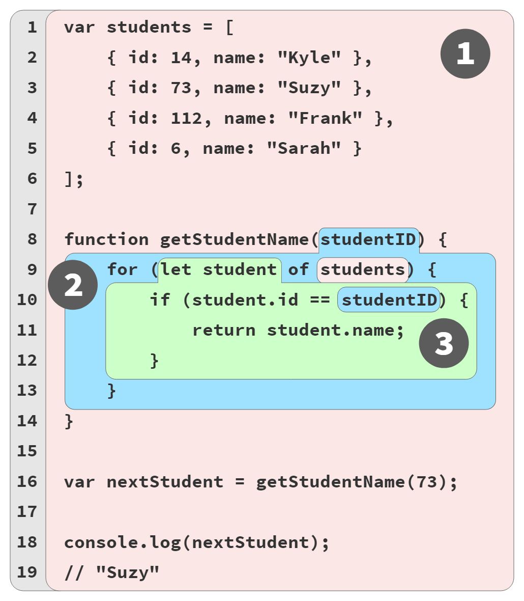

# Bạn Chưa Biết JS Đâu: Phạm Vi & Closures (Scope & Closures) - Tái bản lần 2
# Chương 3: Chuỗi phạm vi (The Scope Chain)

Chương 1 và 2 đã đưa ra định nghĩa cụ thể về *lexical scope* (và các thành phần của nó) cũng như minh họa những phép ẩn dụ hữu ích cho nền tảng khái niệm này. Trước khi tiếp tục với chương này, hãy tìm một ai đó để giải thích (bằng văn bản hoặc nói to thành lời), bằng chính ngôn từ của bạn, xem lexical scope là gì và tại sao việc hiểu nó lại hữu ích.

Điều đó có vẻ giống như một bước mà bạn có thể muốn bỏ qua, nhưng tôi nhận thấy rằng việc dành thời gian để tái cấu trúc lại những ý tưởng này thành lời giải thích cho người khác thực sự rất có ích. Điều đó giúp bộ não của chúng ta tiêu hóa những gì mình đang học!

Giờ là lúc đi sâu vào các chi tiết cốt lõi, vì vậy hãy chuẩn bị tinh thần rằng mọi thứ sẽ trở nên chi tiết hơn rất nhiều từ đây trở đi. Dù vậy, hãy kiên trì nhé, bởi vì những cuộc thảo luận này thực sự sẽ làm nổi bật rõ ràng rằng tất cả chúng ta *chưa biết* nhiều đến mức nào về scope. Hãy chắc chắn rằng bạn dành thời gian cho phần văn bản và tất cả các đoạn mã được cung cấp.

Để làm mới lại ngữ cảnh của ví dụ xuyên suốt của chúng ta, hãy nhớ lại hình ảnh minh họa được mã hóa bằng màu sắc của các bong bóng phạm vi lồng nhau, từ Chương 2, Hình 2:

<figure>
    
    <figcaption><em>Hình 2 (Ch. 2): Các bong bóng Scope có màu</em></figcaption>
    <br><br>
</figure>

Các liên kết giữa các phạm vi được lồng bên trong những phạm vi khác được gọi là chuỗi phạm vi (scope chain), thứ quyết định con đường mà các biến có thể được truy cập dọc theo đó. Chuỗi này có tính định hướng, có nghĩa là việc tra cứu (lookup) chỉ di chuyển lên trên/ra ngoài.

## "Tra cứu" (Lookup) (phần lớn) mang tính khái niệm

Trong Hình 2, hãy chú ý đến màu sắc của tham chiếu biến `students` trong vòng lặp `for`. Chính xác thì làm thế nào chúng ta xác định được rằng đó là một viên bi RED(1)?

Trong Chương 2, chúng ta đã mô tả việc truy cập biến trong lúc chạy (runtime) như một quá trình "tra cứu" (lookup), nơi *Engine* phải bắt đầu bằng cách hỏi *Scope Manager* của phạm vi hiện tại xem nó có biết về một định danh/biến hay không, và tiếp tục đi ngược lên trên/ra ngoài qua chuỗi các phạm vi lồng nhau (hướng về phạm vi toàn cục) cho đến khi tìm thấy, nếu có. Quá trình tra cứu sẽ dừng lại ngay khi tìm thấy khai báo trùng tên đầu tiên trong một xô phạm vi (scope bucket).

Quá trình tra cứu theo đó đã xác định rằng `students` là một viên bi RED(1), bởi vì chúng ta chưa tìm thấy tên biến khớp nào khi duyệt qua chuỗi phạm vi, cho đến khi chúng ta chạm tới phạm vi toàn cục RED(1) cuối cùng.

Tương tự, `studentID` trong câu lệnh `if` được xác định là một viên bi BLUE(2).

Ý niệm về một quá trình tra cứu lúc chạy này rất hữu ích cho việc hiểu về mặt khái niệm, nhưng thực ra đó không phải là cách mọi thứ thường hoạt động trong thực tế.

Màu của xô chứa viên bi (nói cách khác, thông tin siêu dữ liệu về phạm vi mà một biến bắt nguồn từ đó) *thường được xác định* trong suốt quá trình biên dịch ban đầu. Bởi vì lexical scope gần như đã được chốt cố định tại thời điểm đó, màu của một viên bi sẽ không thay đổi dựa trên bất kỳ điều gì có thể xảy ra sau đó trong thời gian chạy (runtime).

Vì màu của viên bi đã được biết từ lúc biên dịch, và nó là bất biến (immutable), thông tin này có thể sẽ được lưu trữ cùng với (hoặc ít nhất là có thể truy cập được từ) mục nhập của từng biến trong AST; thông tin đó sau đó được sử dụng tường minh bởi các chỉ lệnh có thể thực thi cấu thành nên thời gian chạy của chương trình.

Nói cách khác, *Engine* (từ Chương 2) không cần phải tra cứu qua một loạt các phạm vi để tìm ra biến đó đến từ xô phạm vi nào. Thông tin đó đã được biết trước rồi! Việc tránh phải tra cứu lúc runtime là một lợi ích tối ưu hóa then chốt của lexical scope. Quá trình thực thi runtime hoạt động hiệu quả hơn mà không phải tốn thời gian cho tất cả các lần tra cứu này.

Nhưng tôi vừa nói "...thường được xác định..." cách đây ít phút, liên quan đến việc xác định màu của viên bi trong quá trình biên dịch. Vậy thì trong trường hợp nào nó sẽ *không* được biết trong quá trình biên dịch?

Hãy xem xét một tham chiếu đến một biến không được khai báo trong bất kỳ phạm vi nào có sẵn về mặt từ vựng (lexically available) trong tệp hiện tại—xem cuốn *Get Started*, Chương 1, nơi khẳng định rằng mỗi tệp là một chương trình riêng biệt theo góc nhìn của quá trình biên dịch JS. Nếu không tìm thấy khai báo nào, điều đó *chưa hẳn* đã là một lỗi. Một tệp (chương trình) khác trong thời gian chạy thực sự có thể khai báo biến đó trong phạm vi toàn cục dùng chung.

Vì vậy, việc xác định cuối cùng xem liệu biến đó có từng được khai báo một cách thích hợp trong một xô có thể truy cập nào hay không có thể cần phải hoãn lại đến thời điểm runtime.

Bất kỳ tham chiếu nào đến một biến mà ban đầu *chưa được khai báo* (undeclared) sẽ được để lại dưới dạng một viên bi không màu trong suốt quá trình biên dịch tệp đó; màu sắc này không thể xác định được cho đến khi (các) tệp liên quan khác đã được biên dịch và runtime của ứng dụng bắt đầu chạy. Quá trình tra cứu bị trì hoãn đó cuối cùng sẽ giải quyết màu sắc cho bất kỳ phạm vi nào mà biến được tìm thấy (nhiều khả năng là phạm vi toàn cục).

Tuy nhiên, việc tra cứu này tối đa cũng chỉ cần thực hiện một lần cho mỗi biến, vì không có gì khác trong thời gian chạy có thể thay đổi màu của viên bi đó sau này.

Phần "Tra cứu thất bại" (Lookup Failures) trong Chương 2 đề cập đến những gì xảy ra nếu một viên bi cuối cùng vẫn không có màu tại thời điểm tham chiếu của nó được thực thi lúc runtime.

## Hiện tượng che khuất (Shadowing)

"Che khuất" (Shadowing) nghe có vẻ bí ẩn và hơi đáng ngờ. Nhưng đừng lo, nó hoàn toàn hợp lệ!

Ví dụ xuyên suốt của chúng ta trong các chương này sử dụng các tên biến khác nhau qua các ranh giới phạm vi. Vì tất cả chúng đều có tên duy nhất, theo một cách nào đó, sẽ chẳng thành vấn đề nếu tất cả chúng đều chỉ được lưu trữ trong một cái xô (chẳng hạn như RED(1)).

Nơi mà việc có các xô lexical scope khác nhau bắt đầu trở nên quan trọng hơn là khi bạn có từ hai biến trở lên, mỗi biến ở các phạm vi khác nhau, nhưng lại có cùng tên từ vựng. Một phạm vi đơn lẻ không thể có từ hai biến trở lên có cùng một tên; các tham chiếu lặp lại như vậy sẽ được coi như chỉ là một biến duy nhất.

Vì vậy, nếu bạn cần duy trì hai hoặc nhiều biến có cùng tên, bạn phải sử dụng các phạm vi riêng biệt (thường là lồng nhau). Và trong trường hợp đó, cách bố trí các xô phạm vi khác nhau là vô cùng thích đáng.

Hãy xem xét:

```js
var studentName = "Suzy";

function printStudent(studentName) {
    studentName = studentName.toUpperCase();
    console.log(studentName);
}

printStudent("Frank");
// FRANK

printStudent(studentName);
// SUZY

console.log(studentName);
// Suzy
```

| MẸO (TIP): |
| :--- |
| Trước khi đi tiếp, hãy dành chút thời gian để phân tích đoạn mã này bằng các kỹ thuật/phép ẩn dụ khác nhau mà chúng ta đã đề cập trong cuốn sách. Đặc biệt, hãy đảm bảo xác định được màu của các viên bi/bong bóng trong đoạn mã này. Đây là một bài luyện tập rất tốt! |

Biến `studentName` ở dòng 1 (câu lệnh `var studentName = ..`) tạo ra một viên bi RED(1). Biến có cùng tên đó được khai báo dưới dạng một viên bi BLUE(2) ở dòng 3, tham số trong định nghĩa hàm `printStudent(..)`.

Biến `studentName` sẽ là viên bi màu gì trong câu lệnh gán `studentName = studentName.toUpperCase()` và câu lệnh `console.log(studentName)`? Cả ba tham chiếu `studentName` này đều sẽ là BLUE(2).

Với khái niệm "tra cứu" (lookup), chúng ta khẳng định rằng nó bắt đầu từ phạm vi hiện tại và di chuyển dần ra ngoài/lên trên, dừng lại ngay khi tìm thấy một biến trùng khớp. `studentName` BLUE(2) được tìm thấy ngay lập tức. `studentName` RED(1) thậm chí còn không bao giờ được xem xét tới.

Đây là một khía cạnh then chốt trong hành vi của lexical scope, được gọi là *sự che khuất* (shadowing). Biến (tham số) `studentName` BLUE(2) che khuất `studentName` RED(1). Do đó, tham số này đang che khuất biến toàn cục (bị che khuất). Hãy lặp lại câu đó với chính mình vài lần để chắc chắn rằng bạn nắm vững các thuật ngữ này!

Đó là lý do tại sao việc gán lại giá trị cho `studentName` chỉ ảnh hưởng đến biến bên trong (tham số): `studentName` BLUE(2), chứ không phải `studentName` RED(1) toàn cục.

Khi bạn chọn che khuất một biến từ phạm vi bên ngoài, một tác động trực tiếp là từ phạm vi đó vào trong/xuống dưới (qua bất kỳ phạm vi lồng nhau nào), giờ đây không một viên bi nào có thể được mang màu của biến bị che khuất—(RED(1), trong trường hợp này). Nói cách khác, bất kỳ tham chiếu định danh `studentName` nào cũng sẽ tương ứng với biến tham số đó, không bao giờ là biến `studentName` toàn cục. Về mặt từ vựng (lexically), không thể nào tham chiếu đến `studentName` toàn cục ở bất kỳ đâu bên trong hàm `printStudent(..)` (hoặc từ bất kỳ phạm vi lồng nhau nào của nó).

### Mẹo bỏ che khuất ở phạm vi toàn cục (Global Unshadowing Trick)

Xin hãy lưu ý: tận dụng kỹ thuật mà tôi sắp mô tả sau đây không phải là một thực hành tốt, vì tiện ích của nó có hạn, gây bối rối cho người đọc mã của bạn, và có khả năng rước thêm lỗi vào chương trình của bạn. Tôi đề cập đến nó chỉ vì bạn có thể bắt gặp hành vi này trong các chương trình hiện có, và việc hiểu điều gì đang diễn ra là rất quan trọng để không bị vướng mắc.

Việc truy cập một biến toàn cục từ một phạm vi nơi biến đó đã bị che khuất *là có thể*, nhưng không phải thông qua một tham chiếu định danh từ vựng thông thường.

Trong phạm vi toàn cục (RED(1)), các khai báo `var` và các khai báo `function` cũng tự phơi bày dưới dạng các thuộc tính (cùng tên với định danh) trên *đối tượng toàn cục* (global object)—về bản chất là một biểu diễn dạng đối tượng của phạm vi toàn cục. Nếu bạn từng viết JS cho môi trường trình duyệt, có lẽ bạn nhận ra đối tượng toàn cục là `window`. Điều đó không *hoàn toàn* chính xác tuyệt đối, nhưng nó đủ tốt cho cuộc thảo luận của chúng ta. Trong chương tiếp theo, chúng ta sẽ khám phá sâu hơn về chủ đề phạm vi/đối tượng toàn cục.

Hãy xem xét chương trình này, được thực thi cụ thể dưới dạng một tệp .js độc lập trong môi trường trình duyệt:

```js
var studentName = "Suzy";

function printStudent(studentName) {
    console.log(studentName);
    console.log(window.studentName);
}

printStudent("Frank");
// "Frank"
// "Suzy"
```

Bạn có nhận thấy tham chiếu `window.studentName` không? Biểu thức này đang truy cập biến toàn cục `studentName` dưới dạng một thuộc tính trên `window` (mà chúng ta đang tạm coi là đồng nghĩa với đối tượng toàn cục). Đó là cách duy nhất để truy cập một biến bị che khuất từ bên trong một phạm vi nơi biến che khuất hiện diện.

`window.studentName` là một hình ảnh phản chiếu (mirror) của biến `studentName` toàn cục, chứ không phải là một bản sao ảnh chụp (snapshot copy) riêng biệt. Các thay đổi đối với bên này vẫn được nhìn thấy từ bên kia, theo cả hai chiều. Bạn có thể coi `window.studentName` như một getter/setter truy cập vào chính biến `studentName` thực sự. Trên thực tế, bạn thậm chí có thể *thêm* một biến vào phạm vi toàn cục bằng cách tạo/thiết lập một thuộc tính trên đối tượng toàn cục.

| CẢNH BÁO (WARNING): |
| :--- |
| Hãy nhớ rằng: chỉ vì bạn *có thể* không có nghĩa là bạn *nên* làm vậy. Đừng che khuất một biến toàn cục mà bạn cần truy cập, và ngược lại, hãy tránh sử dụng mẹo này để truy cập một biến toàn cục mà bạn đã che khuất. Và chắc chắn đừng làm người đọc mã của bạn bối rối bằng cách tạo các biến toàn cục dưới dạng thuộc tính của `window` thay vì dùng các khai báo chính thức! |

"Mẹo" nhỏ này chỉ hoạt động để truy cập một biến phạm vi toàn cục (chứ không áp dụng cho biến bị che khuất từ một phạm vi lồng nhau), và ngay cả khi đó, nó cũng chỉ áp dụng cho biến được khai báo bằng `var` hoặc `function`.

Các dạng khai báo phạm vi toàn cục khác không tạo ra các thuộc tính đối tượng toàn cục phản chiếu:

```js
var one = 1;
let notOne = 2;
const notTwo = 3;
class notThree {}

console.log(window.one);       // 1
console.log(window.notOne);    // undefined
console.log(window.notTwo);    // undefined
console.log(window.notThree);  // undefined
```

Các biến (bất kể chúng được khai báo như thế nào!) tồn tại trong bất kỳ phạm vi nào khác ngoài phạm vi toàn cục đều hoàn toàn không thể truy cập được từ một phạm vi nơi chúng đã bị che khuất:

```js
var special = 42;

function lookingFor(special) {
    // Định danh `special` (tham số) trong phạm vi này
    // bị che khuất bên trong keepLooking(), và do đó
    // không thể truy cập được từ phạm vi đó.

    function keepLooking() {
        var special = 3.141592;
        console.log(special);
        console.log(window.special);
    }

    keepLooking();
}

lookingFor(112358132134);
// 3.141592
// 42
```

Biến toàn cục `special` RED(1) bị che khuất bởi `special` BLUE(2) (tham số), và bản thân `special` BLUE(2) lại bị che khuất bởi `special` GREEN(3) bên trong `keepLooking()`. Chúng ta vẫn có thể truy cập `special` RED(1) bằng tham chiếu gián tiếp `window.special`. Nhưng không có cách nào để `keepLooking()` truy cập vào `special` BLUE(2) vốn đang chứa số `112358132134`.

### Sao chép không phải là truy cập (Copying Is Not Accessing)

Tôi đã được hỏi câu "Nhưng còn... thì sao?" sau đây hàng chục lần. Hãy xem xét:

```js
var special = 42;

function lookingFor(special) {
    var another = {
        special: special
    };

    function keepLooking() {
        var special = 3.141592;
        console.log(special);
        console.log(another.special);  // Ooo, khéo léo đấy!
        console.log(window.special);
    }

    keepLooking();
}

lookingFor(112358132134);
// 3.141592
// 112358132134
// 42
```

Ồ! Vậy kỹ thuật đối tượng `another` này có bác bỏ tuyên bố của tôi rằng tham số `special` là "hoàn toàn không thể truy cập" từ bên trong `keepLooking()` không? Không, khẳng định đó vẫn đúng.

`special: special` đang sao chép giá trị của biến tham số `special` vào một vùng chứa khác (một thuộc tính có cùng tên). Tất nhiên, nếu bạn đặt một giá trị vào một vùng chứa khác, việc che khuất không còn áp dụng nữa (trừ khi chính `another` cũng bị che khuất!). Nhưng điều đó không có nghĩa là chúng ta đang truy cập vào tham số `special`; nó có nghĩa là chúng ta đang truy cập bản sao của giá trị mà nó có tại thời điểm đó, thông qua *một vùng chứa khác* (thuộc tính đối tượng). Chúng ta không thể gán lại giá trị khác cho tham số `special` BLUE(2) từ bên trong `keepLooking()`.

Một câu hỏi "Nhưng... !?" khác mà bạn có thể sắp nêu ra: chuyện gì sẽ xảy ra nếu tôi sử dụng các đối tượng hoặc mảng làm giá trị thay vì các con số (`112358132134`, v.v.)? Việc chúng ta nắm giữ các tham chiếu đến các đối tượng thay vì các bản sao của các giá trị nguyên thủy (primitive) liệu có "khắc phục" được tính không thể truy cập hay không?

Không. Việc đột biến (mutate) nội dung của giá trị đối tượng thông qua một bản sao tham chiếu **không** giống với việc truy cập từ vựng (lexically) vào chính biến đó. Chúng ta vẫn không thể gán lại giá trị cho tham số `special` BLUE(2).

### Che khuất bất hợp pháp (Illegal Shadowing)

Không phải tất cả các tổ hợp che khuất khai báo đều được phép. `let` có thể che khuất `var`, nhưng `var` không thể che khuất `let`:

```js
function something() {
    var special = "JavaScript";

    {
        let special = 42;   // che khuất hoàn toàn ổn

        // ..
    }
}

function another() {
    // ..

    {
        let special = "JavaScript";

        {
            var special = "JavaScript";
            // ^^^ Syntax Error

            // ..
        }
    }
}
```

Hãy chú ý trong hàm `another()`, khai báo `var special` bên trong đang cố gắng khai báo một biến `special` trên toàn phạm vi hàm, điều này tự thân nó là hoàn toàn ổn (như được thể hiện qua hàm `something()`).

Mô tả lỗi cú pháp (SyntaxError) trong trường hợp này chỉ ra rằng `special` đã được định nghĩa, nhưng thông báo lỗi đó có một chút gây hiểu nhầm—nhắc lại một lần nữa, không có lỗi nào như vậy xảy ra trong `something()`, vì việc che khuất nhìn chung là được phép bình thường.

Lý do thực sự khiến nó phát sinh `SyntaxError` là vì `var` về cơ bản đang cố gắng "vượt qua ranh giới" (hoặc nhảy qua) khai báo `let` có cùng tên, điều này không được cho phép.

Lệnh cấm vượt ranh giới đó sẽ dừng lại một cách hiệu quả tại mỗi ranh giới hàm, vì vậy biến thể sau đây không phát sinh ngoại lệ nào:

```js
function another() {
    // ..

    {
        let special = "JavaScript";

        ajax("https://some.url",function callback(){
            // che khuất hoàn toàn ổn
            var special = "JavaScript";

            // ..
        });
    }
}
```

Tóm lại: `let` (trong một phạm vi bên trong) luôn có thể che khuất một `var` ở phạm vi bên ngoài. `var` (trong một phạm vi bên trong) chỉ có thể che khuất một `let` ở phạm vi bên ngoài nếu có một ranh giới hàm ở giữa chúng.

## Phạm vi của tên hàm (Function Name Scope)

Như bạn đã thấy cho đến nay, một khai báo `function` trông như thế này:

```js
function askQuestion() {
    // ..
}
```

Và như đã thảo luận trong Chương 1 và 2, một khai báo `function` như vậy sẽ tạo ra một định danh trong phạm vi bao bọc (trong trường hợp này là phạm vi toàn cục) có tên là `askQuestion`.

Thế còn chương trình này thì sao?

```js
var askQuestion = function(){
    // ..
};
```

Điều tương tự cũng đúng đối với biến `askQuestion` được tạo ra. Nhưng vì nó là một biểu thức `function`—một định nghĩa hàm được sử dụng như một giá trị thay vì một khai báo độc lập—bản thân hàm sẽ không được "hoist" (xem Chương 5).

Một điểm khác biệt lớn giữa khai báo `function` và biểu thức `function` là điều gì xảy ra với định danh tên của hàm. Hãy xem xét một biểu thức `function` có tên:

```js
var askQuestion = function ofTheTeacher(){
    // ..
};
```

Chúng ta biết `askQuestion` nằm ở phạm vi bên ngoài. Nhưng còn định danh `ofTheTeacher` thì sao? Đối với các khai báo `function` thông thường, định danh tên sẽ nằm ở phạm vi bên ngoài/bao bọc, vì vậy việc cho rằng trường hợp này cũng như vậy là điều hợp lý. Nhưng `ofTheTeacher` lại được khai báo như một định danh **bên trong chính hàm đó**:

```js
var askQuestion = function ofTheTeacher() {
    console.log(ofTheTeacher);
};

askQuestion();
// function ofTheTeacher()...

console.log(ofTheTeacher);
// ReferenceError: ofTheTeacher is not defined
```

| LƯU Ý (NOTE): |
| :--- |
| Thực ra, `ofTheTeacher` không hẳn là *nằm trong phạm vi của hàm*. Phụ lục A, "Các phạm vi ngầm định" (Implied Scopes) sẽ giải thích thêm về điều này. |

Không những `ofTheTeacher` được khai báo bên trong hàm thay vì bên ngoài, mà nó còn được định nghĩa là chỉ đọc (read-only):

```js
var askQuestion = function ofTheTeacher() {
    "use strict";
    ofTheTeacher = 42;   // TypeError

    //..
};

askQuestion();
// TypeError
```

Bởi vì chúng ta đã sử dụng strict-mode, việc gán thất bại được báo cáo dưới dạng một `TypeError`; trong chế độ không nghiêm ngặt (non-strict-mode), phép gán như vậy sẽ thất bại trong im lặng mà không có ngoại lệ nào được đưa ra.

Thế còn khi một biểu thức `function` không có định danh tên thì sao?

```js
var askQuestion = function(){
   // ..
};
```

Một biểu thức `function` có định danh tên được gọi là một "named function expression", nhưng một biểu thức không có định danh tên được gọi là một "anonymous function expression". Các biểu thức hàm ẩn danh rõ ràng không có định danh tên nào gây ảnh hưởng đến cả hai phạm vi.

| LƯU Ý (NOTE): |
| :--- |
| Chúng ta sẽ thảo luận chi tiết hơn nhiều về biểu thức `function` có tên vs. ẩn danh, bao gồm cả những yếu tố nào ảnh hưởng đến quyết định sử dụng dạng này hay dạng kia, trong Phụ lục A. |

## Hàm mũi tên (Arrow Functions)

ES6 đã thêm một dạng biểu thức `function` bổ sung vào ngôn ngữ, được gọi là "hàm mũi tên" (arrow functions):

```js
var askQuestion = () => {
    // ..
};
```

Hàm mũi tên `=>` không yêu cầu từ khóa `function` để định nghĩa nó. Ngoài ra, cặp ngoặc `( .. )` bao quanh danh sách tham số là tùy chọn trong một số trường hợp đơn giản. Tương tự, cặp ngoặc `{ .. }` bao quanh thân hàm cũng là tùy chọn trong một số trường hợp. Và khi `{ .. }` được lược bỏ, một giá trị trả về sẽ được đưa ra mà không cần sử dụng từ khóa `return`.

| LƯU Ý (NOTE): |
| :--- |
| Sự hấp dẫn của các hàm mũi tên `=>` thường được quảng bá là "cú pháp ngắn hơn", và điều đó được cho là tương đương với mã nguồn dễ đọc hơn một cách khách quan. Tuyên bố này tệ nhất là đáng ngờ, và tôi tin rằng nó hoàn toàn sai lầm. Chúng ta sẽ đào sâu vào "khả năng đọc" của các dạng hàm khác nhau trong Phụ lục A. |

Các hàm mũi tên là ẩn danh về mặt từ vựng (lexically anonymous), nghĩa là chúng không có định danh liên quan trực tiếp nào tham chiếu đến hàm. Phép gán cho `askQuestion` tạo ra một cái tên được suy luận là "askQuestion", nhưng điều đó **không giống với việc nó không phải là hàm ẩn danh**:

```js
var askQuestion = () => {
    // ..
};

askQuestion.name;   // askQuestion
```

Các hàm mũi tên đạt được sự ngắn gọn về mặt cú pháp với cái giá phải trả là bạn phải xoay sở trong đầu một loạt các biến thể cho các dạng/điều kiện khác nhau. Chỉ là một vài ví dụ:

```js
() => 42;

id => id.toUpperCase();

(id,name) => ({ id, name });

(...args) => {
    return args[args.length - 1];
};
```

Lý do thực sự tôi đưa ra các hàm mũi tên ở đây là vì một nhận định phổ biến nhưng không chính xác rằng các hàm mũi tên bằng cách nào đó hoạt động khác biệt về mặt lexical scope so với các hàm `function` tiêu chuẩn.

Điều này là không chính xác.

Ngoài việc là hàm ẩn danh (và không có dạng khai báo), các hàm mũi tên `=>` có các quy tắc lexical scope tương tự như các hàm `function`. Một hàm mũi tên, có hoặc không có `{ .. }` xung quanh phần thân của nó, vẫn tạo ra một xô phạm vi lồng nhau riêng biệt bên trong. Các khai báo biến bên trong xô phạm vi lồng nhau này hoạt động giống hệt như trong một phạm vi `function`.

## Rút lui (Backing Out)

Khi một hàm (khai báo hoặc biểu thức) được định nghĩa, một phạm vi mới sẽ được tạo ra. Vị trí của các phạm vi lồng vào nhau tạo nên một hệ thống thứ bậc phạm vi tự nhiên xuyên suốt chương trình, được gọi là chuỗi phạm vi (scope chain). Chuỗi phạm vi kiểm soát việc truy cập biến, với hướng được định hướng lên trên và ra ngoài.

Mỗi phạm vi mới mang lại một trang giấy trắng, một không gian để chứa tập hợp các biến của riêng nó. Khi một tên biến được lặp lại ở các cấp độ khác nhau của chuỗi phạm vi, hiện tượng che khuất (shadowing) sẽ xảy ra, ngăn chặn việc truy cập vào biến bên ngoài từ điểm đó trở vào trong.

Khi chúng ta tạm lùi lại khỏi những chi tiết tinh vi này, chương tiếp theo sẽ chuyển trọng tâm sang phạm vi chính mà tất cả các chương trình JS đều có: phạm vi toàn cục (global scope).
