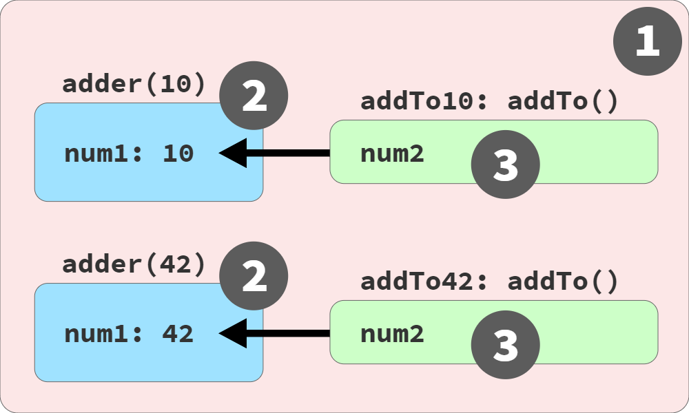
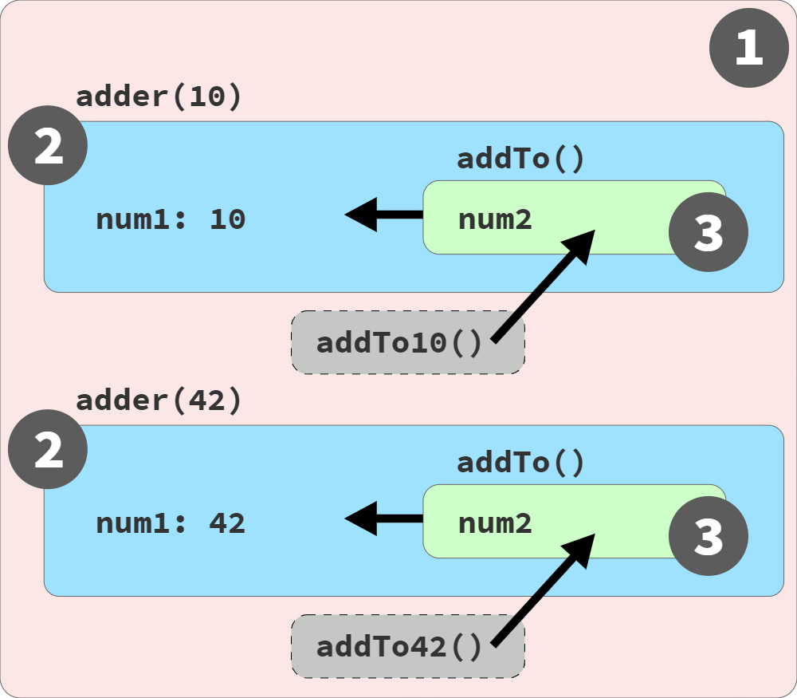

# You Don't Know JS Yet: Scope & Closures - Tái bản lần 2
# Chương 7: Sử dụng Closure

Cho đến thời điểm này, chúng ta đã tập trung vào mọi ngóc ngách của phạm vi từ vựng (lexical scope), và cách điều đó ảnh hưởng đến việc tổ chức cũng như sử dụng các biến trong chương trình của chúng ta.

Sự chú ý của chúng ta một lần nữa chuyển sang mức độ trừu tượng rộng hơn, hướng tới chủ đề vốn từ lâu có phần gây e dè: closure. Đừng lo lắng! Bạn không cần một tấm bằng khoa học máy tính nâng cao để hiểu được nó. Mục tiêu bao quát của chúng ta trong cuốn sách này không chỉ đơn thuần là hiểu về scope, mà là sử dụng nó một cách hiệu quả hơn trong cấu trúc của các chương trình; closure là trọng tâm của nỗ lực đó.

Hãy nhớ lại kết luận chính của Chương 6: nguyên tắc *phơi bày ít nhất* (least exposure principle - POLE) khuyến khích chúng ta sử dụng phạm vi khối (block scoping) (và hàm) để giới hạn phạm vi phơi bày của các biến. Điều này giúp mã nguồn dễ hiểu và dễ bảo trì hơn, đồng thời giúp tránh được nhiều cạm bẫy về scope (chẳng hạn như xung đột tên biến, v.v.).

Closure được xây dựng dựa trên cách tiếp cận này: đối với các biến chúng ta cần sử dụng theo thời gian, thay vì đặt chúng vào các scope bên ngoài lớn hơn, chúng ta có thể đóng gói (thu hẹp scope của) chúng nhưng vẫn bảo toàn quyền truy cập từ bên trong các hàm, phục vụ cho việc sử dụng rộng rãi hơn. Các hàm *ghi nhớ* các biến có phạm vi được tham chiếu này thông qua closure.

Chúng ta đã thấy một ví dụ về dạng closure này trong chương trước (`factorial(..)` ở Chương 6), và gần như chắc chắn bạn đã từng sử dụng nó trong các chương trình của chính mình. Nếu bạn từng viết một hàm callback truy cập vào các biến bên ngoài scope của chính nó... đoán xem nào!? Đó chính là closure.

Closure là một trong những đặc tính ngôn ngữ quan trọng nhất từng được phát minh trong lập trình—nó là nền tảng cho các mô hình lập trình lớn, bao gồm Lập trình hàm (Functional Programming - FP), module, và thậm chí cả một chút thiết kế hướng lớp (class-oriented design). Việc làm quen và thoải mái với closure là điều bắt buộc để làm chủ JS và tận dụng hiệu quả nhiều mẫu thiết kế (design pattern) quan trọng trong toàn bộ mã nguồn của bạn.

Việc giải quyết tất cả các khía cạnh của closure đòi hỏi một khối lượng thảo luận và mã nguồn đồ sộ trong suốt chương này. Hãy chắc chắn rằng bạn dành thời gian và đảm bảo bản thân thấy thoải mái với từng phần trước khi chuyển sang phần tiếp theo.

## Nhìn thấy Closure (See the Closure)

Closure ban đầu là một khái niệm toán học, xuất phát từ phép tính lambda (lambda calculus). Nhưng tôi sẽ không liệt kê các công thức toán học hay sử dụng một loạt ký hiệu và biệt ngữ để định nghĩa nó.

Thay vào đó, tôi sẽ tập trung vào một góc nhìn thực tế. Chúng ta sẽ bắt đầu bằng cách định nghĩa closure dựa trên những gì chúng ta có thể quan sát được trong các hành vi khác nhau của chương trình, trái ngược với việc nếu closure không hiện diện trong JS. Tuy nhiên, ở phần sau của chương này, chúng ta sẽ lật ngược lại closure để xem xét nó từ một *góc nhìn thay thế*.

Closure là một hành vi của các hàm và chỉ các hàm mà thôi. Nếu bạn không đang làm việc với một hàm, closure sẽ không áp dụng. Một đối tượng không thể có closure, một lớp cũng không có closure (mặc dù các hàm/phương thức của nó có thể có). Chỉ có các hàm mới có closure.

Để có thể quan sát được closure, một hàm phải được gọi thực thi, và cụ thể là nó phải được gọi ở một nhánh khác của chuỗi phạm vi (scope chain) so với nơi nó được định nghĩa ban đầu. Một hàm thực thi trong cùng một scope nơi nó được định nghĩa sẽ không thể hiện bất kỳ hành vi khác biệt nào có thể quan sát được dù closure có khả thi hay không; theo góc nhìn và định nghĩa dựa trên quan sát, đó không phải là closure.

Hãy xem qua một số dòng mã, được chú thích bằng các màu bong bóng scope tương ứng của chúng (xem Chương 2):

```js
// outer/global scope: RED(1)

function lookupStudent(studentID) {
    // function scope: BLUE(2)

    var students = [
        { id: 14, name: "Kyle" },
        { id: 73, name: "Suzy" },
        { id: 112, name: "Frank" },
        { id: 6, name: "Sarah" }
    ];

    return function greetStudent(greeting){
        // function scope: GREEN(3)

        var student = students.find(
            student => student.id == studentID
        );

        return `${ greeting }, ${ student.name }!`;
    };
}

var chosenStudents = [
    lookupStudent(6),
    lookupStudent(112)
];

// accessing the function's name:
chosenStudents[0].name;
// greetStudent

chosenStudents[0]("Hello");
// Hello, Sarah!

chosenStudents[1]("Howdy");
// Howdy, Frank!
```

Điều đầu tiên cần chú ý về đoạn mã này là hàm bên ngoài `lookupStudent(..)` tạo ra và trả về một hàm bên trong tên là `greetStudent(..)`. `lookupStudent(..)` được gọi hai lần, tạo ra hai thực thể (instance) riêng biệt của hàm `greetStudent(..)` bên trong nó, cả hai thực thể này đều được lưu vào mảng `chosenStudents`.

Chúng ta xác minh điều đó bằng cách kiểm tra thuộc tính `.name` của hàm được trả về lưu trong `chosenStudents[0]`, và nó thực sự là một thực thể của hàm `greetStudent(..)` bên trong.

Sau khi mỗi lệnh gọi đến `lookupStudent(..)` kết thúc, dường như tất cả các biến bên trong nó sẽ bị loại bỏ và được GC (thu gom rác - garbage collected). Hàm bên trong là thứ duy nhất dường như được trả về và lưu giữ. Nhưng đây chính là nơi hành vi bắt đầu khác biệt theo những cách mà chúng ta có thể quan sát được.

Mặc dù `greetStudent(..)` nhận một đối số duy nhất làm tham số có tên là `greeting`, nó cũng tham chiếu đến cả `students` và `studentID`, các định danh đến từ scope bao bọc của `lookupStudent(..)`. Mỗi tham chiếu đó từ hàm bên trong đến biến ở một scope bên ngoài được gọi là một *closure*. Theo thuật ngữ học thuật, mỗi thực thể của `greetStudent(..)` *đóng bao quanh* (closes over) các biến bên ngoài `students` và `studentID`.

Vậy những closure đó làm gì ở đây, theo một nghĩa cụ thể, có thể quan sát được?

Closure cho phép `greetStudent(..)` tiếp tục truy cập các biến bên ngoài đó ngay cả sau khi scope bên ngoài đã kết thúc (khi mỗi lệnh gọi đến `lookupStudent(..)` hoàn tất). Thay vì các thực thể của `students` và `studentID` bị GC thu gom, chúng vẫn tồn tại trong bộ nhớ. Tại một thời điểm sau đó khi một trong hai thực thể của hàm `greetStudent(..)` được gọi, các biến đó vẫn ở đó và lưu giữ các giá trị hiện tại của chúng.

Nếu các hàm JS không có closure, việc hoàn thành mỗi lệnh gọi `lookupStudent(..)` sẽ ngay lập tức dỡ bỏ scope của nó và GC các biến `students` và `studentID`. Khi sau đó chúng ta gọi một trong các hàm `greetStudent(..)`, điều gì sẽ xảy ra?

Nếu `greetStudent(..)` cố gắng truy cập vào thứ mà nó nghĩ là một viên bi BLUE(2), nhưng viên bi đó thực tế không còn tồn tại (nữa), giả định hợp lý là chúng ta sẽ nhận được một lỗi `ReferenceError`, phải không?

Nhưng chúng ta không nhận được lỗi. Việc thực thi `chosenStudents[0]("Hello")` hoạt động và trả về cho chúng ta thông báo "Hello, Sarah!", có nghĩa là nó vẫn có thể truy cập các biến `students` và `studentID`. Đây là một quan sát trực tiếp về closure!

### Closure mũi tên (Pointed Closure)

Thực ra, chúng ta đã lướt qua một chi tiết nhỏ trong phần thảo luận trước mà tôi đoán là nhiều độc giả đã bỏ lỡ!

Bởi vì cú pháp của hàm mũi tên `=>` quá ngắn gọn, chúng ta rất dễ quên rằng chúng vẫn tạo ra một scope (như đã khẳng định trong phần "Hàm mũi tên" ở Chương 3). Hàm mũi tên `student => student.id == studentID` đang tạo ra một bong bóng scope khác bên trong scope của hàm `greetStudent(..)`.

Dựa trên phép ẩn dụ về những chiếc xô và bong bóng có màu ở Chương 2, nếu chúng ta tạo một sơ đồ màu cho đoạn mã này, có một scope thứ tư ở cấp độ lồng nhau trong cùng nhất này, vì vậy chúng ta sẽ cần một màu thứ tư; có lẽ chúng ta sẽ chọn ORANGE(4) cho scope đó:

```js
var student = students.find(
    student =>
        // function scope: ORANGE(4)
        student.id == studentID
);
```

Tham chiếu BLUE(2) `studentID` thực sự nằm bên trong scope ORANGE(4) thay vì scope GREEN(3) của `greetStudent(..)`; ngoài ra, tham số `student` của hàm mũi tên mang màu ORANGE(4), che khuất (shadow) `student` mang màu GREEN(3).

Hệ quả ở đây là hàm mũi tên này được truyền dưới dạng một hàm callback vào phương thức `find(..)` của mảng phải giữ closure đối với `studentID`, thay vì `greetStudent(..)` giữ closure đó. Điều này không có gì quá to tát, vì mọi thứ vẫn hoạt động như mong đợi. Điều quan trọng chỉ là đừng bỏ qua việc ngay cả những hàm mũi tên tí hon cũng có thể tham gia vào bữa tiệc closure.

### Cộng dồn các Closure (Adding Up Closures)

Hãy xem xét một trong những ví dụ chuẩn mực thường được trích dẫn cho closure:

```js
function adder(num1) {
    return function addTo(num2){
        return num1 + num2;
    };
}

var add10To = adder(10);
var add42To = adder(42);

add10To(15);    // 25
add42To(9);     // 51
```

Mỗi thực thể của hàm bên trong `addTo(..)` đang đóng bao biến `num1` của riêng nó (lần lượt với các giá trị `10` và `42`), do đó các `num1` đó không biến mất chỉ vì `adder(..)` đã kết thúc. Khi sau đó chúng ta gọi một trong các thực thể `addTo(..)` bên trong đó, chẳng hạn như lệnh gọi `add10To(15)`, biến `num1` được đóng bao của nó vẫn tồn tại và vẫn giữ giá trị ban đầu là `10`. Do đó, phép toán có thể thực hiện `10 + 15` và trả về kết quả `25`.

Một chi tiết quan trọng có thể đã quá dễ bị lướt qua trong đoạn văn trước, vì vậy hãy nhấn mạnh lại: closure gắn liền với một thực thể (instance) của một hàm, chứ không phải với định nghĩa từ vựng đơn lẻ của nó. Trong đoạn mã trên, chỉ có một hàm `addTo(..)` bên trong được định nghĩa bên trong `adder(..)`, vì vậy có vẻ như điều đó ngụ ý một closure duy nhất.

Nhưng thực ra, mỗi lần hàm bên ngoài `adder(..)` chạy, một thực thể hàm `addTo(..)` bên trong *mới* lại được tạo ra, và đối với mỗi thực thể mới, lại có một closure mới. Vì vậy, mỗi thực thể hàm bên trong (được gắn nhãn `add10To(..)` và `add42To(..)` trong chương trình của chúng ta) có closure riêng đối với thực thể môi trường scope riêng của nó từ lần thực thi đó của `adder(..)`.

Mặc dù closure dựa trên phạm vi từ vựng (lexical scope) được xử lý tại thời điểm biên dịch, closure lại được quan sát như một đặc tính tại thời điểm chạy (runtime) của các thực thể hàm.

### Liên kết sống, không phải một ảnh chụp nhanh (Live Link, Not a Snapshot)

Trong cả hai ví dụ từ các phần trước, chúng ta đã **đọc giá trị từ một biến** được giữ trong một closure. Điều đó tạo cảm giác như closure có thể là một ảnh chụp nhanh (snapshot) của một giá trị tại một thời điểm nhất định nào đó. Quả thực, đó là một quan niệm sai lầm phổ biến.

Closure thực chất là một liên kết sống (live link), bảo toàn quyền truy cập vào toàn bộ bản thân biến đó. Chúng ta không bị giới hạn ở việc chỉ đọc một giá trị; biến được đóng bao cũng có thể được cập nhật (gán lại giá trị)! Bằng cách đóng bao một biến trong một hàm, chúng ta có thể tiếp tục sử dụng biến đó (đọc và ghi) chừng nào tham chiếu hàm đó còn tồn tại trong chương trình, và từ bất kỳ nơi nào chúng ta muốn gọi hàm đó. Đây là lý do tại sao closure là một kỹ thuật mạnh mẽ được sử dụng rộng rãi trên rất nhiều lĩnh vực lập trình!

Hình 4 mô tả các thực thể hàm và các liên kết scope:

<figure>
    
    <figcaption><em>Hình 4: Trực quan hóa Closure</em></figcaption>
    <br><br>
</figure>

Như trong Hình 4, mỗi lệnh gọi `adder(..)` tạo ra một scope BLUE(2) mới chứa biến `num1`, cũng như một thực thể mới của hàm `addTo(..)` dưới dạng một scope GREEN(3). Chú ý rằng các thực thể hàm (`addTo10(..)` và `addTo42(..)`) hiện diện trong và được gọi từ scope RED(1).

Bây giờ hãy xem xét một ví dụ trong đó biến được đóng bao được cập nhật:

```js
function makeCounter() {
    var count = 0;

    return function getCurrent() {
        count = count + 1;
        return count;
    };
}

var hits = makeCounter();

// sau đó

hits();     // 1

// sau đó

hits();     // 2
hits();     // 3
```

Biến `count` được đóng bao bởi hàm bên trong `getCurrent()`, điều này giữ cho nó tiếp tục tồn tại thay vì bị GC thu gom. Các lệnh gọi hàm `hits()` truy cập *và* cập nhật biến này, trả về số đếm tăng dần mỗi lần.

Mặc dù scope bao bọc của một closure thường là từ một hàm, điều đó thực ra không bắt buộc; chỉ cần có một hàm bên trong hiện diện bên trong một scope bên ngoài:

```js
var hits;
{   // an outer scope (but not a function)
    let count = 0;
    hits = function getCurrent(){
        count = count + 1;
        return count;
    };
}
hits();     // 1
hits();     // 2
hits();     // 3
```

| GHI CHÚ: |
| :--- |
| Tôi cố ý định nghĩa `getCurrent()` dưới dạng một biểu thức hàm (`function` expression) thay vì một khai báo hàm (`function` declaration). Điều này không liên quan đến closure, mà liên quan đến những điều kỳ quặc nguy hiểm của FiB (Chương 6). |

Vì việc nhầm lẫn closure theo hướng giá trị (value-oriented) thay vì theo hướng biến (variable-oriented) là quá phổ biến, các nhà phát triển đôi khi gặp vướng mắc khi cố gắng sử dụng closure để chụp nhanh và lưu giữ một giá trị từ một thời điểm nào đó. Hãy xem xét:

```js
var studentName = "Frank";

var greeting = function hello() {
    // we are closing over `studentName`,
    // not "Frank"
    console.log(
        `Hello, ${ studentName }!`
    );
}

// later

studentName = "Suzy";

// later

greeting();
// Hello, Suzy!
```

Bằng cách định nghĩa `greeting()` (hay còn gọi là `hello()`) khi `studentName` đang giữ giá trị `"Frank"` (trước khi được gán lại thành `"Suzy"`), giả định sai lầm thường là closure sẽ nắm bắt `"Frank"`. Nhưng `greeting()` được đóng bao trên biến `studentName`, chứ không phải giá trị của nó. Bất cứ khi nào `greeting()` được gọi, giá trị hiện tại của biến (`"Suzy"`, trong trường hợp này) sẽ được phản ánh.

Minh họa kinh điển cho sai lầm này là việc định nghĩa các hàm bên trong một vòng lặp:

```js
var keeps = [];

for (var i = 0; i < 3; i++) {
    keeps[i] = function keepI(){
        // closure over `i`
        return i;
    };
}

keeps[0]();   // 3 -- TẠI SAO LẠI THẾ!?
keeps[1]();   // 3
keeps[2]();   // 3
```

| GHI CHÚ: |
| :--- |
| Kiểu minh họa closure này thường sử dụng `setTimeout(..)` hoặc một số hàm callback khác như trình xử lý sự kiện (event handler), bên trong vòng lặp. Tôi đã đơn giản hóa ví dụ bằng cách lưu trữ các tham chiếu hàm trong một mảng, để chúng ta không cần phải bận tâm về thời gian bất đồng bộ trong phân tích của mình. Dù thế nào đi nữa thì nguyên lý closure vẫn như nhau. |

Bạn có thể đã mong đợi lệnh gọi `keeps[0]()` trả về `0`, vì hàm đó được tạo trong lần lặp đầu tiên của vòng lặp khi `i` bằng `0`. Nhưng một lần nữa, giả định đó bắt nguồn từ việc nghĩ về closure theo hướng giá trị hơn là theo hướng biến.

Điều gì đó về cấu trúc của vòng lặp `for` có thể đánh lừa chúng ta nghĩ rằng mỗi lần lặp sẽ có một biến `i` mới riêng biệt; trên thực tế, chương trình này chỉ có duy nhất một biến `i` vì nó được khai báo bằng `var`.

Mỗi hàm được lưu lại đều trả về `3`, bởi vì khi kết thúc vòng lặp, biến `i` duy nhất trong chương trình đã được gán giá trị `3`. Mỗi hàm trong số ba hàm trong mảng `keeps` đều có các closure riêng lẻ, nhưng tất cả chúng đều được đóng bao trên cùng một biến `i` dùng chung đó.

Tất nhiên, một biến đơn lẻ chỉ có thể giữ một giá trị tại bất kỳ thời điểm nào. Vì vậy, nếu bạn muốn lưu giữ nhiều giá trị, bạn cần một biến khác nhau cho mỗi giá trị.

Làm thế nào chúng ta có thể làm điều đó trong đoạn mã vòng lặp? Hãy tạo một biến mới cho mỗi lần lặp:

```js
var keeps = [];

for (var i = 0; i < 3; i++) {
    // new `j` created each iteration, which gets
    // a copy of the value of `i` at this moment
    let j = i;

    // the `i` here isn't being closed over, so
    // it's fine to immediately use its current
    // value in each loop iteration
    keeps[i] = function keepEachJ(){
        // close over `j`, not `i`!
        return j;
    };
}
keeps[0]();   // 0
keeps[1]();   // 1
keeps[2]();   // 2
```

Mỗi hàm hiện được đóng bao trên một biến riêng biệt (mới) từ mỗi lần lặp, mặc dù tất cả chúng đều được đặt tên là `j`. Và mỗi `j` nhận một bản sao giá trị của `i` tại thời điểm đó trong lần lặp vòng lặp; `j` đó không bao giờ bị gán lại. Vì vậy, cả ba hàm hiện đều trả về các giá trị như mong đợi của chúng: `0`, `1`, và `2`!

Một lần nữa hãy nhớ rằng, ngay cả khi chúng ta sử dụng tính bất đồng bộ trong chương trình này, chẳng hạn như truyền mỗi hàm `keepEachJ()` bên trong vào `setTimeout(..)` hoặc đăng ký một trình xử lý sự kiện nào đó, thì hành vi closure tương tự vẫn sẽ được quan sát.

Hãy nhớ lại phần "Các vòng lặp" ở Chương 5, phần này minh họa cách một khai báo `let` trong vòng lặp `for` thực sự không chỉ tạo ra một biến duy nhất cho vòng lặp, mà thực tế tạo ra một biến mới cho *mỗi lần lặp* của vòng lặp. Mẹo/đặc thù đó chính xác là những gì chúng ta cần cho các closure trong vòng lặp của mình:

```js
var keeps = [];

for (let i = 0; i < 3; i++) {
    // the `let i` gives us a new `i` for
    // each iteration, automatically!
    keeps[i] = function keepEachI(){
        return i;
    };
}
keeps[0]();   // 0
keeps[1]();   // 1
keeps[2]();   // 2
```

Vì chúng ta đang sử dụng `let`, ba biến `i` được tạo ra, một cho mỗi lần lặp, do đó mỗi biến trong ba closure *hoạt động hoàn hảo* như mong đợi.

### Các closure phổ biến: Ajax và Sự kiện (Common Closures: Ajax and Events)

Closure thường gặp nhất là với các hàm callback:

```js
function lookupStudentRecord(studentID) {
    ajax(
        `https://some.api/student/${ studentID }`,
        function onRecord(record) {
            console.log(
                `${ record.name } (${ studentID })`
            );
        }
    );
}

lookupStudentRecord(114);
// Frank (114)
```

Hàm callback `onRecord(..)` sẽ được gọi vào một thời điểm nào đó trong tương lai, sau khi phản hồi từ lệnh gọi Ajax trả về. Lệnh gọi này sẽ xảy ra từ nội bộ của tiện ích `ajax(..)`, bất kể tiện ích đó đến từ đâu. Hơn nữa, khi điều đó xảy ra, lệnh gọi `lookupStudentRecord(..)` đã hoàn thành từ lâu.

Vậy thì tại sao `studentID` vẫn còn đó và có thể truy cập được bởi hàm callback? Closure.

Các trình xử lý sự kiện (event handler) là một trường hợp sử dụng phổ biến khác của closure:

```js
function listenForClicks(btn,label) {
    btn.addEventListener("click",function onClick(){
        console.log(
            `The ${ label } button was clicked!`
        );
    });
}

var submitBtn = document.getElementById("submit-btn");

listenForClicks(submitBtn,"Checkout");
```

Tham số `label` được đóng bao bởi hàm callback xử lý sự kiện `onClick(..)`. Khi nút được nhấp, `label` vẫn tồn tại để được sử dụng. Đây chính là closure.


### Điều gì xảy ra nếu tôi không thể nhìn thấy nó? (What If I Can't See It?)

Có lẽ bạn đã từng nghe câu ngạn ngữ quen thuộc này:

> Nếu một cái cây đổ trong rừng mà không có ai ở xung quanh để nghe thấy, liệu nó có tạo ra âm thanh không?

Đó là một màn thể dục triết học ngớ ngẩn. Tất nhiên xét từ góc độ khoa học, các sóng âm thanh được tạo ra. Nhưng mấu chốt thực sự là: *liệu điều đó có quan trọng* nếu âm thanh đó xảy ra?

Hãy nhớ rằng, điểm nhấn trong định nghĩa của chúng ta về closure là khả năng quan sát được (observability). Nếu một closure tồn tại (theo nghĩa kỹ thuật, triển khai hoặc học thuật) nhưng nó không thể được quan sát thấy trong các chương trình của chúng ta, thì *liệu nó có quan trọng không?* Không hề.

Để củng cố quan điểm này, chúng ta hãy xem xét một số ví dụ *không* dựa trên closure theo cách có thể quan sát được.

Ví dụ, việc gọi một hàm sử dụng việc tra cứu phạm vi từ vựng (lexical scope lookup):

```js
function say(myName) {
    var greeting = "Hello";
    output();

    function output() {
        console.log(
            `${ greeting }, ${ myName }!`
        );
    }
}

say("Kyle");
// Hello, Kyle!
```

Hàm bên trong `output()` truy cập các biến `greeting` và `myName` từ scope bao bọc của nó. Nhưng lệnh gọi `output()` xảy ra ngay trong chính scope đó, nơi mà dĩ nhiên `greeting` và `myName` vẫn luôn sẵn có; đó chỉ đơn giản là lexical scope, không phải closure.

Bất kỳ ngôn ngữ có phạm vi từ vựng nào mà các hàm của nó không hỗ trợ closure vẫn sẽ hoạt động theo cùng một cách như thế này.

Trên thực tế, các biến trong global scope về cơ bản không thể được đóng bao (một cách có thể quan sát được), bởi vì chúng luôn luôn có thể truy cập được từ mọi nơi. Không một hàm nào có thể được gọi trong bất kỳ phần nào của chuỗi scope mà lại không phải là hậu duệ của global scope.

Hãy xem xét:

```js
var students = [
    { id: 14, name: "Kyle" },
    { id: 73, name: "Suzy" },
    { id: 112, name: "Frank" },
    { id: 6, name: "Sarah" }
];

function getFirstStudent() {
    return function firstStudent(){
        return students[0].name;
    };
}

var student = getFirstStudent();

student();
// Kyle
```

Hàm `firstStudent()` bên trong quả thực có tham chiếu đến `students`, vốn là một biến nằm ngoài scope của chính nó. Nhưng vì `students` tình cờ đến từ global scope, nên bất kể hàm đó được gọi ở đâu trong chương trình, khả năng truy cập `students` của nó không có gì đặc biệt hơn lexical scope thông thường.

Mọi lệnh gọi hàm đều có thể truy cập các biến toàn cục, bất kể ngôn ngữ có hỗ trợ closure hay không. Các biến toàn cục không cần phải được đóng bao.

Các biến chỉ đơn thuần hiện diện nhưng không bao giờ được truy cập thì không tạo ra closure:

```js
function lookupStudent(studentID) {
    return function nobody(){
        var msg = "Nobody's here yet.";
        console.log(msg);
    };
}

var student = lookupStudent(112);

student();
// Nobody's here yet.
```

Hàm bên trong `nobody()` không đóng bao bất kỳ biến bên ngoài nào—nó chỉ sử dụng biến `msg` của chính nó. Mặc dù `studentID` hiện diện trong scope bao bọc, nhưng `studentID` không được `nobody()` tham chiếu tới. JS engine không cần phải giữ `studentID` tồn tại sau khi `lookupStudent(..)` chạy xong, vì vậy GC muốn dọn dẹp vùng nhớ đó!

Dù các hàm JS có hỗ trợ closure hay không, chương trình này vẫn hoạt động như nhau. Do đó, không có closure nào được quan sát ở đây.

Nếu không có lệnh gọi hàm nào, closure không thể được quan sát:

```js
function greetStudent(studentName) {
    return function greeting(){
        console.log(
            `Hello, ${ studentName }!`
        );
    };
}

greetStudent("Kyle");

// nothing else happens
```

Trường hợp này khá phức tạp, vì hàm bên ngoài chắc chắn có được gọi. Nhưng hàm bên trong mới là hàm *có thể* có closure, thế nhưng nó lại không bao giờ được gọi; hàm được trả về ở đây chỉ đơn giản bị bỏ đi. Vì vậy, ngay cả khi về mặt kỹ thuật JS engine đã tạo ra closure trong một khoảnh khắc ngắn ngủi, nó cũng không hề được quan sát thấy theo bất kỳ cách có ý nghĩa nào trong chương trình này.

Một cái cây có thể đã đổ... nhưng chúng ta không nghe thấy nó, vì vậy chúng ta không bận tâm.

### Định nghĩa có thể quan sát được (Observable Definition)

Bây giờ chúng ta đã sẵn sàng để định nghĩa closure:

> Closure được quan sát thấy khi một hàm sử dụng (các) biến từ (các) scope bên ngoài ngay cả khi đang chạy trong một scope mà (các) biến đó vốn không thể truy cập được.

Các phần chính của định nghĩa này là:

* Phải có sự tham gia của một hàm

* Phải tham chiếu ít nhất một biến từ một scope bên ngoài

* Phải được gọi trong một nhánh khác của chuỗi scope so với (các) biến đó

Định nghĩa hướng tới sự quan sát này có nghĩa là chúng ta không nên xem nhẹ closure như một chuyện phiếm học thuật, gián tiếp nào đó. Thay vào đó, chúng ta nên tìm kiếm và lên kế hoạch cho các hiệu ứng cụ thể, trực tiếp mà closure tạo ra đối với hành vi chương trình của mình.

## Vòng đời của Closure và Thu gom rác (GC) (The Closure Lifecycle and Garbage Collection (GC))

Vì closure vốn gắn liền với một thực thể hàm, nên closure của nó đối với một biến sẽ kéo dài chừng nào vẫn còn tham chiếu đến hàm đó.

Nếu mười hàm cùng đóng bao trên cùng một biến, và theo thời gian chín tham chiếu hàm trong số này bị loại bỏ, thì tham chiếu hàm duy nhất còn lại vẫn tiếp tục bảo toàn biến đó. Một khi tham chiếu hàm cuối cùng đó bị loại bỏ, closure cuối cùng đối với biến đó sẽ biến mất, và bản thân biến đó sẽ được GC thu gom rác.

Điều này có tác động quan trọng đến việc xây dựng các chương trình hiệu quả và có hiệu năng cao. Closure có thể vô tình ngăn cản quá trình GC của một biến mà bạn đã không còn dùng tới nữa, dẫn đến việc tiêu tốn bộ nhớ mất kiểm soát theo thời gian. Đó là lý do tại sao việc loại bỏ các tham chiếu hàm (và do đó là các closure của chúng) khi chúng không còn cần thiết nữa là rất quan trọng.

Hãy xem xét:

```js
function manageBtnClickEvents(btn) {
    var clickHandlers = [];

    return function listener(cb){
        if (cb) {
            let clickHandler =
                function onClick(evt){
                    console.log("clicked!");
                    cb(evt);
                };
            clickHandlers.push(clickHandler);
            btn.addEventListener(
                "click",
                clickHandler
            );
        }
        else {
            // passing no callback unsubscribes
            // all click handlers
            for (let handler of clickHandlers) {
                btn.removeEventListener(
                    "click",
                    handler
                );
            }

            clickHandlers = [];
        }
    };
}

// var mySubmitBtn = ..
var onSubmit = manageBtnClickEvents(mySubmitBtn);

onSubmit(function checkout(evt){
    // handle checkout
});

onSubmit(function trackAction(evt){
    // log action to analytics
});

// later, unsubscribe all handlers:
onSubmit();
```

Trong chương trình này, hàm `onClick(..)` bên trong giữ một closure đối với `cb` được truyền vào (callback sự kiện được cung cấp). Điều đó có nghĩa là các tham chiếu biểu thức hàm `checkout()` và `trackAction()` được giữ lại thông qua closure (và không thể bị GC) chừng nào các trình xử lý sự kiện này còn được đăng ký.

Khi chúng ta gọi `onSubmit()` mà không có tham số đầu vào ở dòng cuối cùng, tất cả các trình xử lý sự kiện sẽ bị hủy đăng ký, và mảng `clickHandlers` được làm rỗng. Khi tất cả các tham chiếu hàm trình xử lý nhấp chuột bị loại bỏ, các closure của tham chiếu `cb` tới `checkout()` và `trackAction()` cũng sẽ bị loại bỏ.

Khi xem xét tính toàn vẹn và hiệu quả chung của chương trình, việc hủy đăng ký một trình xử lý sự kiện khi nó không còn cần thiết nữa thậm chí có thể còn quan trọng hơn cả việc đăng ký ban đầu!

### Theo từng biến hay theo từng Scope? (Per Variable or Per Scope?)

Một câu hỏi khác chúng ta cần giải quyết: liệu chúng ta nên coi closure chỉ áp dụng cho (các) biến bên ngoài được tham chiếu, hay closure bảo toàn toàn bộ chuỗi scope cùng với tất cả các biến của nó?

Nói cách khác, trong đoạn mã đăng ký sự kiện trước đó, hàm `onClick(..)` bên trong chỉ đóng bao trên `cb`, hay nó cũng đóng bao trên cả `clickHandler`, `clickHandlers`, và `btn`?

Về mặt khái niệm, closure là **theo từng biến** (per variable) chứ không phải *theo từng scope* (per scope). Các hàm callback Ajax, các trình xử lý sự kiện, và tất cả các hình thức closure hàm khác thường được cho là chỉ đóng bao trên những gì chúng tham chiếu một cách tường minh.

Nhưng thực tế lại phức tạp hơn thế.

Một chương trình khác cần xem xét:

```js
function manageStudentGrades(studentRecords) {
    var grades = studentRecords.map(getGrade);

    return addGrade;

    // ************************

    function getGrade(record){
        return record.grade;
    }

    function sortAndTrimGradesList() {
        // sort by grades, descending
        grades.sort(function desc(g1,g2){
            return g2 - g1;
        });

        // only keep the top 10 grades
        grades = grades.slice(0,10);
    }

    function addGrade(newGrade) {
        grades.push(newGrade);
        sortAndTrimGradesList();
        return grades;
    }
}

var addNextGrade = manageStudentGrades([
    { id: 14, name: "Kyle", grade: 86 },
    { id: 73, name: "Suzy", grade: 87 },
    { id: 112, name: "Frank", grade: 75 },
    // ..many more records..
    { id: 6, name: "Sarah", grade: 91 }
]);

// later

addNextGrade(81);
addNextGrade(68);
// [ .., .., ... ]
```

Hàm bên ngoài `manageStudentGrades(..)` nhận một danh sách các bản ghi học sinh, và trả về một tham chiếu hàm `addGrade(..)`, mà chúng ta gắn nhãn bên ngoài là `addNextGrade(..)`. Mỗi lần chúng ta gọi `addNextGrade(..)` với một điểm số mới, chúng ta nhận lại danh sách hiện tại của 10 điểm số hàng đầu, được sắp xếp theo thứ tự giảm dần (xem `sortAndTrimGradesList()`).

Kể từ khi kết thúc lệnh gọi ban đầu `manageStudentGrades(..)`, và giữa nhiều lệnh gọi `addNextGrade(..)`, biến `grades` được bảo toàn bên trong `addGrade(..)` thông qua closure; đó là cách danh sách liên tục các điểm số hàng đầu được duy trì. Hãy nhớ rằng, đó là một closure trên chính biến `grades`, chứ không phải mảng mà nó nắm giữ.

Tuy nhiên, đó không phải là closure duy nhất liên quan. Bạn có thể phát hiện các biến khác đang được đóng bao không?

Bạn có nhận thấy rằng `addGrade(..)` tham chiếu đến `sortAndTrimGradesList` không? Điều đó có nghĩa là nó cũng đóng bao trên định danh đó, vốn tình cờ giữ một tham chiếu đến hàm `sortAndTrimGradesList()`. Hàm bên trong thứ hai đó phải tiếp tục tồn tại để `addGrade(..)` có thể tiếp tục gọi nó, điều này cũng có nghĩa là bất kỳ biến nào mà *nó* đóng bao cũng sẽ được giữ lại—mặc dù trong trường hợp này, không có gì thêm được đóng bao ở đó.

Còn thứ gì khác được đóng bao nữa không?

Hãy xem xét biến `getGrade` (và hàm của nó); liệu nó có được đóng bao không? Nó được tham chiếu trong scope bên ngoài của `manageStudentGrades(..)` trong lệnh gọi `.map(getGrade)`. Nhưng nó không được tham chiếu trong `addGrade(..)` hay `sortAndTrimGradesList()`.

Thế còn danh sách (có khả năng là rất lớn) các bản ghi học sinh mà chúng ta truyền vào dưới dạng `studentRecords` thì sao? Biến đó có được đóng bao không? Nếu có, mảng các bản ghi học sinh sẽ không bao giờ được GC thu gom, điều này dẫn đến việc chương trình này chiếm giữ một lượng bộ nhớ lớn hơn nhiều so với những gì chúng ta có thể phỏng đoán. Nhưng nếu chúng ta nhìn kỹ lại một lần nữa, không có hàm bên trong nào tham chiếu đến `studentRecords`.

Theo định nghĩa *theo từng biến* của closure, vì `getGrade` và `studentRecords` *không* được tham chiếu bởi các hàm bên trong, chúng không được đóng bao. Chúng sẽ hoàn toàn tự do để được GC thu gom ngay sau khi lệnh gọi `manageStudentGrades(..)` hoàn tất.

Thật vậy, hãy thử gỡ lỗi đoạn mã này trong một JS engine gần đây, chẳng hạn như v8 trong Chrome, đặt một điểm dừng (breakpoint) bên trong hàm `addGrade(..)`. Bạn có thể nhận thấy rằng thanh công cụ kiểm tra (inspector) **không liệt kê** biến `studentRecords`. Dưới góc độ gỡ lỗi, đó là bằng chứng cho thấy engine không duy trì `studentRecords` thông qua closure. Thở phào nhẹ nhõm!

Nhưng quan sát này đáng tin cậy đến mức nào để coi là bằng chứng? Hãy xem xét chương trình (khá gượng ép!) này:

```js
function storeStudentInfo(id,name,grade) {
    return function getInfo(whichValue){
        // warning:
        //   using `eval(..)` is a bad idea!
        var val = eval(whichValue);
        return val;
    };
}

var info = storeStudentInfo(73,"Suzy",87);

info("name");
// Suzy

info("grade");
// 87
```

Hãy chú ý rằng hàm `getInfo(..)` bên trong không đóng bao một cách rõ ràng trên bất kỳ biến nào trong số `id`, `name`, hoặc `grade`. Tuy nhiên, các lệnh gọi đến `info(..)` dường như vẫn có thể truy cập các biến đó, mặc dù là thông qua việc sử dụng mánh lới gian lận lexical scope `eval(..)` (xem Chương 1).

Vì vậy, tất cả các biến chắc chắn đã được bảo toàn thông qua closure, mặc dù không được hàm bên trong tham chiếu một cách rõ ràng. Vậy điều đó có bác bỏ khẳng định *theo từng biến* để ủng hộ *theo từng scope* không? Còn tùy.

Nhiều JS engine hiện đại áp dụng một *tối ưu hóa* nhằm loại bỏ bất kỳ biến nào khỏi phạm vi closure nếu chúng không được tham chiếu một cách rõ ràng. Tuy nhiên, như chúng ta thấy với `eval(..)`, có những tình huống mà sự tối ưu hóa như vậy không thể được áp dụng, và phạm vi closure tiếp tục chứa tất cả các biến ban đầu của nó. Nói cách khác, về mặt triển khai thực tế, closure phải là *theo từng scope*, và sau đó một tối ưu hóa tùy chọn sẽ cắt tỉa scope chỉ còn lại những gì đã được đóng bao (một kết quả tương tự như closure *theo từng biến*).

Ngay cả cách đây vài năm, nhiều JS engine đã không áp dụng tối ưu hóa này; hoàn toàn có khả năng các trang web của bạn vẫn có thể chạy trên các trình duyệt như vậy, đặc biệt là trên các thiết bị cũ hơn hoặc cấu hình thấp hơn. Điều đó có nghĩa là các closure tồn tại lâu dài chẳng hạn như các trình xử lý sự kiện có thể đang giữ bộ nhớ lâu hơn nhiều so với những gì chúng ta tưởng.

Và thực tế việc đây vốn dĩ là một tối ưu hóa tùy chọn, chứ không phải là một yêu cầu bắt buộc của đặc tả ngôn ngữ, có nghĩa là chúng ta không nên tùy tiện cho rằng nó luôn được áp dụng ở mọi nơi.

Trong những trường hợp một biến nắm giữ một giá trị lớn (như một đối tượng hoặc một mảng) và biến đó hiện diện trong một scope closure, nếu bạn không cần giá trị đó nữa và không muốn bộ nhớ đó bị giữ lại, thì việc chủ động loại bỏ giá trị đó một cách thủ công sẽ an toàn hơn (về mặt sử dụng bộ nhớ) thay vì chỉ dựa vào tối ưu hóa closure/GC.

Hãy áp dụng một *cách khắc phục* cho ví dụ `manageStudentGrades(..)` trước đó để đảm bảo mảng có khả năng rất lớn được giữ trong `studentRecords` không bị giữ lại trong một scope closure một cách không cần thiết:

```js
function manageStudentGrades(studentRecords) {
    var grades = studentRecords.map(getGrade);

    // unset `studentRecords` to prevent unwanted
    // memory retention in the closure
    studentRecords = null;

    return addGrade;
    // ..
}
```

Chúng ta không xóa `studentRecords` khỏi scope closure; điều đó chúng ta không thể kiểm soát. Chúng ta đang đảm bảo rằng ngay cả khi `studentRecords` vẫn còn trong scope closure, biến đó không còn tham chiếu đến mảng dữ liệu có khả năng rất lớn nữa; mảng đó có thể được GC thu gom rác.

Một lần nữa, trong nhiều trường hợp, JS có thể tự động tối ưu hóa chương trình để đạt được hiệu quả tương tự. Nhưng đó vẫn là một thói quen tốt để cẩn thận và đảm bảo một cách rõ ràng rằng chúng ta không giữ bất kỳ lượng bộ nhớ thiết bị đáng kể nào bị ràng buộc lâu hơn mức cần thiết.

Trên thực tế, về mặt kỹ thuật, chúng ta cũng không cần hàm `getGrade()` nữa sau khi lệnh gọi `.map(getGrade)` hoàn tất. Nếu việc đo lường hiệu năng (profiling) ứng dụng cho thấy đây là một khu vực trọng yếu tiêu tốn bộ nhớ quá mức, chúng ta có thể giải phóng thêm một chút bộ nhớ bằng cách giải phóng tham chiếu đó để giá trị của nó cũng không bị ràng buộc. Điều đó có thể không cần thiết trong ví dụ đồ chơi này, nhưng đây là một kỹ thuật chung cần ghi nhớ nếu bạn đang tối ưu hóa dung lượng bộ nhớ (memory footprint) của ứng dụng.

Bài học rút ra: điều quan trọng là phải biết closure xuất hiện ở đâu trong các chương trình của chúng ta, và những biến nào được bao gồm. Chúng ta nên quản lý các closure này một cách cẩn thận để chỉ giữ lại những gì tối thiểu cần thiết và không lãng phí bộ nhớ.

## Một góc nhìn thay thế

Xem lại định nghĩa của chúng ta về closure, khẳng định là các hàm là "giá trị hạng nhất" (first-class values) có thể được truyền đi khắp nơi trong chương trình, giống như bất kỳ giá trị nào khác. Closure là mối liên kết-kết hợp gắn liền hàm đó với phạm vi/các biến bên ngoài chính nó, bất kể hàm đó đi đến đâu.

Hãy cùng nhớ lại một ví dụ mã từ phần trước trong chương này, một lần nữa với các màu bong bóng phạm vi (scope bubble colors) tương ứng được chú thích:

```js
// outer/global scope: RED(1)

function adder(num1) {
    // function scope: BLUE(2)

    return function addTo(num2){
        // function scope: GREEN(3)

        return num1 + num2;
    };
}

var add10To = adder(10);
var add42To = adder(42);

add10To(15);    // 25
add42To(9);     // 51
```

Góc nhìn hiện tại của chúng ta cho thấy rằng bất cứ nơi nào một hàm được truyền tới và thực thi, closure sẽ duy trì một liên kết ẩn quay ngược trở lại phạm vi ban đầu để tạo điều kiện thuận lợi cho việc truy cập vào các biến được đóng bao (closed-over variables). Hình 4, được lặp lại ở đây để tiện theo dõi, minh họa khái niệm này:

<figure>
    
    <figcaption><em>Hình 4 (lặp lại): Trực quan hóa Closures</em></figcaption>
    <br><br>
</figure>

Nhưng có một cách khác để tư duy về closure, và chính xác hơn là bản chất của các hàm khi được *truyền đi khắp nơi*, có thể giúp đào sâu các mô hình tư duy của bạn.

Mô hình thay thế này giảm bớt sự nhấn mạnh vào "hàm dưới dạng giá trị hạng nhất", mà thay vào đó tập trung vào cách các hàm (giống như tất cả các giá trị không nguyên thủy) được giữ theo dạng tham chiếu (held by reference) trong JS, và được gán/truyền thông qua bản sao tham chiếu (reference-copy) — xem Phụ lục A của cuốn *Get Started* để biết thêm thông tin.

Thay vì nghĩ về việc thể hiện hàm bên trong của `addTo(..)` di chuyển sang phạm vi bên ngoài RED(1) thông qua lệnh `return` và phép gán, chúng ta có thể hình dung rằng các thể hiện của hàm thực sự chỉ ở nguyên vị trí trong môi trường phạm vi của chính chúng, dĩ nhiên là với chuỗi phạm vi (scope chain) của chúng còn nguyên vẹn.

Những gì được *gửi* tới phạm vi RED(1) **chỉ là một tham chiếu** đến thể hiện hàm tại chỗ đó, chứ không phải bản thân thể hiện của hàm. Hình 5 mô tả các thể hiện hàm bên trong vẫn giữ nguyên vị trí, được trỏ tới bởi các tham chiếu RED(1) `addTo10` và `addTo42` tương ứng:

<figure>
    
    <figcaption><em>Hình 5: Trực quan hóa Closures (Góc nhìn thay thế)</em></figcaption>
    <br><br>
</figure>

Như được hiển thị trong Hình 5, mỗi lệnh gọi đến `adder(..)` vẫn tạo ra một phạm vi BLUE(2) mới chứa biến `num1`, cũng như một thể hiện của phạm vi GREEN(3) `addTo(..)`. Nhưng điểm khác biệt so với Hình 4 là, giờ đây các thể hiện GREEN(3) này vẫn ở nguyên vị trí, được lồng một cách tự nhiên bên trong các thể hiện phạm vi BLUE(2) của chúng. Các tham chiếu `addTo10` và `addTo42` được di chuyển tới phạm vi bên ngoài RED(1), chứ không phải bản thân các thể hiện hàm.

Khi `addTo10(15)` được gọi, thể hiện hàm `addTo(..)` (vẫn ở nguyên vị trí trong môi trường phạm vi BLUE(2) ban đầu của nó) được thực thi. Vì bản thân thể hiện hàm chưa bao giờ di chuyển, tất nhiên nó vẫn có quyền truy cập tự nhiên vào chuỗi phạm vi của nó. Tương tự với lệnh gọi `addTo42(9)` — không có gì đặc biệt ở đây ngoài lexical scope.

Vậy thì closure *là gì*, nếu không phải là phép màu *kỳ diệu* cho phép một hàm duy trì liên kết đến chuỗi phạm vi ban đầu của nó ngay cả khi hàm đó di chuyển khắp các phạm vi khác? Trong mô hình thay thế này, các hàm ở nguyên vị trí và tiếp tục truy cập vào chuỗi phạm vi ban đầu của chúng như chúng luôn có thể.

Closure thay vào đó mô tả sự *kỳ diệu* của việc **giữ cho một thể hiện hàm sống sót**, cùng với toàn bộ môi trường và chuỗi phạm vi của nó, miễn là còn ít nhất một tham chiếu đến thể hiện hàm đó trôi nổi ở bất kỳ phần nào khác của chương trình.

Định nghĩa đó về closure ít mang tính quan sát hơn và nghe có vẻ hơi lạ lẫm so với góc nhìn học thuật truyền thống. Nhưng dẫu sao nó vẫn hữu ích, bởi vì lợi ích là chúng ta đơn giản hóa việc giải thích closure thành sự kết hợp đơn giản giữa các tham chiếu và các thể hiện hàm tại chỗ.

Mô hình trước đó (Hình 4) không hề *sai* khi mô tả closure trong JS. Nó chỉ mang nhiều cảm hứng khái niệm hơn, một góc nhìn học thuật về closure. Ngược lại, mô hình thay thế (Hình 5) có thể được mô tả là tập trung vào việc hiện thực hóa nhiều hơn một chút, tức cách JS thực sự vận hành.

Cả hai góc nhìn/mô hình đều hữu ích trong việc hiểu closure, nhưng người đọc có thể thấy góc nhìn này dễ nắm bắt hơn góc nhìn kia một chút. Dù bạn chọn cách nào, các kết quả quan sát được trong chương trình của chúng ta vẫn như nhau.

| GHI CHÚ: |
| :--- |
| Mô hình thay thế này cho closure có ảnh hưởng đến việc chúng ta phân loại các callback đồng bộ có phải là ví dụ về closure hay không. Xem thêm chi tiết về sắc thái này trong Phụ lục A. |

## Tại sao lại là Closure?

Bây giờ chúng ta đã có một sự hiểu biết toàn diện về closure là gì và cách nó hoạt động, hãy cùng khám phá một số cách nó có thể cải thiện cấu trúc và tổ chức mã nguồn của một chương trình ví dụ.

Hãy tưởng tượng bạn có một nút bấm trên trang mà khi nhấp vào, nút này sẽ truy xuất và gửi một số dữ liệu thông qua yêu cầu Ajax. Nếu không sử dụng closure:

```js
var APIendpoints = {
    studentIDs:
        "https://some.api/register-students",
    // ..
};

var data = {
    studentIDs: [ 14, 73, 112, 6 ],
    // ..
};

function makeRequest(evt) {
    var btn = evt.target;
    var recordKind = btn.dataset.kind;
    ajax(
        APIendpoints[recordKind],
        data[recordKind]
    );
}

// <button data-kind="studentIDs">
//    Register Students
// </button>
btn.addEventListener("click",makeRequest);
```

Hàm tiện ích `makeRequest(..)` chỉ nhận một đối tượng `evt` từ một sự kiện click. Từ đó, nó phải lấy thuộc tính `data-kind` từ phần tử nút đích, và sử dụng giá trị đó để tra cứu cả URL cho endpoint của API cũng như dữ liệu nào nên được đưa vào yêu cầu Ajax.

Cách này hoạt động ổn, nhưng thật đáng tiếc (kém hiệu quả, dễ gây nhầm lẫn hơn) khi trình xử lý sự kiện phải đọc thuộc tính DOM mỗi lần nó được kích hoạt. Tại sao một trình xử lý sự kiện không thể *ghi nhớ* giá trị này? Hãy thử dùng closure để cải thiện đoạn mã:

```js
var APIendpoints = {
    studentIDs:
        "https://some.api/register-students",
    // ..
};

var data = {
    studentIDs: [ 14, 73, 112, 6 ],
    // ..
};

function setupButtonHandler(btn) {
    var recordKind = btn.dataset.kind;

    btn.addEventListener(
        "click",
        function makeRequest(evt){
            ajax(
                APIendpoints[recordKind],
                data[recordKind]
            );
        }
    );
}

// <button data-kind="studentIDs">
//    Register Students
// </button>

setupButtonHandler(btn);
```

Với cách tiếp cận `setupButtonHandler(..)`, thuộc tính `data-kind` được truy xuất một lần và gán cho biến `recordKind` khi thiết lập ban đầu. `recordKind` sau đó được đóng bao bởi trình xử lý click `makeRequest(..)` bên trong, và giá trị của nó được sử dụng trong mỗi lần kích hoạt sự kiện để tra cứu URL và dữ liệu cần gửi.

| GHI CHÚ: |
| :--- |
| `evt` vẫn được truyền tới `makeRequest(..)`, mặc dù trong trường hợp này chúng ta không còn sử dụng nó nữa. Nó vẫn được liệt kê, nhằm mục đích nhất quán với đoạn mã trước. |

Bằng cách đặt `recordKind` bên trong `setupButtonHandler(..)`, chúng ta giới hạn phạm vi phơi bày của biến đó vào một tập con phù hợp hơn của chương trình; việc lưu trữ nó trên phạm vi toàn cục sẽ tồi tệ hơn nhiều cho việc tổ chức và tính dễ đọc của mã nguồn. Closure cho phép thể hiện hàm `makeRequest()` bên trong *ghi nhớ* biến này và truy cập bất cứ khi nào cần thiết.

Phát triển dựa trên mẫu này, chúng ta có thể tra cứu cả URL và dữ liệu một lần duy nhất, ngay lúc thiết lập:

```js
function setupButtonHandler(btn) {
    var recordKind = btn.dataset.kind;
    var requestURL = APIendpoints[recordKind];
    var requestData = data[recordKind];

    btn.addEventListener(
        "click",
        function makeRequest(evt){
            ajax(requestURL,requestData);
        }
    );
}
```

Bây giờ `makeRequest(..)` đã đóng bao quanh `requestURL` và `requestData`, giúp mã nguồn dễ hiểu hơn một chút và cũng có hiệu năng cao hơn một chút.

Hai kỹ thuật tương tự từ mô hình Lập trình hàm (Functional Programming - FP) dựa vào closure là áp dụng một phần (partial application) và currying. Tóm lại, với các kỹ thuật này, chúng ta thay đổi *hình dạng* của các hàm yêu cầu nhiều đầu vào để một số đầu vào được cung cấp trước, và các đầu vào khác được cung cấp sau; các đầu vào ban đầu được ghi nhớ thông qua closure. Khi tất cả các đầu vào đã được cung cấp, hành động cơ bản sẽ được thực hiện.

Bằng cách tạo ra một thể hiện hàm đóng gói một số thông tin bên trong (thông qua closure), hàm có thông tin đã lưu trữ sau đó có thể được sử dụng trực tiếp mà không cần phải cung cấp lại đầu vào đó. Điều này làm cho phần mã đó sạch hơn, và cũng mang lại cơ hội đặt tên cho các hàm được áp dụng một phần bằng các tên ngữ nghĩa tốt hơn.

Ứng dụng kỹ thuật partial application, chúng ta có thể cải thiện hơn nữa đoạn mã trước đó:

```js
function defineHandler(requestURL,requestData) {
    return function makeRequest(evt){
        ajax(requestURL,requestData);
    };
}

function setupButtonHandler(btn) {
    var recordKind = btn.dataset.kind;
    var handler = defineHandler(
        APIendpoints[recordKind],
        data[recordKind]
    );
    btn.addEventListener("click",handler);
}
```

Các đầu vào `requestURL` và `requestData` được cung cấp trước, tạo ra hàm được áp dụng một phần `makeRequest(..)`, mà chúng ta gán nhãn cục bộ là `handler`. Khi sự kiện cuối cùng kích hoạt, đầu vào cuối cùng (`evt`, ngay cả khi nó bị bỏ qua) được truyền vào `handler()`, hoàn tất các đầu vào của nó và kích hoạt yêu cầu Ajax bên dưới.

Về mặt hành vi, chương trình này khá giống với chương trình trước, với cùng kiểu closure. Nhưng bằng cách cô lập việc tạo ra `makeRequest(..)` trong một tiện ích riêng biệt (`defineHandler(..)`), chúng ta làm cho định nghĩa đó có thể tái sử dụng tốt hơn trong toàn bộ chương trình. Chúng ta cũng giới hạn một cách rõ ràng phạm vi closure chỉ với hai biến cần thiết.

## Đến gần hơn với Closure

Khi chúng ta khép lại một chương dày đặc kiến thức, hãy hít thở sâu vài lần để tất cả lắng đọng lại. Nghiêm túc đấy, đó là một lượng thông tin rất lớn đối với bất kỳ ai!

Chúng ta đã khám phá hai mô hình tư duy để tiếp cận closure:

* Mang tính quan sát (Observational): closure là một thể hiện hàm ghi nhớ các biến bên ngoài của nó ngay cả khi hàm đó được truyền tới và **được gọi trong** các phạm vi khác.

* Mang tính hiện thực (Implementational): closure là một thể hiện hàm và môi trường phạm vi của nó được bảo tồn tại chỗ trong khi bất kỳ tham chiếu nào đến nó được truyền đi khắp nơi và **được gọi từ** các phạm vi khác.

Tóm tắt các lợi ích đối với chương trình của chúng ta:

* Closure có thể cải thiện hiệu quả bằng cách cho phép một thể hiện hàm ghi nhớ thông tin đã xác định trước đó thay vì phải tính toán lại mỗi lần.

* Closure có thể cải thiện khả năng đọc mã, giới hạn mức độ phơi bày phạm vi bằng cách đóng gói (các) biến bên trong các thể hiện hàm, trong khi vẫn đảm bảo thông tin trong các biến đó có thể truy cập được để sử dụng trong tương lai. Các thể hiện hàm hẹp hơn, chuyên biệt hơn thu được sẽ gọn gàng hơn khi tương tác, vì thông tin được lưu giữ không cần phải truyền vào trong mỗi lần gọi.

Trước khi bước tiếp, hãy dành thời gian để phát biểu lại phần tóm tắt này *bằng lời của chính bạn*, giải thích closure là gì và tại sao nó hữu ích trong các chương trình của bạn. Nội dung chính của cuốn sách khép lại bằng một chương cuối cùng được xây dựng dựa trên nền tảng closure cùng với mẫu thiết kế module.
